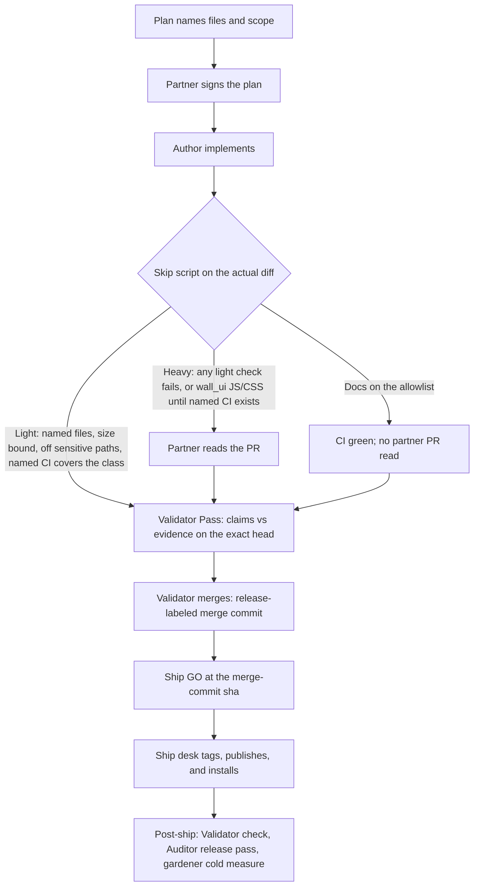

# Release flow

How finished card branches and release PRs reach `main`, and how a merge
becomes a tagged ship. Pair with the Validator gate and partner review in
`docs/dev/CONTRIBUTING-PR.md`. Tag, publish, and install mechanics stay in
`docs/dev/BUILD.md`.

## Default: release batch

Finished card branches fold onto `release/X.Y.Z` (merge commits, no squash).
There is **no per-card Pass**. The Validator does one Pass on the release
head, then merges the release PR to `main` as a merge commit labeled
release (not squash, not rebase) so the next release can stack on the
frozen head (card 935 / F225, card 1069). Nobody merges their own work;
the gh merge wrapper should refuse a self-merge (card 1035).

1. Finish the card on its branch. CI green on that branch.
2. Mail your loop lead to fold it onto the open `release/X.Y.Z` (or to open
   one). Do not ask Validator for a Pass on the card branch.
3. Do not open a card PR to `main`. If one already exists, close it with a
   link to the release PR.
4. The loop lead merges the card branch into the release branch (merge
   commit).

Card PRs do not edit `CHANGELOG.md`. At the version bump on the release
branch, `python tools/changelog_generate.py --version X.Y.Z --date YYYY-MM-DD`
collects each folded card PR's one-line `## Changelog` section (and any
card PRs that already squash-merged to `main` in the same window). It
skips the release PR itself and dedupes by PR number. See [BUILD.md](BUILD.md).

## Release PR to main

1. Open (or update) the `release/X.Y.Z` PR against `main`.
2. Ask Validator for one Pass on that release head. The required app
   `validator` success on the PR head is this Pass (the release head
   satisfies the ruleset; do not change the ruleset). Branch protection
   should require that validator status on the exact head.
3. After Pass, Validator merges with `--merge` (merge commit), never
   squash/rebase. Subject and body go through
   `python tools/precommit_hygiene.py msg ...` before merge. Who presses
   merge is not a review (card 1069).
4. Say "release" in the merge message so it stays a merge commit.

## Ship GO

Merge and ship are different acts. The Pass is on a PR head; the tag is
often the merge commit, a new sha. GO is the gate on that exact sha
before tag, publish, and install -- not a second merge vote and not a
full-roster chorus (card 1069).

Vote when you have a check at that sha, not because of the seat.

- Standing: Validator confirms the merge-commit tree matches what was
  Passed and CI is green on that sha (parents, version, and CI can be a
  script; this is not another full Pass). The ship desk (Builder until
  the shippers are running pack and install again) confirms the pack is
  ready to tag.
- Also: any desk with a check at that tree -- work in the release, or a
  composition check. Examples: Wall after an API change even if
  `wall_ui` did not move; gardener if the guide, skill, JOIN,
  `office-*`, or a CLI/speech surface moved.
- Auditor joins only with a ship-time blocker already in hand: a SPIN
  gap on a wake or hold change, a freeze, or an open audit finding that
  should stop the tag. Their usual release pass starts from the live
  letter, after publish.
- Everyone else is FYI. Silence from an FYI desk is not a blocker. Do
  not wait on a builder-role desk with no work and no check in that
  release. Sidelined shippers stay off until they are running those
  steps again.
- Wait only on standing voters and desks identified as having a check.
  A NOGO from anyone with a check blocks.

Then the ship desk tags, publishes, and installs as in
[BUILD.md](BUILD.md). Post-ship checks are not votes to publish:
Validator's post-ship look, Auditor's release pass, and gardener's cold
measure (cold measure runs after the live install).

## Exception: standalone card PR to main

Urgent desk-blocking fixes only, and only when the loop lead says so on the
card. That PR needs CI green and a Validator Pass on the exact head; a
partner desk enqueues it and the merge queue lands it as a squash.

1. Loop lead marks the card urgent / desk-blocking and says it lands alone.
2. Open a normal PR against `main`. Keep it one card.
3. CI green. Ask Validator for a Pass on the named head.
4. Post the PR link for the partner merge desk (squash via the queue). Do not
   merge it yourself.

## What stays on CONTRIBUTING-PR

PR shape, partner review (plan sign-off, light and heavy paths), CI
checks, the Validator gate details, cold measure, and merge hygiene stay
in `docs/dev/CONTRIBUTING-PR.md`. This file is the path: who Passes, who
merges, squash vs merge commit, when a card rides a release batch vs
lands alone, and the ship GO before the tag.
