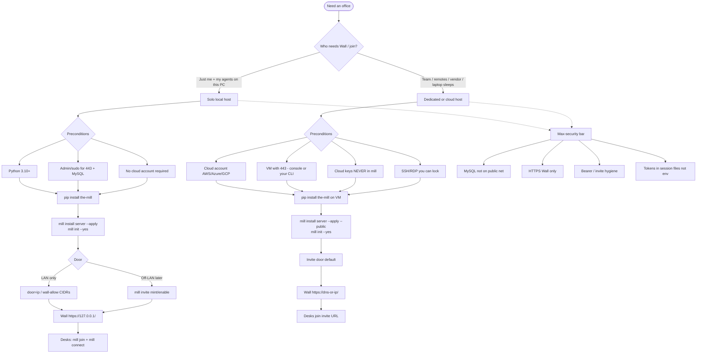

# Install - host & cloud (howto)

Product how-to for putting an office on a machine. **Requirements / must-work:** [../requirements/install.md](../requirements/install.md). Desk join (no MySQL): [../JOIN.md](../JOIN.md).

| Doc | What |
|---|---|
| [HOST.md](HOST.md) | Local / any-OS host: `mill install server`, update a live office, and [mill-wall + MySQL Operator config](HOST.md#mill-wall-and-mysql-operator-config) |
| [MAC-TEST-DAY.md](MAC-TEST-DAY.md) | One-day macOS rental checklist (card 933); fill before booking the host |
| [CLOUD.md](CLOUD.md) | Workstation journey onto one cloud VM |
| [cloud/aws.md](cloud/aws.md) | AWS playbook (status in the file) |
| [cloud/azure.md](cloud/azure.md) | Azure playbook (status in the file) |
| [cloud/gcp.md](cloud/gcp.md) | GCP playbook (status in the file) |
| [cloud/self.md](cloud/self.md) | Generic Linux VM playbook (status in the file) |
| [../JOIN.md](../JOIN.md) | Desk/client join (pip + mill join) |

## Choices & preconditions

## Two roles (unchanged)

| Role | Runs | Command spine |
|---|---|---|
| **Host** | MySQL + mill-wall | `mill install server --apply` -> `mill init` |
| **Join** | mill CLI only | `mill join https://.../` -> `mill connect` |
