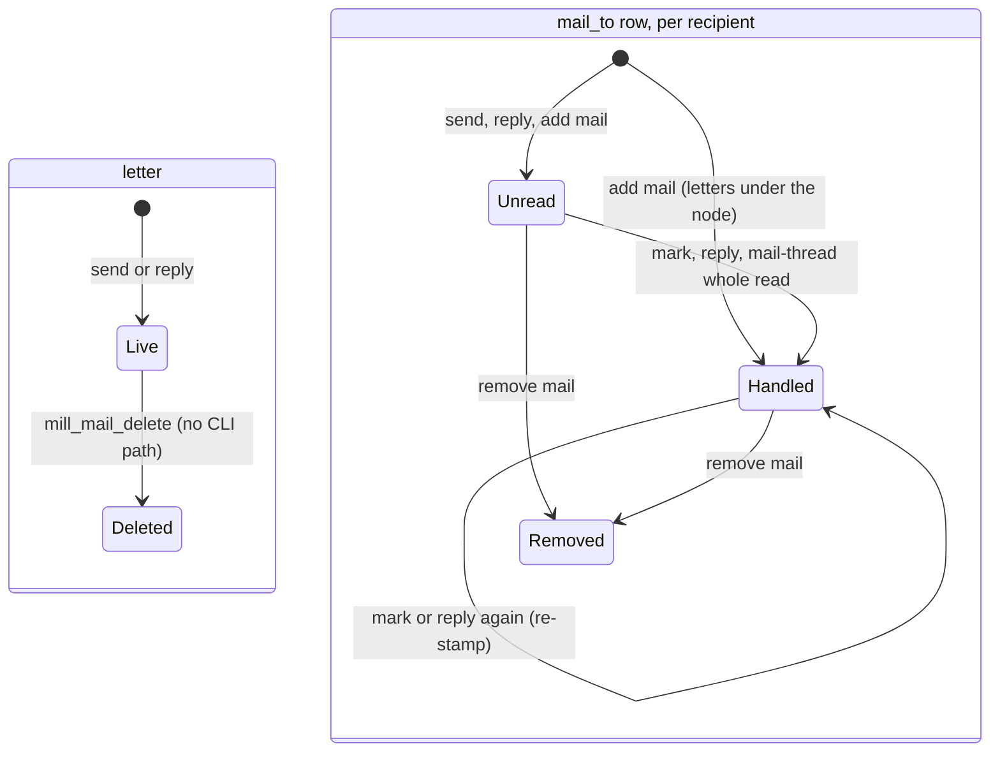
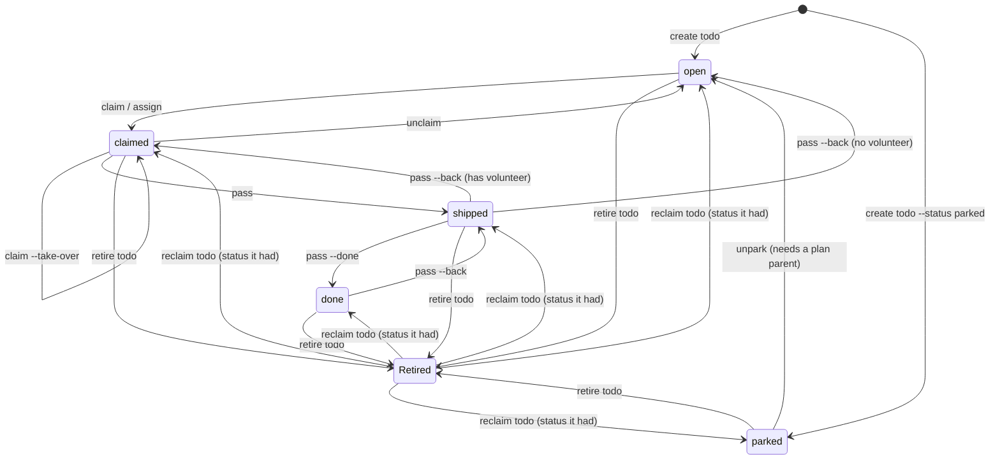
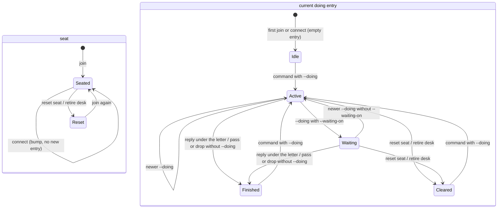
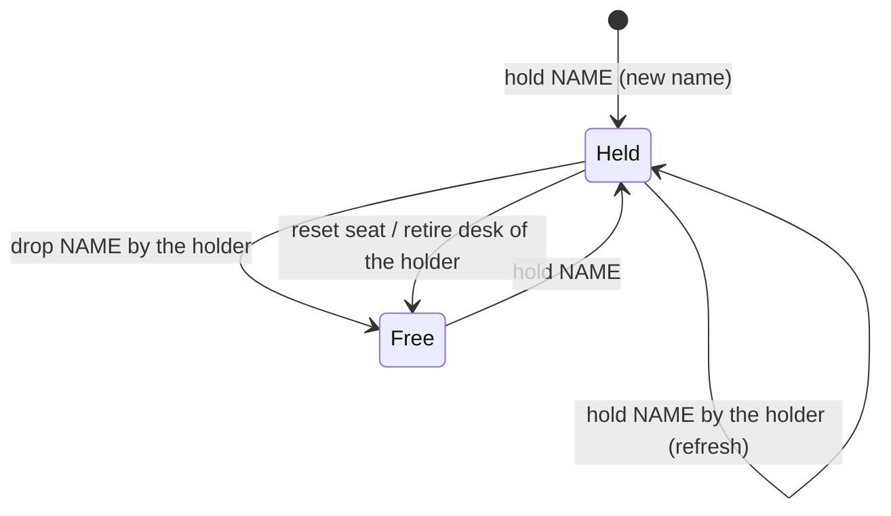
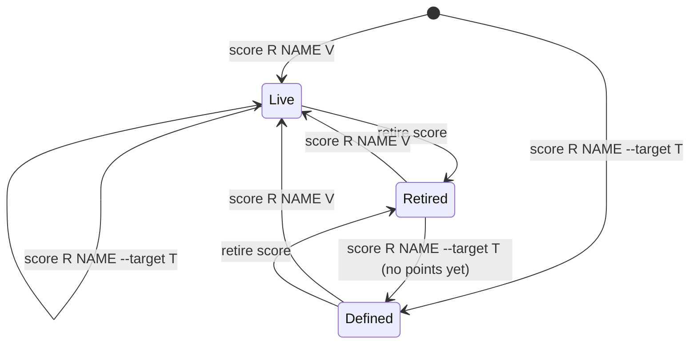

# Activity states

One state diagram per activity type, and one table row per transition, read from the code on main (0.7.19). File:line refs below are v0.7.19 coordinates pending a refresh against 0.8.0 (act, move rows, doing.evidence). A cold desk can walk every row: run the command, then run the check and compare.

The five types are the `activity.type` enum at `agent_coord/server/sql/tables.sql:46`: `mail`, `todo`, `doing`, `hold`, `score`. The headings use those spellings. Where the CLI word differs, the section says so once.

Paths are from the repo root. `rpc.py` is `agent_coord/server/api/mill/rpc.py`; SQL files are in `agent_coord/server/sql/`. A line number points at the procedure or the branch that makes the move. "Gap" marks a place where the code has no path, or does something a desk would not expect. Gaps are reported, not fixed here.

Placeholders: `R` roster, `NEED` card need, `N` id, `D` desk, `F` body file, `NAME` hold or score name, `V` number.

Related: [states.md](states.md) (desk loop, todo lifecycle, retire), [activity.md](../requirements/activity.md) (generic Live, Remembered, Gone), [records.md](records.md) (tables), [cli-desk.md](cli-desk.md) (full command forms).

## mail

A letter has two layers. The letter row (`mail`) is live until deleted. Each recipient has its own `mail_to` row: unread while `opened` is NULL, handled once it is stamped. Handled is the only read state; inbox lists the unread rows.

| # | From | To | Command | Code | Check |
|---|------|----|---------|------|-------|
| M1 | none | letter live; each recipient unread | `mill send desk D --body-file F` (or `send roster R`, `--to-desk D`, `--room ROOM`) | `rpc.py:1334` `_h_send` -> `sp_mail.sql:233` `mill_mail_insert`, recipients `sp_mail.sql:15` `mill_mail_to_put` | sender output has `id` N; recipient `mill inbox` lists N |
| M2 | none | reply live; recipients unread, the replier's parent handled | `mill reply N --body-file F [--to-desk D]` | `rpc.py:1675` `_h_reply`; parent stamp `rpc.py:1805`; room-only desks set copied (`asked` 0) `sp_mail.sql:44` `mill_mail_to_copied` | output `replied_to` N; replier `mill inbox` no longer lists N; recipients list the new id |
| M3 | unread | handled | `mill mark N [N...]` | `rpc.py:3545` `_h_mark` -> `sp_opened.sql:9` `mill_mail_open` | output `"state": "handled"`; `mill inbox` drops N; `mill inbox --all` still shows it |
| M4 | unread | handled | `mill mail-thread N` (also `--full`, `--subtree`, `--after ID`) | `rpc.py:2074` (whole read) -> `rpc.py:1947` `_mark_shown` (unread rows only, `rpc.py:1960`) | output `marked` lists the ids; `mill inbox` drops them |
| M5 | unread | unread (no change) | `mill inbox`, `mill mail-thread N --room` (no `--after`), a bare room name | `rpc.py:2074` (preview reads never mark) | output `marked` is empty; `mill inbox` still lists N |
| M6 | handled | handled (new stamp) | `mill mark N` or `mill reply N --body-file F` again | `sp_opened.sql:37` stamps `opened` without checking it was NULL | output `"state": "handled"`; nothing else visible |
| M7 | not a recipient | unread on N; handled on every letter under N | `mill add mail:N D` (self: any desk; another desk: sender, recipient, room member or Admin) | `rpc.py:3184` -> `sp_mail.sql:56` `mill_mail_to_node_put`; opened NULL only for N itself `sp_mail.sql:97`; the sender is never added | output `added`; D's `mill inbox` lists N and not its replies |
| M8 | recipient | removed from N and every letter under it | `mill remove mail:N D` | `rpc.py:3200` -> `sp_mail.sql:131` `mill_mail_to_node_delete` | output `removed`; D's `mill inbox --all` no longer lists those ids |
| M9 | live | deleted | none | `sp_mail.sql:327` `mill_mail_delete`; caller `agent_coord/server/records/mail.py:42` has no caller | gap: not reachable from the CLI |

Refused, nothing changed:

- send with no recipient: `mail: no recipients` (`sp_mail.sql:279`).
- mark of a letter the desk is not on: `mark: mail N is not in this desk's mailbox` (`rpc.py:3561`); `mark --state` is not a flag (`rpc.py:3552`).
- add or remove another desk by a desk not on the letter or its room (`rpc.py:3178`).
- remove of a desk that is not a recipient (`sp_mail.sql:173`), or one that would leave a letter with no recipient (`sp_mail.sql:196`).

Gaps:

- No command deletes a letter (M9). If `mill_mail_delete` runs, it deletes the letter (its `mail_to` rows cascade) and stamps `activity.deleted`. The activity row stays as a tombstone, and so do its labels, because the label foreign key cascades only on an activity delete (`tables.sql:77`).
- No command edits a letter: `sp_mail.sql:287` `mill_mail_update` has no caller.
- No command puts a letter back to unread. Handled is final for that desk.
- Read receipts never fire from the CLI: send always writes `receipt` 0 (`rpc.py:1371`), so `push_receipt` in `sp_opened.sql:47` is always 0.

## todo

A card has one status from the `todo.status` enum (`tables.sql:172`): `parked`, `open`, `claimed`, `shipped`, `done`. Retired is a second flag on top of any status (`activity.deleted` stamped, the card row kept). A retired card is hidden from every list and from every card command, because card commands find cards through `rec_todo.find`, which calls `mill_todo_select` (`agent_coord/server/records/todo.py:272`), and that read skips retired cards.

| # | From | To | Command | Code | Check |
|---|------|----|---------|------|-------|
| T1 | none | open | `mill create todo R NEED [--detail T]` | `rpc.py:2359` `_h_open` -> `sp_todo.sql:13` `mill_todo_insert` (with a parent: `sp_todo.sql:53` `mill_todo_insert_attached`) | output `id`, `"status": "open"`; `mill todo R NEED` shows open |
| T2 | none | parked | `mill create todo R NEED --status parked` | `rpc.py:2383` (parked or open only) -> `sp_todo.sql:13` | `mill todo R NEED` shows parked |
| T3 | parked | open | `mill unpark R NEED [--parent-type todo --parent-id N]` | `rpc.py:2425` `_h_unpark` -> `sp_todo.sql:136` `mill_todo_update` | output `"status": "open"`; `mill todo R NEED` shows open |
| T4 | open | claimed (caller is volunteer) | `mill claim R NEED` | `rpc.py:2250` -> `sp_cmd.sql:112` `cmd_claim` | output `"status": "claimed"`; `mill todo R NEED` shows the caller as volunteer |
| T5 | open | claimed (named desk) | `mill assign R NEED D` (limited trust: Admin) | `rpc.py:2134` `_h_assign` -> `sp_todo.sql:136` | output `"volunteer": "D"`; `mill todo R NEED` shows D |
| T6 | claimed by another desk | claimed by caller | `mill claim R NEED --take-over` | `sp_cmd.sql:134` (refused without the flag), `sp_cmd.sql:137` (stale prior) | output `prior_volunteer`; `mill todo R NEED` shows the caller |
| T7 | claimed | open (no volunteer) | `mill unclaim R NEED` (the volunteer) | `rpc.py:2492` -> `sp_cmd.sql:148` `cmd_unclaim` | output `"status": "open"`; `mill todo R NEED` shows no volunteer |
| T8 | claimed | shipped | `mill pass R NEED [--evidence T]` (the volunteer) | `rpc.py:2526` -> `sp_cmd.sql:195` `cmd_pass` ship | output `"status": "shipped"`, `"was": "claimed"` |
| T9 | shipped | done | `mill pass R NEED --done` (the asker, or Admin) | `sp_cmd.sql:204` `cmd_pass` done | output `"status": "done"`; `mill todo R` hides it, `mill todo R --done` lists it |
| T10 | done | shipped | `mill pass R NEED --back` (asker or volunteer) | `sp_cmd.sql:212` | output `"status": "shipped"`, evidence cleared |
| T11 | shipped | claimed, or open when there is no volunteer | `mill pass R NEED --back` | `sp_cmd.sql:216` | output `status` claimed or open |
| T12 | any status | retired (status kept) | `mill retire todo R NEED --yes` (asker or Admin) | `rpc.py:1217` -> `sp_todo.sql:258` `mill_todo_retire` | output `"op": "retired"`; `mill todo R --done` no longer lists it |
| T13 | retired | the status it had | `mill reclaim todo R NEED --yes` (asker or Admin) | `rpc.py:1217` -> `sp_todo.sql:293` `mill_todo_reclaim` | output `"op": "reclaimed"`; `mill todo R NEED` shows the old status |
| T14 | any | same status | `mill note R NEED --note T`, `mill note R NEED --done-when T` | `rpc.py:2586` -> `sp_todo.sql:136` (body only); `sp_cmd.sql:237` `cmd_card_accept` | `mill todo R NEED` shows the new line; status unchanged |
| T15 | live | deleted | none (test-only `probe-delete` RPC, fixture rosters `t-<8 hex>`, the creator) | `agent_coord/server/probe_delete.py:129` -> `sp_todo.sql:192` `mill_todo_delete` | gap: not a mill subcommand |

Refused, nothing changed (the SP text is the refusal code):

- claim, assign or unclaim on parked, shipped or done: `card:moves:CMD:STATUS` (`sp_cmd.sql:58`); a parked card also names `mill unpark`.
- claim of a card another desk holds without `--take-over`: `card:claimed_by:D`; take-over that names a stale prior: `card:stale_prior` (`sp_cmd.sql:134`, `sp_cmd.sql:137`).
- assign of a card with a volunteer: `assign: assignee must relinquish first` (`rpc.py:2147`).
- unclaim by a desk that is not the volunteer: `card:who_may_unclaim` (`sp_cmd.sql:161`).
- pass: `card:already_shipped`, `card:already_done`, `card:not_shippable`, `card:claim_first`, `card:who_may_ship` (`sp_cmd.sql:196` to `sp_cmd.sql:201`); `--done` not from shipped `card:done_not_shipped`, wrong desk `card:who_may_done` (`sp_cmd.sql:205` to `sp_cmd.sql:209`); `--back` not from shipped or done `card:back_status`, wrong desk `card:who_may_back` (`sp_cmd.sql:213` to `sp_cmd.sql:215`).
- done-when on a done card: `card:done_when_done` (`sp_cmd.sql:251`).
- unpark of a card with no plan parent (`rpc.py:2449`).
- create of a need that exists on that roster (`rpc.py:2406`).
- retire of a retired card (`sp_todo.sql:282`); reclaim of a card that is not retired (`sp_todo.sql:311`); retire or reclaim by a desk that is not the asker or Admin (`rpc.py:1232`).
- every card command on a retired card: `no such need` (`rpc.py:2243`).

Gaps:

- No command parks a card after it is made. Parked is reachable only from create (T2).
- `mill unpark` does not check that the card is parked (`rpc.py:2425` to `rpc.py:2453`). Read from the code, not run: on a claimed, shipped or done card with a plan parent it writes `open`, keeps the volunteer and clears `claimed_at` (`sp_todo.sql:167`).
- `mill create todo R NEED` looks the need up with the retired cards left out (`rpc.py:2396`). Read from the code, not run: a need whose card is retired gets a second card.
- No command deletes a card (T15). If `mill_todo_delete` runs, the card row and its watchers go; the activity row stays as a tombstone (`sp_todo.sql:238`) and so do its labels (`sp_todo.sql:198`).

## doing

CLI words: the type is `doing`, but no command is named `doing`. A desk writes one with `--doing TEXT` on another command, reads them with `mill connected`, and its seat comes from `mill join` and `mill connect`. [activity.md](../requirements/activity.md) still calls this type `join`.

Two layers. The seat (table `seat`, one row per desk) is not an activity; it holds the token and the connect stamps. Doing rows are the activity: append-only, and the newest row is the desk's current doing. How an entry ended is worked out on read from later rows (`sp_doing.sql:24` `mill_doing_end`, `sp_doing.sql:57` `mill_doing_cleared`), never stored.

| # | From | To | Command | Code | Check |
|---|------|----|---------|------|-------|
| D1 | no seat | seated; empty entry when the desk has none | `mill join --link-file LINKFILE` | `rpc.py:255` `_issue_here` -> `sp_join.sql:90` `mill_join_upsert` (entry `sp_join.sql:144`) | `mill connected --desk D` lists the desk, `"doing": ""` |
| D2 | seated | connected: no new entry; on the first socket `seat.time_connect` stamped (`time_disconnect` cleared) and the doing activity row bumped | `mill connect D` | `agent_coord/server/asgi.py:587` -> `agent_coord/server/records/join.py:45` -> `sp_join.sql:284` `mill_join_connect`; first socket `asgi.py:608` `HUB.add` -> `agent_coord/server/push.py:150` -> `push.py:330` `_mark_join_socket` -> `records/join.py:61` `mark_socket` -> `sp_join.sql:326` `mill_join_socket` | stderr `mill connect:` line, then `"ready": true`; other desks get a DOING hint |
| D3 | connected | disconnected: `seat.time_disconnect` stamped, doing activity row bumped | stop the connect process | when the last socket leaves: `asgi.py:671` `HUB.discard` -> `push.py:157` to `push.py:171` -> `push.py:330` `_mark_join_socket` -> `records/join.py:61` `mark_socket` -> `sp_join.sql:326` `mill_join_socket` | `mill connected --desk D` still lists the desk; alive turns stale once the seat row is over 15 minutes old |
| D4 | idle, finished or cleared | active on the item | any of `send`, `reply`, `mark`, `create todo`, `claim`, `unclaim`, `assign`, `pass`, `note`, `unpark`, `hold`, `drop`, `score` with `--doing TEXT` (e.g. `mill claim R NEED --doing TEXT`) | `rpc.py:951` `_doing_after` -> `sp_doing.sql:79` `mill_doing_put` | output `doing_entry` with `on`; `mill connected --desk D` shows `doing` and `on` |
| D5 | active | waiting | the same with `--waiting-on "WHAT WHY"` (WHAT is a desk, `mail-N`, `todo-N` or `hold-N`) | `sp_doing.sql:108` to `sp_doing.sql:122` | `mill connected --desk D` shows `waiting_on`; the target desk's view lists D under `desks` |
| D6 | active or waiting | active (newer entry) | another `--doing TEXT` | `sp_join.sql:27` `mill_doing_insert` | `mill connected --desk D --history` shows the old row replaced by a newer one |
| D7 | active on `mail-N` | finished | `mill reply N --body-file F` (any reply by D under N) | derived: `sp_doing.sql:36` | `mill connected --desk D` shows `idle`, `last.ended_by` finished |
| D8 | active on `todo-N` | finished | `mill pass R NEED` or `mill pass R NEED --done`, without `--doing` | `rpc.py:922` `_doing_finish` -> `sp_doing.sql:142` `mill_doing_finish` | same as D7 |
| D9 | active on `hold-N` | finished | `mill drop NAME` without `--doing` | `rpc.py:935` -> `sp_doing.sql:142` | same as D7 |
| D10 | any entry | cleared | `mill reset seat D --yes` (Admin) or `mill retire desk D --yes` (Admin) | `sp_join.sql:194` `mill_join_reset`, `sp_name.sql:41`; both call `sp_join.sql:71` `mill_doing_clear` | `mill connected --desk D` shows `idle`, `last.ended_by` cleared |
| D11 | seated | reset: token cleared, webhook off, holds freed | `mill reset seat D --yes` (Admin) | `rpc.py:1261` -> `sp_join.sql:194` | output `"op": "reset"` and `released` count; D's next command fails until it joins again |

Alive or stale in `mill connected` comes from the seat row's age (15 minutes).

Never ends an entry (`sp_doing.sql:11`): `mark`, `note`, another desk's pass, `pass --back`, taking a hold again. An entry on a score ends only as cleared or newer.

Refused, nothing changed (the command and its doing commit together, `rpc.py:998`):

- `--doing` from a desk with no seat: `doing: desk has not joined` (`sp_doing.sql:101`).
- `--doing` on an item that is gone: `doing: the item is gone` (`sp_doing.sql:105`); on a command that wrote no item, such as a refused hold: `no item was written` (`rpc.py:975`).
- `--waiting-on` naming nothing, or the desk itself (`sp_doing.sql:111` to `sp_doing.sql:122`).
- join with a different token for a seated desk: `desk live: token required (no steal)` (`sp_join.sql:127`).
- connect for a desk with no seat: `mill connect: desk has not joined` (`sp_join.sql:296`).

Gaps:

- Doing has no delete. Rows are append-only by design (`tables.sql:218`); reset and retire append an empty row.
- Clock-out is not wired: `sp_join.sql:174` `mill_join_delete` is reached only from `records/join.py:105`, which has no caller.

## hold

A hold row is one per resource name (`tables.sql:253`, unique `resource_id`). Held means `desk_id` is set; free means it is NULL. The row is never deleted. Holds do not expire: there is no timer in `sp_hold.sql` or `records/hold.py`, and a hold outlives the connect that took it.

| # | From | To | Command | Code | Check |
|---|------|----|---------|------|-------|
| H1 | no row | held by caller | `mill hold NAME` | `rpc.py:2716` -> `sp_hold.sql:45` `mill_hold_upsert` (insert) | output `"held": true`; `mill hold --peek NAME` names the caller |
| H2 | free | held by caller | `mill hold NAME` | `sp_hold.sql:53` | same as H1 |
| H3 | held by caller | held by caller (`updated` refreshed) | `mill hold NAME` | `sp_hold.sql:67` | output `"held": true`; `mill hold` shows a newer `since` |
| H4 | held by caller | free | `mill drop NAME` | `rpc.py:2763` -> `agent_coord/server/records/hold.py:136` -> `sp_hold.sql:79` `mill_hold_delete` | output `"released": true`; `mill hold` no longer lists NAME |
| H5 | held by D | free | `mill reset seat D --yes` or `mill retire desk D --yes` (Admin) | `sp_join.sql:222` and `sp_name.sql:54` -> `sp_hold.sql:113` `mill_hold_release_desk` | `mill hold` no longer lists D's holds |
| H6 | any | same | `mill hold --peek NAME`, `mill hold` | `rpc.py:2730`, `rpc.py:2777` (reads only) | a peek at a name never held says so in `hint` |

Refused, nothing changed:

- hold of a name another desk holds: `"ok": false`, `"held": false`, `owner` names the holder, exit 1 (`sp_hold.sql:71`, `rpc.py:2743`). No hint goes out (`rpc.py:2757`).
- drop by a desk that does not hold it: `held by D, not you` or `not held by you` (`records/hold.py:175`).

Gaps:

- A hold has no delete. Drop and reset keep the row with `desk_id` NULL, its activity row and its labels.

## score

A score is a definition row (`score`) plus a series of points (`score_point`). A desk records on the roster's score (`desk_id` is the roster, `sp_score.sql:239`). Trend and gap are worked out on read (`agent_coord/server/score_series.py:65`, `score_series.py:84`), not stored. Retired is `activity.deleted` stamped; the row and the points stay.

| # | From | To | Command | Code | Check |
|---|------|----|---------|------|-------|
| S1 | none | live, one point | `mill score R NAME V [--target T] [--better up] [--unit U] [--note N] [--at TIME]` | `rpc.py:2864` -> `sp_score.sql:174` `mill_score_point_add` | output `latest` V, `trend` new |
| S2 | none | defined, no points | `mill score R NAME --target T [--better down] [--unit U]` | `rpc.py:2886` -> `sp_score.sql:273` `mill_score_define` | `mill score R NAME` shows `target`, no points |
| S3 | defined or live | live, one more point | `mill score R NAME V` | `sp_score.sql:254` | output `latest`, `gap`, `trend` |
| S4 | live | live, new target, better or unit | `mill score R NAME --target T` | `sp_score.sql:320` | `mill score R NAME` shows the new `target` and `gap` |
| S5 | defined or live | retired | `mill retire score R NAME --yes` (a desk that recorded a point on it, or Admin) | `rpc.py:2819` -> `sp_score.sql:338` `mill_score_retire` | output `"retired": true`; `mill score R NAME` refused `no score NAME on R`; `mill score R` leaves it out |
| S6 | retired | live or defined again | `mill score R NAME V` or `mill score R NAME --target T` | `sp_score.sql:263`, `sp_score.sql:328` clear `activity.deleted` | `mill score R NAME` shows it again, old points included |
| S7 | live | deleted | none (test-only `probe-delete` RPC; the install migration) | `probe_delete.py:131`, `agent_coord/install/migrate.py:1017` -> `sp_score.sql:126` `mill_score_delete` | gap: not a mill subcommand |

Trend words (`score_series.py:65`): `new` under two points; `improving` or `worse` by the last step; `flat` inside the flat band; `met` replaces flat or improving when the latest is at or past the target.

Other writers, not the desk CLI: `sp_score.sql:16` `mill_score_upsert` (per-desk host scores) and `sp_score.sql:74` `mill_score_admin_upsert` (office host ticks owned by Admin).

Refused, nothing changed:

- VALUE or `--target` that is not a number, `--better` not up or down, `--unit` over 16 characters, `--note` over the limit, `--note` without VALUE, `--at` without VALUE, `--at` malformed or in the future (`rpc.py:2841` to `rpc.py:2863`, `sp_score.sql:199` to `sp_score.sql:227`).
- retire with VALUE or `--at` (`rpc.py:2822`); retire of a score that does not exist (`sp_score.sql:372`); retire by a desk that never recorded on it and is not Admin (`sp_score.sql:377`).
- a read of a name with no score: `score: no score NAME on R` (`rpc.py:2901`).

Gaps:

- Retire is not final: the next point or target brings the score back (S6).
- With one point, `trend` reads `new` even when `gap` is `met` (`score_series.py:67` returns before the met check), so a desk that stops on `met` does not stop after a first point that meets the target.
- No command deletes a score (S7). If `mill_score_delete` runs, the score row, its points and its labels stay; only `activity.deleted` is stamped and the watchers go.

## Gaps in one list

| Type | Gap | Where |
|------|-----|-------|
| mail | no delete command; the SP leaves an activity tombstone and the labels | `sp_mail.sql:327` |
| mail | no edit command | `sp_mail.sql:287` |
| mail | no step back to unread | `sp_opened.sql:9` |
| mail | read receipts never set by send | `rpc.py:1371` |
| todo | no move into parked after create | `rpc.py:2383` |
| todo | unpark does not check the card is parked | `rpc.py:2425` |
| todo | create files a second card for a retired need | `rpc.py:2396` |
| todo | no delete command; the SP leaves an activity tombstone and the labels | `sp_todo.sql:192` |
| doing | no delete (append-only) | `tables.sql:218` |
| doing | clock-out not wired | `sp_join.sql:174`, `records/join.py:105` |
| hold | no delete; release keeps the row and the labels | `sp_hold.sql:79` |
| score | retire undone by the next point | `sp_score.sql:263` |
| score | one point reads `new`, never `met` | `score_series.py:67` |
| score | no delete command; the SP keeps the score row, points and labels | `sp_score.sql:126` |
