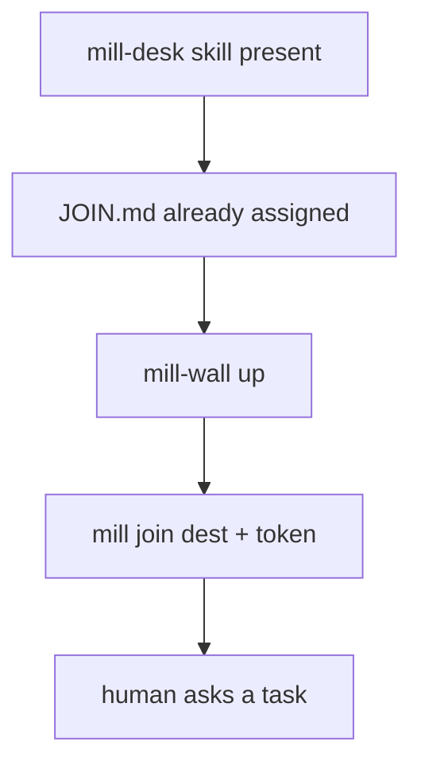
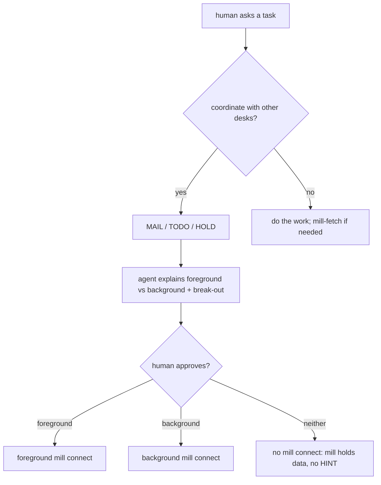
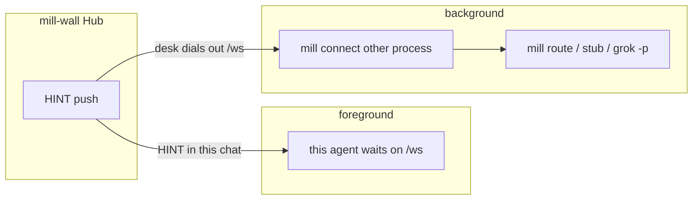
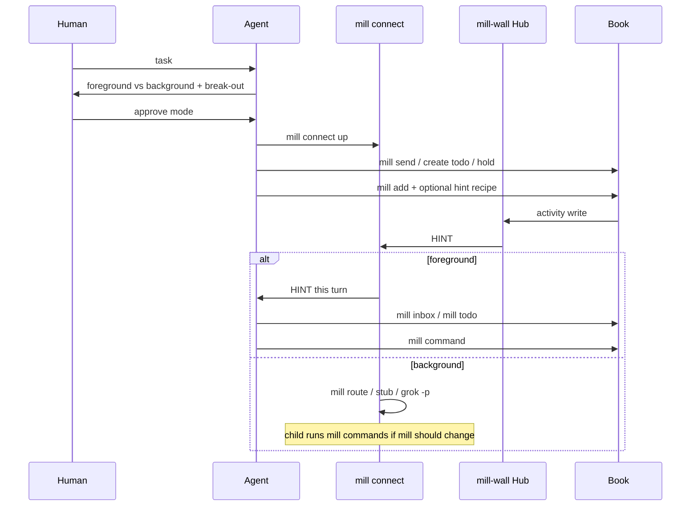

# mill connect - foreground vs background

Pre-T0 docs: mill-desk skill already loaded; **[JOIN.md](../JOIN.md)** already assigned. mill connect modes live here. Chat inbound map: [skill.md](skill.md). HINT `detail`: [hints.md](hints.md). Background program map: [route.md](route.md). Hub `/ws`: [howto-ai.md](howto-ai.md). Grok 1.0.46 foreground mail: [grok-foreground.md](grok-foreground.md).

**Point:** no agent **loops** mill to see if state changed. Watchers push a HINT. mill connect **waits on `/ws`**. mill-fetch **once**. STOP.

Do not say sit. mill connect is **up** or mill connect **died**. Esc does **not** cancel mill connect.

## mill startup (before the human asks)



mill join clocks the dest. mill connect is **not** required yet (until the human's task needs collab HINTs - then background connect on the Wall-reachable host; JOIN.md). No watchers yet -> nothing to miss.

## After the task: explain, then human approves

Foreground vs background is a **work-mode** choice. The agent states **outcomes** (the human need not know `/ws`). Human **approves**. Then mill connect **up**.

**Wakeup paste = approval:** if the human's wakeup paste already includes the `mill connect` line, that paste **is** approval to start **background** connect - do not wait for a second approve.



Coordinate with mill: `mill send` (MAIL), `mill create todo` (TODO), `mill hold` / `mill drop` (HOLD). Tree/label/assign when needed. Not a fourth bus.

## Two modes



| Mode | Who waits on `/ws` | This chat | HINT goes to |
| :--- | :--- | :--- | :--- |
| **Foreground** | **this** agent | **blocked** until HINT handled | this turn (skill.md inbound) |
| **Background** | **another process** | **free** | mill route / stub / `grok -p` |

Same Hub. Same `{type,id,hint,detail}`. `hint` stays `MAIL`/`TODO` (route key). **`detail`** is this desk's `watcher.hint` or the default ([hints.md](hints.md)).

**Today:** background mill connect is the sibling process (route/spawn). **CLI foreground:** mill connect-wait blocks **that** mill process on /ws until **one** work HINT (skips PING). On the first sync after sit, only undelivered push_queue items (they carry `time`) end the wait; card 949 mailbox resurfacing omits `time` and does not, nor does a later sync whose items a live connect of this desk already got (outcome `sent`); an empty queue keeps waiting. A live HINT after hold ends it. Stdout is one final JSON result line (last line is the result); no stderr banner; a delivered HINT exits 0. Build shells it as this turn, then mill-fetch. Break-out = interrupt that mill CLI (Ctrl+C). Esc still does **not** cancel mill connect. `mill connect DESK --vendor grok-build --session UUID` starts a new headless turn in that session per HINT ([grok-foreground.md](grok-foreground.md)); injecting a HINT into an open TUI turn is **not** built.

Regression row F28 (connect-wait-holds). Regression row F44 (connect-wait-sent). Regression row F-connect-wait-startup-sync.

Seatless connect: `mill connect NAME` when this computer holds no seat for NAME prints one line on stderr and exits 2, before anything connects: `mill connect: no seat for NAME on this computer; a desk joins once with mill join --link-file PATH (the welcome link from the office host) (a roster is not a desk: mill connected ROSTER lists its desks)`. The line is the same for a roster, an unknown name and an unjoined desk, and the client asks the office nothing, so the refusal never tells which names exist. Regression row F30 (connect-seatless).

Seat in use: one desk has one live connect. A new `mill connect DESK` (also `connect-wait`) refuses while another live connect holds the seat: the holder stays, the office closes the newcomer with 4409, and it prints one line `{"busy": true, "desk", "next"}`, where next reads `busy: another session has the seat for DESK (since T) and gets this desk's letters; stop. To take a dead or stale seat: mill connect --take DESK`, and exits 0. A command in that shell prints the same busy text (exit 1). A first refusal looks again after 1 and 2 seconds, so a connect that just closed is not busy. `-r`/`--refuse` is the default and is kept. `mill connect --take DESK` takes the seat and the older one exits 5 (superseded). A dead holder does not block once the office drops that socket; after a drop, an automatic reconnect refused by this desk's own old socket retries for up to 45 seconds, then reports busy. The wake hint names `mill connect -r DESK` and says the same: busy means stop. Regression rows F43 (connect-refuse), F125 (connect-busy).

**Model skill.** Grok Bot cannot leave `mill connect-wait` running. That delta is [models/grok-bot/SKILL.md](models/grok-bot/SKILL.md). Grok Build foreground is [grok-foreground.md](grok-foreground.md). Do not copy this page into a model skill.

## What to tell the human

**Foreground** - I wait on mill. When mail or a card I watch changes, **this chat turns**. Your next line **queues** until I handle that HINT.

**Break out of foreground** (say it before they approve):

- **Force-send** a line - human wins; do not mill-wait as idle. Esc does **not** cancel mill connect.
- **Stop mill connect** - wait ends; dest still joined; **no HINT** until mill connect is **up** again.
- **Switch to background** - mill connect as the other process; this chat is free; HINT does **not** turn this window.

If we cannot break out, **do not recommend foreground**.

**Background** - another mill connect stays **up**. HINT **starts a program** (mill stub, mill route, or `grok -p`). This chat stays free. mill is updated only if that program runs mill commands. This window does **not** auto-turn.

`grok -p` is a **new** process, not a wake of this TUI.

## After approve



1. mill connect **up** (one dest, **one** mill connect; a second is refused busy unless it passes `--take`).  
2. `mill add <type>:<id> [--hint ...]` on those TODO/HOLD/SCORE/DOING (tree parent if nest); a letter takes `mill add mail:<id>` with no `--hint`.  
3. Background: mill route add, or mill **stub** (HINT JSON in, mill-fetch if needed, **STOP** - no mill-pass because the child exited 0).  
4. HINT -> read `detail` -> mill-fetch only leftovers -> mill command -> **STOP**.  
5. Never loop mill inbox/todo to see if state changed.

Switching fg<->bg: **stop** the old mill connect, then start the new mode.

## Constraints

- **One receiver per dest.** Foreground handler **or** mill route spawn, not both on the same HINT.
- **HINT queue.** Drain **one**; human force-send **wins** over a HINT pile.
- **Stub** must STOP. mill connect does **not** mill-update for exit 0.
- **Watchers after** mill connect is **up**. Watching first only fills mill; no doorbell.
- **Background mill connect in this TUI** dies on TUI restart and the 10h job cap. Host mill connect survives.
- **Webhook wake is picked at join, not connect.** `mill connect` configures nothing. See [Webhook wake](#webhook-wake).
- mill route is **not** mill connect. mill route is the background **map** on the mill-connect PC.

## Webhook wake

`mill join` sets how the wall reaches a desk while its connect is down. A plain join leaves websocket delivery (today's default). Webhook delivery:

```
mill join --link-file LINKFILE --webhook-url-file URLFILE --webhook-key-file KEYFILE
mill join <desk> --webhook-url-file URLFILE --webhook-key-file KEYFILE   # a seated desk, no new link
mill join <desk> --websocket                                             # back to websocket only
```

- The key never goes on the command line: `--webhook-key-file PATH`, `--webhook-key-env NAME` or `--webhook-key-stdin`. The key can be copied in any of these forms: the bare key, `Bearer KEY`, or the whole `Authorization: Bearer KEY` line. `--webhook-url URL` also works; `--webhook-url-file` keeps the URL out of shell history.
- A seated desk proves who it is with its own seat token (the one connect presents), so changing its delivery needs no new invite.
- The wall accepts only an https URL on a host in its `wake_hosts` allowlist (host config; default `api2.cursor.sh/automations/webhook/`). It refuses IP literals, a user or password in the URL, a non-default port, and a path with a `.` or `..` segment or an encoded slash, backslash or dot (checked before the prefix, at join and again before every POST). Every address the host resolves to must be public, and a redirect is never followed. A URL off the allowlist is refused with the allowed prefixes and the exact host Admin step to add one: the line `wake_hosts = "CURRENT,HOST/<webhook path prefix>/"` in the wall's config file (`~/.mill/config.toml` of the account mill-wall runs as, or the file named by `AGENT_COORD_CONFIG`), read on the next join with no restart; or, when the wall has `AGENT_COORD_WAKE_HOSTS` set (it wins over the file), that variable in the mill-wall service environment and a restart. The refusal never shows the URL path.
- Join test-fires once (`{"kind": "wake-test"}`) and stores the URL and key only on a 2xx. It prints one line: `{"kind": "wake", "desk": D, "webhook": "armed", "host": H, "test": 200, "wake_on": "addressed"}`. Re-running with the same values prints `"test": "unchanged"` and sends no POST. A failure prints what is wrong and how to fix it, for example the key refused (401), no webhook at that URL (404), host unreachable, wrong host or http. The output never shows the URL path or the key.
- The key belongs to the desk. It is stored on that desk's seat row and nowhere else, and only the POST reads it back. No list, wall view, log or error shows it. `mill reset seat` and `mill retire desk` forget it.
- `mill connect` shows the state on its sync line: `"wake": "webhook armed (host H)"`, `"wake": "webhook armed (host H, wake on addressed)"` or `"wake": "off"`.
- `--wake-on addressed|all` (#628; default `addressed` since card 836) is the desk's choice of which items POST. With `addressed`, an item the desk gets only as a room member (`wake.reason` `room`) does not POST: it waits in the queue for the desk's next connect, so a room copy wakes no one: the desk sees it on its next connect (the sync line hands it over, and `inbox` lists it), which is any wake for a named letter or hint, its own work, or a scheduled check. `--wake-on all` keeps room wakes. The wall logs `wake=skipped reason=room-only` and takes no window. Hints, named letters and replies to the desk's own letters still POST. The choice lives on the seat row; each `mill join DESK --webhook-...` sets it again (absent means `addressed`), and `--websocket` resets it to `addressed`. A book from before card 836 moves every seat on `all` to `addressed` once, at `ensure` (the column default is the marker; a later `--wake-on all` is kept). Regression rows F74 (wake-on), F127 (room-copy-quiet).

**What a POST is.** The POST is a doorbell for a desk whose connect is down. It carries the same frame a sitting desk would get (`kind`/`type`, `id`, `hint`, `detail`, and the poke key `idem`), plus `desk`, `roster` and a `wake` block (`reason`, `room`, `pending`, `pending_count`, `last_note`, `lease`, `window_s`, `next`). `pending_count` is how many items the last lease held back (0 on a fresh wake); `last_note` is the note the last run left with `mill wake-done --note`, or null; `lease` is this wake's lease token (12 hex characters, null on the join test), which the run passes back with `mill wake-done --lease`; `window_s` is the lease length. A letter's text is never in it. The desk's own key goes in `Authorization: Bearer` and `X-Automation-Key`.

**Who and why.** `desk` names the target, so one receiver can route wakes for many desks: desk names are unique within an office, so key any routing by `desk` alone. `roster` is informational: the desk's one roster other than Office, else Office (the rule a send uses for its sender roster), so a desk on several rosters reports Office whatever roster the letter carries. `wake.reason` comes from the routing the wall already does: `addressed` for a letter that names this desk (`--to-desk`, `mill add mail:ID`, a roster it is on), a reply to a letter this desk sent, or a card or watch hint; `room` for a reply-all letter this desk gets only as a room participant. When the POST stands for a burst, `reason` is `addressed` if any waiting item is. `wake.room` is the room name of the letter, or null for a hint, an off-room letter, or a thread the wall opened by reply with no room name. The join test POST has `reason` and `room` null and an `id` of its own (`wake-test-<hex>`). Regression row F73 (wake-route).

Example (placeholder values):

```
{"kind": "mail", "id": 4242, "idem": "mail:4242:DESK", "desk": "DESK", "roster": "ROSTER",
 "wake": {"reason": "room", "room": "ROOM", "pending": 3, "pending_count": 2,
          "last_note": "answered 4241; 4242 is next", "lease": "0123456789ab", "window_s": 900,
          "next": "mill connect DESK: the sync line hands over every waiting hint and letter, and this desk's routes walk them"},
 "mill": "X.Y.Z"}
```

**One woken run at a time (wake lease, F144).** A POST takes a wake lease for that desk. While it is held the wall sends that desk no other POST: new letters and hints wait in its queue (`wake=coalesced reason=lease`). A connect sync does not end the lease, because a woken run connects once per shell call; it only resets the held-back count, since that sync handed the items over. The run ends the lease with `mill wake-done [--note TEXT]` as its last step. If items were held back and some still wait in the queue, the wall then sends exactly one trailing POST (#669): its frame is the latest held-back item, `wake.pending` is the queue size, `wake.pending_count` the distinct items held back, `wake.last_note` the run's note, and it logs `wake=sent status=200 reason=trailing`. A run that never says done (it crashed, or its client predates `wake-done`) loses the lease after `wake_lease_s` seconds (wall config, or `AGENT_COORD_WAKE_LEASE_S`; default 900): the same one trailing POST goes out then, logged `reason=lease-expired`, and the next item after that time POSTs at once, so a desk is never wedged. Nothing held back, or the run already read every row, sends none (`wake=none reason=drained`). Each `mill wake-done` logs `webhook desk=D wake=done held_s=S queued=N note=yes|no`. The check for a live lease and the record of the held-back item are one step, so a `mill wake-done` that lands while a letter is arriving either sees that letter held back (and rings it) or lets it post (F144a). `mill wake-done --lease TOKEN` ends only the lease that token names: a run that outlived its lease and says done after a newer wake is stale, keeps its note for the next wake (unless a newer note waits), logs `wake=done stale=yes`, and ends nothing (F144b). A done with no token, as older clients send, ends the current lease. The trailing POST takes a lease of its own. The lease starts only when a valid POST is attempted: a URL the wall refuses, or a host that does not resolve to a public address, takes none, so fixing it (re-arming) wakes the desk at once. The lease lives in the office's wall process (one per office), so a seat in two offices has two leases, and a wall restart frees every lease. The join test POST carries its own `id` (`wake-test-<hex>`) and never takes or counts toward a lease. The design follows the grokbot-wake-relay repo. Regression rows F144 (wake-lease), F-wake-trailing.

**One log line per wake.** The wall writes one line per desk for every wake on `mill-backchannel.log`, for a letter and a hint alike: `webhook desk=D kind=mail id=N wake=sent status=200` (a hint names `type=` instead of `kind=`), `wake=coalesced reason=lease`, `wake=sent status=200 reason=trailing` (after `mill wake-done`) or `reason=lease-expired` (the lease timed out), `wake=done` and `wake=none reason=drained` (above), `reason=leave` or `reason=unsent` (ring on leave, below), `wake=skipped reason=not-allowed`, `reason=not-public` or `reason=room-only`, or `wake=fail status=N why="REASON"` / `wake=fail err=TYPE`. REASON is the receiver's own short answer (its `error`, `message`, `detail` or `reason` field, else the text; one line, at most 120 characters, the URL, its path and query, and the key removed; absent when the receiver sent none). It never shows the URL, its host or the key (the sync line shows the host). A desk that is not armed logs nothing.

**A webhook that keeps failing (#838).** When 3 wakes in a row for one desk fail (any non-2xx answer or no answer), the wall logs `webhook desk=D failing n=3 since=T` and sends the Admin roster one letter for that run, with the desk, the count, the last answer and the fix. The desk's next `mill connect` shows it on its sync line: `"wake": "webhook armed (host H); failing: N wakes in a row since T, last 400 (REASON); letters wait for mill connect"`. The letters themselves are never lost: every one waits in the desk's queue for its next connect. The first 2xx ends the run, and a later run sends a new letter. The run lives in the wall's memory, so a wall restart starts the count again.

**Nothing is lost.** Every hint and letter is written to the desk's push queue as `missed` before the wall rings or sends anything (#832), so a desk woken fast enough to connect before the POST returns still finds it on its sync line. A live frame that reached a socket marks its row `sent`; every hint and letter that went to a webhook desk, whether POSTed or held back by the window, stays `missed`. The woken desk runs `mill connect DESK` and gets every one of them on its sync line. Its redirector chain then walks each one with the same walk and key check a live hint gets ([route.md](route.md)), once per poke key: several changes of one hold or card share a key, so the walk takes the latest of them. A replayed item that the chain skips (a repeat key, or the desk's watch filter) prints no line; the sync line already shows it (#670). A route takes a hint it matches. A hint no route takes is left for the agent reading the sync line, with no second vendor poke. A failed wake (a timeout, a connection error, 408, 429, or a 5xx) retries off the request that queued it. The wait is full jitter: up to 5 seconds the first time, then double, and never more than 10 minutes. The waits stop at about 1 hour. Every retry posts the same body, so the idempotency key and the lease stay the same wake, not a new window. A 4xx other than 408 or 429 does not retry. The retry stops when the desk connects and the queue drains, or when a newer wake for that desk succeeds. When the waits run out, one line names the desk, the attempts, and the last status. A wall restart drops the timer. The queued letters still arrive on the desk's next connect.

**Ring on leave.** When a desk's last socket leaves, or a live frame finds no socket because the desk left after the wall looked, the wall rings an armed desk that still has a `missed` (or `error`) hint or letter waiting (#832). The POST is the newest waiting item's frame with its poke key; the window, `--wake-on` and the URL checks apply as for any other wake, and it logs `reason=leave` or `reason=unsent`. A desk that is sitting again, or has nothing waiting, is not rung. Receipts never ring. A row can reach a desk both live and on a sync line; the chain walks it once per poke key. Regression row F124 (wake-row-first-ring-on-leave).

## Doc split

| Doc | When |
| :--- | :--- |
| JOIN.md | mill startup + pointer here |
| **this file** | fg vs bg, explain/approve, break-out |
| skill.md | chat inbound / outbound once they are a dest |
| hints.md | `detail` / `watcher.hint` recipes |
| route.md | HINT -> program |
| access.md | Bearer dest |

`mill briefing connect`

## Windows / PowerShell notes

- Prefer `--doing=text-without-spaces` (or quote carefully). PowerShell `Start-Process -ArgumentList` with `--doing` then a spaced string can split into extra argv; `mill` then rejects unknown tokens.
- Same host rule as JOIN: mill connect must run where Wall is reachable.

