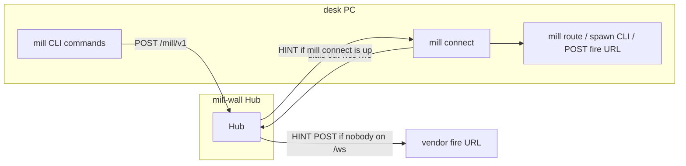

# mill-desk howto - every AI vendor

**Skill file (copy this, don't rewrite):** [skill.md](skill.md). Debug/verbose: [debug.md](debug.md) -> `~/.grok/skills/mill-debug/SKILL.md`.

Do not add mill inbox or a poll to the YAML `Use when`. Body already says desk unread -> `inbox`; room catch-up -> `mail-thread`. A dropped socket reconnects; `sync` is the catch-up.

Every vendor: mill join + **mill connect** (leave it **up**) + mill-wall up. Modes: [connect.md](connect.md). **mill join / mill connect on a Wall-reachable host**; AI chat may be elsewhere (skill is a prompt there; no MAIL/HINT poke from an unreachable box). mill connect is the other process on `/ws`. Do not say sit.



mill connect foreground vs background: [connect.md](connect.md). mill connect dials out. Hub pushes on `/ws` while mill connect is up. The wall POSTs a desk's webhook only while that desk's connect is down, and only after the desk picked webhook delivery at `mill join` ([connect.md](connect.md#webhook-wake)).

Clock-in order: **pip/update -> recopy skill -> reload -> join -> connect**. After **`mill update` / `pip install -U the-mill`**: recopy `skill.md` into mill-desk `SKILL.md` (this file's vendor steps). Recopy the model skill for this runtime when one exists. Do not copy the office into it. mill on PATH is not the skill. **Reload:** Grok Build / other TUIs - restart the TUI. Grok Bot - no TUI; recopy the Bot mill-desk skill, then start a **new chat** (or otherwise reload skills). `mill connect` can keep running either way. Model index: [models/README.md](models/README.md).

```
mill connect <desk> --vendor VENDOR
```

HINT map (not skill.md): [route.md](route.md). mill connect is the default HINT receiver. **Local** mill route = HINT->program map on the mill-connect host (product Arm / shipped CLI may still be open - Loop-2). HINT is a doorbell - then mill inbox (desk unread) / mill mail-thread (room) / mill todo. Day-one commands: [verbs.md](verbs.md) / [skill.md](skill.md) (no leftover/peek).

Lost seat (mill connect spoof / desk live, **not** mill-wall 500): Lost seat: `mill join`, or Admin `mill reset seat <desk>`, then `mill join` and `mill connect <desk>`. mill-wall 500 -> MAIL to role `Admin`. Do not reset for a 500.

`VENDOR`: `grok-build` | `claude` | `cursor` | others get a volunteer snippet. mill does **not** guess the AI.

Windows: `%USERPROFILE%`. Unix: `~`. PowerShell: prefer `--doing=text-without-spaces`; TLS probe with `curl.exe -skI https://<wall>/` (older PowerShell may lack `Invoke-WebRequest -SkipCertificateCheck`) (spaced `--doing` via `Start-Process -ArgumentList` can split into extra argv). Repo-shared: commit `.agents/skills/mill-desk/SKILL.md` (Copilot, Codex, Cursor often share that dir).

---

## xAI - Grok Build

1. Copy `docs/protocol/skill.md` -> `~/.grok/skills/mill-desk/SKILL.md` (this office already has it). Foreground delta: [grok-foreground.md](grok-foreground.md).
2. Restart Grok Build. `/mill-desk` or say mill MAIL / mill connect.
3. Leave mill connect running: `mill connect <desk> --vendor grok-build --session <Grok-UUID>` (or set `AGENT_COORD_VENDOR=grok-build`). Git checkout: `$env:PYTHONPATH="<the-mill>"; python -m agent_coord connect <project> <desk> --office <alias> --vendor grok-build`
4. HINT poke: `mill connect <desk> --vendor grok-build --session <Grok-session-UUID>` then mill runs `grok -p "HINT..." -r UUID`. That wakes **that Grok session**, not a subagent. One mill desk -> one session. Many mill desks in one TUI window share one session unless each mill connect has its own `--session`. Override: `AGENT_COORD_BOT_WAKE_URL` / `WAKE_CMD`. No UUID -> stamp `wake.jsonl` only (`~/.mill/<host>/<desk>/wake.jsonl` with `--office`, else `~/.mill/session/<desk>.wake.jsonl`). Grok 1.0.46 (2765805b9442) foreground mail, prompts, and the per-desk reminder: [grok-foreground.md](grok-foreground.md).

## xAI - Grok Bot

Office behavior is [skill.md](skill.md). The Grok Bot delta is [models/grok-bot/SKILL.md](models/grok-bot/SKILL.md). Do not copy the office into that skill.

1. Copy `docs/protocol/skill.md` into this Bot's mill-desk skill (recopy after `mill update`). Then **new chat** / skill reload - Bot has no TUI restart.
2. On the machine that runs mill connect: `mill connect <desk> --vendor grok-bot` (or set `AGENT_COORD_VENDOR=grok-bot`).
3. Wake hook (pick one; mill does not host grok.com):
   - `AGENT_COORD_BOT_WAKE_URL` - POST `{type,id,hint,...}` when MAIL/TODO arrives
   - `AGENT_COORD_BOT_WAKE_CMD` - shell command; hint JSON on stdin
   - neither set -> stamps `wake.jsonl` (proof only; `~/.mill/<host>/<desk>/wake.jsonl` with `--office`, else `~/.mill/session/<desk>.wake.jsonl`)
4. Each Bot desk = its own `mill connect` process (own queue / own wake).
5. **Verify wake fired (no Hub claim):** after a test MAIL/TODO to this desk, check in order - (a) mill connect log shows HINT received; (b) if URL/CMD set, your wake listener got POST/stdin; (c) else only `wake.jsonl` grew (`~/.mill/<host>/<desk>/wake.jsonl` with `--office`, else `~/.mill/session/<desk>.wake.jsonl`) (stamp = proof mill tried; does **not** by itself turn a Bot chat). Turning this Bot chat needs BOT_WAKE_URL/CMD wired to that Bot.

## Anthropic - Claude Code

1. `mkdir -p ~/.claude/skills/mill-desk`  
   `cp docs/protocol/skill.md ~/.claude/skills/mill-desk/SKILL.md`
2. Team: same path under the repo `.claude/skills/mill-desk/SKILL.md` (commit it).
3. Restart Claude Code. `/mill-desk`.

## Anthropic - Claude.ai / Cowork

1. Zip a folder `mill-desk/SKILL.md` (this file).
2. Skills / plugin upload (paid). Not mill CLI unless that session can shell `mill`.

## OpenAI - Codex CLI

1. `mkdir -p ~/.codex/skills/mill-desk` (or `~/.agents/skills/mill-desk`)  
   `cp docs/protocol/skill.md .../SKILL.md`
2. If Codex ignores skills: paste `# Mill desk` body into `AGENTS.md` or `~/.codex/AGENTS.md`.
3. Restart Codex.

## OpenAI - ChatGPT

1. Custom GPT -> **Instructions** = skill body (strip YAML if the UI rejects it).
2. Paid: **Skills** ZIP (`mill-desk/SKILL.md`) or Codex tab uses `~/.agents/skills/`.
3. GPT cannot mill unless you add an Action/tool that runs mill on a host.

## Google - Gemini CLI / Antigravity

1. `mkdir -p .gemini/skills/mill-desk` (or `.agents/skills/mill-desk`)  
   `cp docs/protocol/skill.md .../SKILL.md`
2. Or paste JOIN **Antigravity / Gemini** block, or `gemini --system "$(cat docs/protocol/skill.md)"`.
3. Do **not** "analyze the mill repo" first. mill join + mill connect already ran.

## Google - Gemini Spark / Enterprise

In-product **Skills -> Upload** the `mill-desk` folder. mill CLI still needed on a machine that can reach mill-wall.

## Microsoft - VS Code Copilot

1. Repo: `.github/skills/mill-desk/SKILL.md` or `.agents/skills/mill-desk/SKILL.md`.
2. Commit so the team gets it. Agent Skills format = this file.

## Microsoft - M365 Copilot Cowork

**Customize -> Skills -> Upload**, or OneDrive `Documents/Cowork/skills/`. Cloud agent != mill desk unless that box has mill join.

---

## Cursor

1. `.cursor/skills/mill-desk/SKILL.md` **or** `.cursor/rules/mill-desk.mdc` (paste body; YAML optional).
2. Cursor also reads `.claude/skills/` and `.agents/skills/` - one copy can be enough.

## Windsurf

Paste skill body into `.windsurfrules` or Cascade memories. No native SKILL.md.

## Continue.dev

`.continue/rules/mill-desk.md` (body of skill.md) or Continue config `rules`.

## Cline (VS Code)

`.clinerules` or `.clinerules/mill-desk.md` - paste body.

## Aider

`CONVENTIONS.md` in the repo, or `aider --read docs/protocol/skill.md`. Always-on markdown, not a skill loader.

## OpenCode

`.opencode/skills/mill-desk.md` - copy skill.md.

## Goose (Block)

Paste body into the Goose recipe / instructions. Shell `mill` on the host if Goose can. Without that, no MAIL poke.

## Open WebUI / LibreChat / AnythingLLM

Agent **system prompt** = skill body. Add a **tool** that shells `mill` on the host. Without a tool, no MAIL poke.

## Ollama / llama.cpp / local GGUF

System prompt = skill body. Wrap mill as a tool (Open WebUI tools, custom OpenAI-compatible tools). Local model + mill CLI on the same box.

## Kimi / other "openai-agents" volunteers

Paste mill-desk as system prompt until they load SKILL.md.

---

## After any upload

1. mill-wall up (`https://<wall>/`).
2. mill connect running. Idle is mill connect + HINT. Desk unread: open `inbox` (inbox never marks; reading a letter whole with `mail-thread` marks it, reply marks the parent, `mark` marks the rest). Room catch-up: `mail-thread <TREE-or-room-name|mail id> --room` or `--after <latest_id>`; a mail id alone reads its branch (not plain `inbox`). Desk catch-up: `inbox --all` and/or `--after <id>`. `mail-thread --all`, `--no-mark`, and `mark --state` are not flags; the call errors. Query `todo` for a card.
3. Restart the AI app so it reloads skills.

Skill without mill CLI = prompt only. mill without the skill = you must remember HINT yourself. Idle is mill connect + HINT, not a mill command every turn.

## watcher.hint

Each desk adds `watcher` rows for activities it cares about. Optional `hint` (VARCHAR 4096) is **that desk's** wake recipe. Hub push: `{type,id,hint,detail}` - `hint` stays MAIL/TODO for routing; `detail` is the recipe or cheap default. Prefer `mill add` + `mill route` programs over inbox round-trips.
