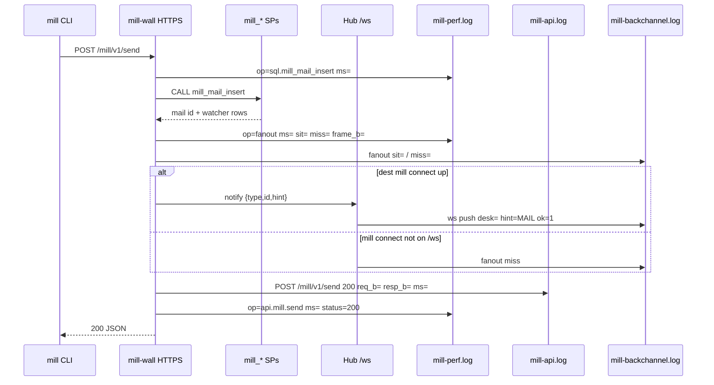
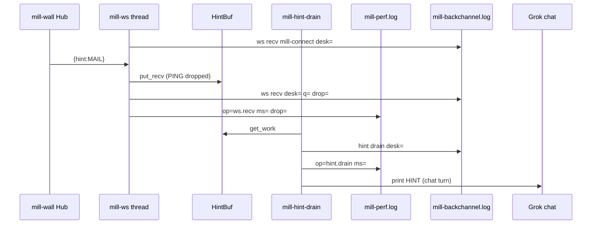
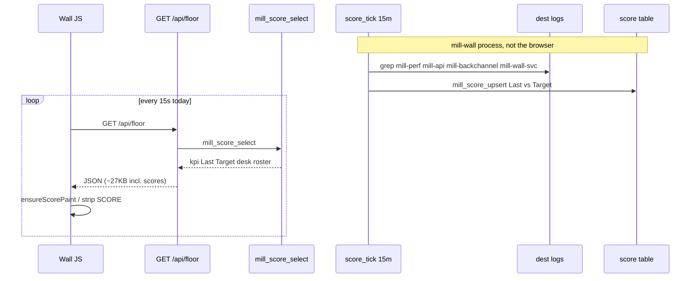
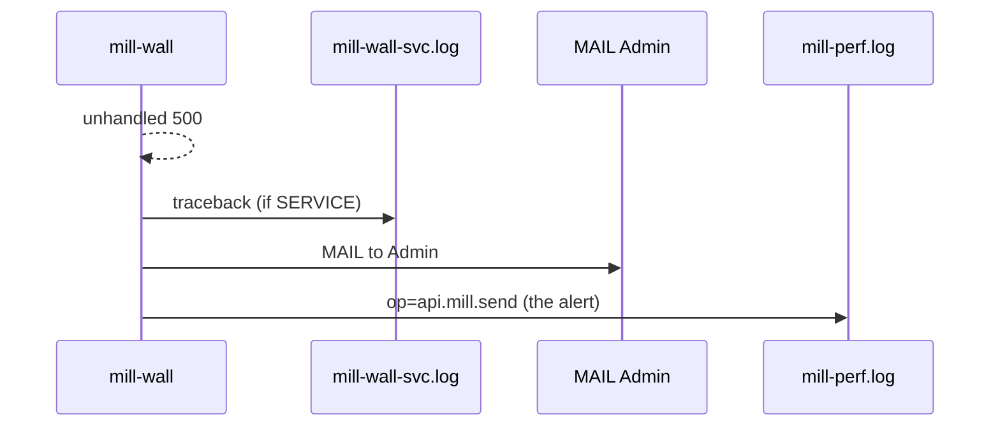
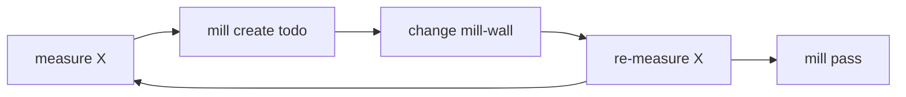

# mill-wall instrumentation

Two records. The logs debug the wall. The book records the work.

Dest for the logs: `AGENT_COORD_MILL_HOME` or `~/.mill`. **No session tokens, no mail/todo body text.** Door secrets in these files are stored as `[redacted]` (bearer, invite, token, password, client secret, URL userinfo). Sizes are **UTF-8 bytes**, not LLM tokens. Tokens are vendor-side; mill bytes **correlate**.

## Log instrumentation

**Intent.** See whether this office is cheap and healthy: which call was slow, which hint was dropped, which episode ended, and whether the wall answered 500. The lines are a debug trace. They are not the product history.

**How.** The wall writes one line at the end of an operation. `perf_log` appends `mill-perf.log` (`op=`, `ms=`, and the sizes it already has). `api_log` appends `mill-api.log`. Hub and mill-connect events append `mill-backchannel.log`. Nothing in these lines is read back to answer "what did this desk do today."

`score_tick` runs about every 15 minutes, reads the last hour of those files (and a few book counts), and stores one office-wide number on a score row: wall speed, idle polls, hint drops, and the episode stamps (`wake.first_ok`, `card.verbs_to_done`, `hold.blocked`, `nest.hit`, `mail.hit`). That number is replaced on the next tick. Earlier hours are not kept.

## Product instrumentation

**Intent.** Two facts about agent work. Every finished command moves the activity row the command chart names. Separately, each desk's commands are counted per hour and rolled into that calendar day.

**How.** The activity write is the procedure for that command. Activity ids and delete rules are in [Activity](../requirements/activity.md). The seat pulse is `seat.updated`.

The hour and the day are `mill_score_event`. The wall calls it when a command finishes, with the desk, the command, the host milliseconds, and `req_b` / `resp_b`. The procedure adds that command to the current hour document and to today's midnight document. The same hour on a later day replaces the hour. The day row stays. Mail bytes are `send`, `reply`, `inbox`, and `mail-thread`. Todo bytes are `todo`, `open`, `note`, `pass`, `claim`, and `assign`. One score per desk (`kpi` `system`) holds today's command count in `score.value`. The document cap is 4096 bytes. A larger write is rejected and `mill-perf.log` records `op=score.history`.

## Files

| File | Role |
|---|---|
| **`mill-perf.log`** | Profiler. One line per op, `key=value`. **Start here.** |
| **`mill-api.log`** | mill HTTPS commands + `/api/floor` (status, ms, owner, err) |
| **`mill-backchannel.log`** | mill-wall mill-connect / leave / push / miss **and** mill connect recv / drain / drop (always `desk=`) |
| **`logs/mill-wall-access.log`** | Every HTTP: `METHOD path status req_b= resp_b= ms` |
| `session/<name>.hints.jsonl` | Frames kept for this mill connect. Secret-shaped strings in the frame are `[redacted]`. |
| `mill-wall-svc.log` | Windows SCM crash (isatty / bind) |
| `mill-wall-svc-out.log` | mill-wall service **child** stdout |
| `wall-detach.log` | Wall detach remnants |

`mill-perf` / `mill-api` / `mill-backchannel` are written to dest **root**. Access log is dest **`logs/`**. mill-wall also prints latency snapshots: `n` / `p50_ms` / `p95_ms` / `max_ms` (in-process, last N HTTPS calls).

## `mill-perf.log`

```
2026-09-17T00:00:00Z op=sql.mill_mail_insert ms=8.2 n=1 ok=1
2026-09-17T00:00:00Z op=fanout ms=1.4 type=mail id=6 hint=MAIL watchers=2 sit=1 miss=1 frame_b=48
2026-09-17T00:00:00Z op=ws.recv ms=0.0 desk=DESK_alice hint=MAIL id=6 q=1 drop=0 frame_b=48
2026-09-17T00:00:00Z op=hint.drain ms=1.2 desk=DESK_alice hint=MAIL id=6 ok=1 q=0
2026-09-17T00:00:00Z op=api.mill.send ms=14.1 status=200 owner=<desk> req_b=412 body_b=88 resp_b=96
2026-09-17T00:00:00Z op=api.floor ms=80.0 status=200 n=1 resp_b=7545
```

(`watchers=` in this log line is fanout row count; the book table is `watcher`.)

| Field | Meaning |
|---|---|
| `op=` | `sql.<SP>` | `api.mill.<verb>` | `api.floor` | `fanout` | `ws.recv` | `hint.drain` | `ws.reconnect` |
| `ms=` | wall clock |
| `req_b=` | mill HTTPS **request** JSON bytes |
| `body_b=` | mill `body` / `need` / `note` only (the letter/card) |
| `resp_b=` | mill HTTPS **response** JSON (`inbox`, floor, ...) |
| `frame_b=` | Hub `{type,id,hint}` (~40-80 B) |
| `n=` | SQL row count or floor project count |
| `sit=` `miss=` | fanout: mill connect on `/ws` vs not (log field still named `sit=`) |
| `desk=` | mill connect / Hub room. N desks one PC: always present on mill-connect lines |
| `q=` `drop=` | mill connect HINT FIFO depth; `drop=1` oldest HINT discarded (recv still ran) |
| `status=` | 200 / 400 / 500 |
| `ok=` | SQL 1/0 |
| `err=` | short; no stack in this file |

**SQL `activity.bytes`:** last mail or todo body length (`LENGTH(body)`). Not HTTP. The activity row is `(type, id)`.

## Correlate with tokens (later)

You will not know the vendor tokenizer. Plot:

| Mill | vs tokens when |
|---|---|
| `body_b` / `activity.bytes` | desk **reads** one letter/card |
| `resp_b` on `inbox` / `todo` / `floor` | mill dumps a **list** into the model |
| `frame_b` | ignore (poke is tiny) |
| `req_b` | mill send/open **write** |

Idle: mill connect on `/ws`, `frame_b` only, until `MAIL`/`TODO` then one `inbox` `resp_b`. Dumping mill every turn is `resp_b` x N.

## Admin MAIL

Unhandled mill-wall **500** (not `CoordError` 400, not heartbeat/wake) -> `MAIL` to `Admin`. That send is itself in these logs (`api.mill.send` / fanout). Don't loop: `mill_admin_alert` swallows its own errors.

## What not to log

Session tokens, `Authorization`, mail/todo **text**, mill CA keys. Size only.

## Sequence diagrams

Timers = `mill-perf.log`. Bytes/status = `mill-api.log` (+ access log). Poke events = `mill-backchannel.log`. Errors = `mill-wall-svc.log`. The product hour and day are `mill_score_event`, described above.

### mill send (API + Hub)



### mill connect recv vs drain



### Wall SCORE glance (UI does not write Last)



### mill-wall 500 -> Admin MAIL



## mill-wall is a server

Buzzwords only count as mill facts:

| Word | Mill meaning | Now | Later |
|---|---|---|---|
| **Robust** | mill-wall process does not die on a bad `/ws` or floor; 500 -> MAIL to `Admin`; SCM child uvicorn | try/except + Admin MAIL | one mill-wall, floor cannot 500 the process |
| **Performant** | poke + `CALL mill_*` in milliseconds; idle is `/ws` not a model turn | `mill-perf.log`, `activity.bytes` | p95 `api.floor` / `sql.mill_*` as cards |
| **Scalable** | N desks = N `/ws` + `watcher`, not dump `/api/floor` into every agent | Hub + `mail_to` snapshot | don't add a queue table; rooms already scale with mill connect |
| **Secure** | TLS (mill CA), `token_hash` owns the desk, `token_required`, no tokens in logs, `lan_only`, dest is desks/roles not scrape-the-Wall | HTTPS mill-wall, hash, logs stripped | door / invite UX still TBD; don't mill-send `To: human` |
| **Cheap (tokens)** | mill JSON in the model only after HINT | mill connect + `inbox` unread | `resp_b` / `body_b` vs vendor tokens |

GitHub issues are intake. The loop is still **measure X -> card -> cut -> re-measure**. Robust/fast/scale/secure are **named X** (`500s`, `api.floor p95`, `fanout miss`, `token in logs` = 0), not a rewrite.

## Improvement loop (measure X -> cut X)

GitHub issue / mill create todo is **one** intake (a bug is a card). The profiler is the other: **pick a number, move it, prove it**.



**X is one named metric**, not "make it faster." Examples:

| X | Where | Better |
|---|---|---|
| `api.floor` p95 ms | `mill-perf.log` / mill-wall p95 snapshot | glance doesn't stall mill-wall |
| floor cache miss outside the hit | `mill-perf.log` | per-pane cache, table versions, one line per floor request. Regression row F13 (lan-wall-latency). |
| `sql.mill_mail_insert` p95 | `op=sql.` | send stays milliseconds |
| `fanout` miss vs mill connect | `sit=` `miss=` (log fields) | more desks on `/ws`, fewer missed frames |
| `resp_b` inbox/floor | `mill-perf.log` | less mill JSON into the model (correlates to tokens) |
| mill-wall 500s | Admin MAIL | host faults -> card, then gone |
| GitHub issue / mill create todo bug | mill TODO | one card, mill pass |

Rules: **one X per card**. Re-measure the **same** `op=` before mill pass. Don't mix repo hygiene with mill-wall p95.

Intake: GitHub issue -> mill create todo dest Admin or `the-mill`. Profiler: grep `op=api.floor` this week vs last. Both become mill work; only the profiler **proves** the cut.

Hub poke + one `CALL` should stay milliseconds. Floor and fat inbox will dominate **ms and tokens**.
