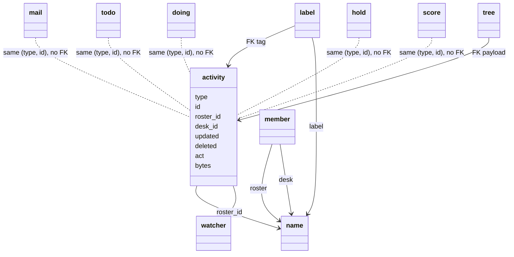

# Records

Tables in `agent_coord/server/sql/tables.sql`. Indexes: PRIMARY and UNIQUE keys are implicit; every other index is declared there and named `idx_*`. A `<x>_kind` column next to a roster, label, tree or res column pins the name kind for its FK to `name (id, type)` (0.8.0). Python: `agent_coord/server/records/` (`CALL mill_*` only).

**Roster** is the one name type for teams. id 1 = Office. id 2 = Admin. CLI argv `ROSTER` is a roster (`the-mill`, Office, ...). SQL/JSON for mail, todo, score, and activity is **`roster_id`**. `seat` has no roster (roster membership is `member`). Hold has no roster. `name.deleted` retires a name (the unique key stays). Create: desk `mill connect`, roster Admin `mill create roster`. Office host KPIs (`mill-wall.*`, `mill-desk.*` office rows, book KPIs) are score rows with `roster_id` Office and `desk_id` the Admin roster, written by `mill_score_admin_upsert` (no watcher). Admin is never looked up as a desk. Regression row F19 (score-tick-admin-roster). Rename/reclaim: [usecases.md](usecases.md) N1-N4.

`seat` is unique `desk_id` - the hash owns the name, not a pid. `doing` is what a desk is doing. `watcher` is who to poke. `mail_to` is who has mail. `member` is who belongs to a roster. `mill_invite` is door (pending until `enabled_at`).

| table | mill thing |
|---|---|
| `name` | Bare string plus a type. Types: `desk`, `roster`, `label`, `tree`, `res`. PK `id`. UNIQUE `(type, name)`. `n` is the desk count for a roster. Seeds: `(1, roster, Office)`, `(2, roster, Admin)`. A name row is not an activity. |
| `activity` | `(type, id)`. Types: `mail`, `todo`, `doing`, `hold`, `score`. `roster_id` is required, default 1 (Office). `desk_id` NULL is the office itself (0.8.0). `bytes` is the last payload UTF-8 length (mail or todo body). |
| `mail` | letter (sender `desk_id`, body, `roster_id`). No dest. |
| `mail_to` | dest `desk_id`, `opened`, `receipt`, `asked` (1 named on the letter, 0 copied: reached only as a room member on reply-all; waiting on a desk counts asked rows). No roster column. JOIN `name` for the desk name. Survives mill member-remove. |
| `member` | N-N `(name_id, desk_id)`, PK `(name_id, name_kind, desk_id)`. `name_id` is a roster. Not a label. `name.n` = desk count. |
| `todo` | One JSON `body`. The floor prints `need_id`: the need string the creator passed, kept in that JSON body (`todo.py` reads it back from the `slug` key). **`need_id` is not a name tuple** (not `(type, name)` / not `ROLE_` / `PROJ_` speech). There is no need column. `updated_id` last desk that wrote; `creator_id` mill create todo; `assigned_id` claimer; `claimed_at` when the card became claimed or its volunteer changed (NULL when not claimed; a claimed card's age in `mill connected`); `roster_id` the card's roster; `done_when` the asker's acceptance line (`cmd_card_accept`) both NULL when unset (#867). The evidence of a ship or done step is in `todo_event` (0.8.0). |
| `seat` | one desk's standing setup (#818); unique `desk_id`. Desk bearer is `token_hash`; also wake (`delivery_mode`, `endpoint_url`, `endpoint_key`, `wake_on`), `lan_ip`, `time_connect`, `time_disconnect`. Not an activity: no type column and no activity row. Roster membership is `member`. |
| `doing` | what a desk is doing (#818). Append-only: one row per entry, never overwritten; the desk's current doing is its newest row (`mill_doing_insert`, `mill_doing_put`, `mill_doing_finish`, `mill_doing_clear`). `on_type`/`on_id` is the item the entry is about; `waiting_type`/`waiting_id`/`waiting_why` is what it is blocked on (#822). Each row has an activity row of type `doing`; a seat event (connect, socket, clock-out, reset) bumps the activity row of the desk's newest entry. |
| `human` | one person. They hold the bearer. The book stores `bearer_hash`. `directory_sub` is the directory or IAM subject. |
| `human_desk` | one human, many desks. One desk, one human. |
| `human_member` | directory group mapped onto a mill roster. No row means viewer. |
| `hold` | One lock per resource, UNIQUE `(resource_id, resource_kind)`. `resource_id` is a res name. `desk_id` NULL means free. No roster column. Release nulls `desk_id`; the row stays. |
| `score` | The definition of a series: `desk_id`, `roster_id`, `kpi`, `target`, `better` (up or down), `unit`; `value`/`note` hold the latest point. UNIQUE `(roster_id, roster_kind, desk_key, kpi)`, where `desk_key` is `IFNULL(desk_id, 0)`. `desk_id` NULL means the office or the roster owns the series (0.8.0; main wrote the roster id there). |
| `score_point` | One numeric point of a score: PK `(score_id, id)`, `created`, `desk_id` (who recorded it), `value` DOUBLE, `note`. Newest N is a backward primary-key read. FK `score_id` and `desk_id` ON DELETE RESTRICT. |
| `score_evidence` | History of one score. Hour rows are `1970-01-01` at that clock hour; `taken` is the real day. Day rows are the real midnight. `value` is JSON, at most 4096 bytes. Day rows older than 30 days are removed. The 1970 hour rows stay. FK `score_id` ON DELETE RESTRICT (#95: score delete keeps the card). |
| `tree_read` | Per-desk read cursor on one tree (#155): PK `(desk_id, tree_id)`, `tree_id` is the tree's name row, `last_id` the newest activity id this desk has read on it. A mail room today. |
| `tree` | Celko nested set. Structure only. `name_id` is a tree name. Payload is an activity `(type, id)`. The first card is lft 1, rgt 2. PK `(name_id, name_kind, type, id)`. mill attach/move/prune/detach. |
| `watcher` | who to poke `(type, id, desk_id)`. Types: `todo`, `doing`, `hold`, `score`. Not used for mail. `desk_id` is a desk (FK to `seat`); `mill add` on a roster writes one row per member desk (0.8.0). A name id is not a watcher target. |
| `push_queue` | one async HINT, MAIL, or receipt per desk. Deleted when a mill sync hands it back. Rows older than 30 days are never handed back. `mill_push_expire` deletes them at wall start and then twice a day. Each desk that lost rows gets one `kind=expired` line (window start, window end, and counts for hint, mail, receipt, missed, and error; no bodies). A later window adds to that same line. The line does not age out. |
| `label` | N-N tags `(type, id, name_id)`. `name_id` is a label name. You label activities. |
| `mill_invite` | door keys |
| `mill_invite_join` | who used an invite |
| `doing` moves | 0.8.0 has no new table (the owner, 2026-10-26). `doing.act` says what a row is: `focus` or `clear` is a desk's own `--doing` (its newest one is `seat.doing_id`); any other act is a move on the item `(on_type, on_id)` by that desk: a card's status or volunteer change, a hold take or drop. `peer_id` is a move's second desk. A card's evidence is the text of its `ship` or `done` row. `activity.act` is the item's latest move, by `activity.desk_id`. The act list is in `docs/requirements/beta/BETA-CHANGES.md`. |

`updated` on `activity` moves. Each new mail, todo, doing, hold, and score row inserts its activity row with the id that table just allocated. A name write does not insert an activity row. The write chart is [../requirements/activity.md](../requirements/activity.md).

**`watcher` watches an activity** of type `todo`, `doing`, `hold`, or `score`. Hub poke is `{type, id, hint}`. Payload tables (`mail`, `mail_to`, `todo`, ...) are state. Mail does not use `watcher`. A send pushes `{kind: mail}` to each `mail_to` desk. An open with `receipt` set pushes `{kind: receipt}` to the sender. `push_queue` keeps each of those, and each watcher frame, until the next mill sync (`mill connect` or a mill command) hands them back and deletes the row. Doing is the desk's newest `doing` row (`mill_doing_put`); a watcher on that entry follows the desk to its next one (`mill_doing_insert`). A doing row's blocked-on (#822, `--waiting-on`) is three fields on that row, `waiting_type` (desk, mail, todo, hold), `waiting_id` and `waiting_why`; there is no edge, link or adjacency table, and who is blocked on a desk is a read (`mill_doing_now` part blocked). Hub rooms are `/ws/<name>`. The name table stores that desk name. Glance seeds are name objects: rosters `Office` and `Admin`.

Activity is the timeline, not a parent. Each `mail`, `todo`, `doing`, `hold`, and `score` row has one activity row with the same `(type, id)`, written in the same transaction after the payload (#216). No payload table has a foreign key to `activity`. Only `label` and `tree` keep one (`fk_label_activity`, `fk_tree_activity`). `score_point` and `score_evidence` hang off `score`. `seat`, `tree_read`, `mail_to`, `human`, `human_desk`, `human_member`, `push_queue`, `mill_invite`, and `mill_invite_join` are in the table above and have no activity row. The chart is [../requirements/activity.md](../requirements/activity.md).

`member` is live roster (desk <-> roster). `mail_to` is **snapshot at send**: a desk added to a roster later gets no rows on older letters. To bring a desk into a thread, `mill add mail:ID WHO` (`mill_mail_to_node_put`) backfills it: an unread row on that letter, opened rows on the older letters below it (#265). `label` tags activities. mill attach is tree (put under).

Session token file is `~/.mill/session/<name>.token` (`client/tokens.py`, hash on `seat.token_hash`), not the `activity` table. `protocol/presence/` is an old mill drain path (ignore).

Tests: `tests/server/records/test_records.py` (DB `mill_records_test`).
