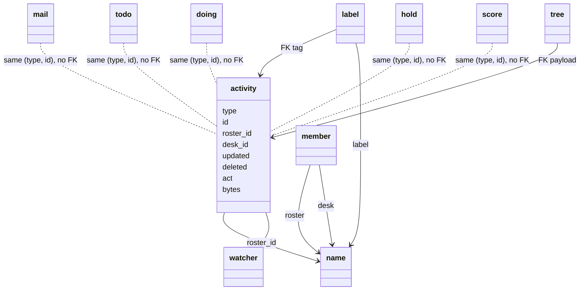

# Records

Tables in `agent_coord/server/sql/tables.sql`. Indexes: PRIMARY and UNIQUE keys are implicit; every other index is declared there and named `idx_*`. A pointer at `name` is a plain id, and a trigger requires the type (card 1163). Python: `agent_coord/server/records/` (`CALL mill_*` only).

**Roster** is the one name type for teams. id 1 = Office. id 2 = Admin. CLI argv `ROSTER` is a roster (`the-mill`, Office, ...). SQL/JSON for mail, todo, score, and activity is **`roster_id`**. `seat` has no roster (roster membership is `member`). Hold has no roster. `name.deleted` retires a name (the unique key stays). Create: desk `mill connect`, roster Admin `mill create roster`. Office host KPIs (`mill-wall.*`, `mill-desk.*` office rows, book KPIs) are score rows with `roster_id` Office and `desk_id` the Admin roster, written by `mill_score_admin_upsert` (no watcher). Admin is never looked up as a desk. Regression row F19 (score-tick-admin-roster). Rename/reclaim: [usecases.md](usecases.md) N1-N4.

`seat` is unique `desk_id` - the hash owns the name, not a pid. `doing` is what a desk is doing. `watcher` is who to poke. `mail_to` is who has mail. `member` is who belongs to a roster. `mill_invite` is door (pending until `enabled_at`).

| table | mill thing |
|---|---|
| `name` | Bare string plus a type. Types: `desk`, `roster`, `label`, `tree`, `res`. PK `id`. UNIQUE `(name)`. `n` is the desk count for a roster. Seeds: `(1, roster, Office)`, `(2, roster, Admin)`. A name row is not an activity. |
| `activity` | `(type, id)`. Types: `mail`, `todo`, `doing`, `hold`, `score`, `wake`. `roster_id` is required, default 1 (Office). `desk_id` NULL is the office itself (0.8.0). `bytes` is the last payload UTF-8 length (mail or todo body). |
| `mail` | letter (sender `desk_id`, body, `roster_id`). No dest. `body_updated`/`body_updater_id`: when and by which desk the body last changed; NULL means never edited (card 1133). |
| `mail_to` | dest `desk_id`, `opened`, `receipt` (1 when the sender passed `--receipt` on send/reply; while 1 and `opened` is unset the dest is always woken), `asked` (1 named on the letter, 0 copied: reached only as a room member on reply-all). No roster column. JOIN `name` for the desk name. Survives mill member-remove. |
| `member` | N-N `(name_id, desk_id)`, PK `(name_id, desk_id)`. `name_id` is a roster. Not a label. `name.n` = desk count. |
| `todo` | `body` is the card text; `meta` (JSON) holds the rest: `slug`, `progress`, `eta_at`, `started_at`, `aliases` (card 1133). `body_updated`/`body_updater_id`: the last write that changed the text, NULL when never edited. Readers get one document, `MILL_TODO_DOC(body, meta)`. The floor prints `need_id`: the need string the creator passed, kept in `meta` (`todo.py` reads it back from the `slug` key). **`need_id` is not a name tuple** (not `(type, name)` / not `ROLE_` / `PROJ_` speech). There is no need column. `updated_id` last desk that wrote; `creator_id` mill create todo; `assigned_id` claimer; `claimed_at` when the card became claimed or its volunteer changed (NULL when not claimed; a claimed card's age in `mill connected`); `roster_id` the card's roster; `done_when` the asker's acceptance line (`cmd_card_accept`) both NULL when unset (#867). The evidence of a ship or done step is in `todo_event` (0.8.0). |
| `seat` | one desk's standing setup (#818); unique `desk_id`. Desk bearer is `token_hash`; also wake (`delivery_mode`, `endpoint_url`, `endpoint_key`, `wake_on`), `lan_ip`, `time_connect`, `time_disconnect`. Not an activity: no type column and no activity row. Roster membership is `member`. |
| `doing` | one `tw` run (card 1207): `type`, `id`, `created`, `desk_id`, `roster_id`, `text`. Written only by `mill_doing_task` (tw); a desk may have many live at once. A run's state is its newest `transition` row (tw_start, tw_wait, tw_resume, tw_finished, tw_failed, tw_stale, clear); it is live until finished, failed, stale or cleared. No seat pointer, no item link, no blocked-on columns. |
| `human` | one person. They hold the bearer. The book stores `bearer_hash`. `directory_sub` is the directory or IAM subject. |
| `human_desk` | one human, many desks. One desk, one human. |
| `human_member` | directory group mapped onto a mill roster. No row means viewer. |
| `hold` | One lock per resource, UNIQUE `(resource_id)`. `resource_id` is a res name. `desk_id` NULL means free. No roster column. Release nulls `desk_id`; the row stays. |
| `score` | One desk and one `kpi`. The row is an activity: primary key `(type, id)`, unique `id`. `desk_id` is required. Unique `(desk_id, kpi)`. `meta` is JSON markup (`target`, `better`, `unit`) and is not searched. The latest number and remark are the newest `score_point`. |
| `score_point` | One numeric point of a score: PK `(score_id, id)`, `created`, `desk_id` (who recorded it), `value` DOUBLE, `note`. Newest N is a backward primary-key read. FK `score_id` and `desk_id` ON DELETE RESTRICT. |
| `score_view` | One row per score per viewer desk (card 1212, card 1214): `score_id`, `viewer_id`, `n`, `last_seen`. `score_id` references `score`. `viewer_id` is the desk that opened it. A wall read does not write it. No hint and no wake. |
| `score_evidence` | History of one score. Hour rows are `1970-01-01` at that clock hour; `taken` is the real day. Day rows are the real midnight. `value` is JSON, at most 4096 bytes. Day rows older than 30 days are removed. The 1970 hour rows stay. FK `score_id` ON DELETE RESTRICT (#95: score delete keeps the card). |
| `tree_read` | Per-desk read cursor on one tree (#155): PK `(desk_id, tree_id)`, `tree_id` is the tree's name row, `last_id` the newest activity id this desk has read on it. A mail room today. |
| `tree` | Celko nested set. Structure only. `name_id` is a tree name. Payload is an activity `(type, id)`. The first card is lft 1, rgt 2. PK `(name_id, type, id)`. mill attach/move/prune/detach. |
| `watcher` | who to poke `(type, id, desk_id)`. Types: `todo`, `doing`, `hold`, `score`, `wake`. Not used for mail. `desk_id` is a desk (FK to `seat`); `mill add` on a roster writes one row per member desk (0.8.0). A name id is not a watcher target. |
| `wake` | activity kind table (former `push_queue`): one async hint, mail, or receipt per desk. Hand-back marks `state=taken` (no delete) and writes a `transition`. Untaken rows older than 7 days roll into one `cause=expired` marker per desk via `mill_push_expire`. |
| `transition` | one row per state change of one activity (`from_state`/`to_state`/`reason` text; enums in code). |
| `transition_edge` | allowed `(activity_type, from_state, to_state, reason)` seed for `mill_transition_put`. |
| `activity_history` | the old text of a letter or card body, one row per replace (`mill_body_replace`, card 1133): `type` (`mail` or `todo`), `activity_id`, `old_body` (full text, never a diff), `old_updated` and `old_updater_id` (when and by whom that text was written), `replaced_at`, `replaced_by`. UNIQUE `(type, activity_id, old_updated)`. FK `(type, activity_id)` to `activity` ON DELETE CASCADE. `mill_body_history` lists the old texts newest first; pass order `oldest` for the first text first (any other order refuses `body:order`). A replace whose text is the same as the current text writes nothing and refuses `body:unchanged`: replace did nothing because the text is the same. |
| `label` | N-N tags `(type, id, name_id)`. `name_id` is a label name. You label activities. |
| `mill_invite` | door keys |
| `mill_invite_join` | who used an invite |
| card and hold moves | Card 1207: moves are `transition` rows on the item (`activity_type`, `activity_id`, `reason`, `desk_id`), not doing rows. A card's evidence rides its `ship` or `done` transition. `activity.act` is the item's latest move, by `activity.desk_id`. |

`updated` on `activity` moves. Each new mail, todo, doing, hold, and score row inserts its activity row with the id that table just allocated. A name write does not insert an activity row. The write chart is [../requirements/activity.md](../requirements/activity.md).

**`watcher` watches an activity** of type `todo`, `doing`, `hold`, `score`, or `wake`. Hub poke is `{type, id, hint}`. Payload tables (`mail`, `mail_to`, `todo`, ...) are state. Mail does not use `watcher`. A send pushes `{kind: mail}` to each `mail_to` desk. An open with `receipt` set pushes `{kind: receipt}` to the sender (receipts never ring a webhook). `wake` keeps each of those, and each watcher frame, until the next mill sync (`mill connect` or a mill command) hands them back (marks taken; row stays). A `doing` row is one tw run, written only by `mill_doing_task` (card 1207); its state is its transition rows, and a desk's live doings are the runs with no ending transition (`mill_doing_now`). There is no blocked-on field. Hub rooms are `/ws/<name>`. The name table stores that desk name. Glance seeds are name objects: rosters `Office` and `Admin`.

Activity is the timeline, not a parent. Each `mail`, `todo`, `doing`, `hold`, `score`, and `wake` row has one activity row with the same `(type, id)`, written in the same transaction after the payload (#216). No payload table has a foreign key to `activity`. Only `label` and `tree` keep one (`fk_label_activity`, `fk_tree_activity`). `score_point` and `score_evidence` hang off `score`. `seat`, `tree_read`, `mail_to`, `human`, `human_desk`, `human_member`, `transition`, `transition_edge`, `mill_invite`, and `mill_invite_join` are in the table above and have no activity row of their own (`wake` does). The chart is [../requirements/activity.md](../requirements/activity.md).

`member` is live roster (desk <-> roster). `mail_to` is **snapshot at send**: a desk added to a roster later gets no rows on older letters. To bring a desk into a thread, `mill add mail:ID WHO` (`mill_mail_to_node_put`) backfills it: an unread row on that letter, opened rows on the older letters below it (#265). `label` tags activities. mill attach is tree (put under).

Session token file is `~/.mill/session/<name>.token` (`client/tokens.py`, hash on `seat.token_hash`), not the `activity` table. `protocol/presence/` is an old mill drain path (ignore).

Tests: `tests/server/records/test_records.py` (DB `mill_records_test`).
