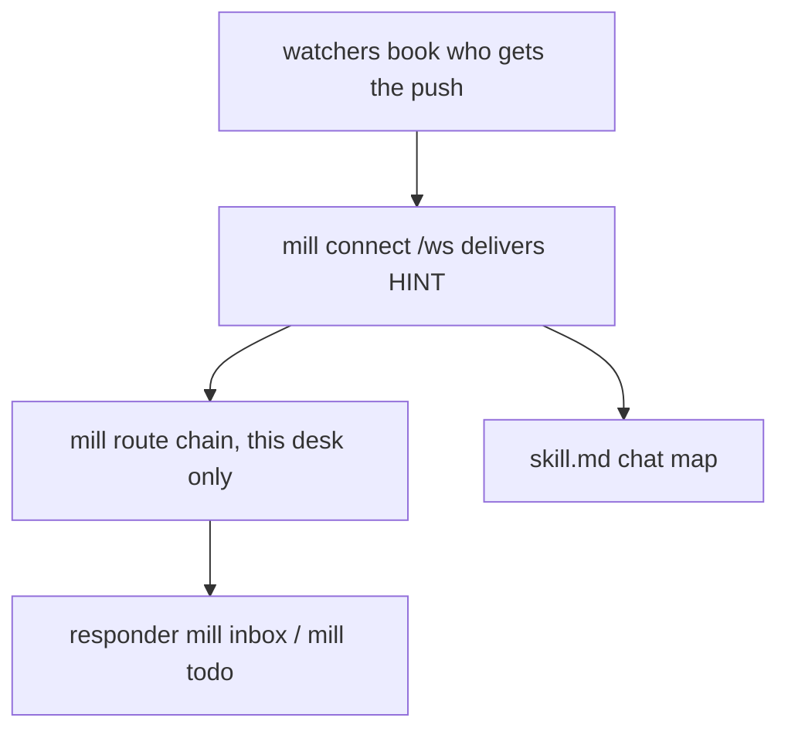

# mill route - this desk's redirector chain

**Local chain:** `mill route add`, `mill route rm`, and `mill route list` are the only arm. The list is a chain of redirectors, called in order. The first one that handles the frame stops the chain. Do not invent a second arm command. There is no `mill use`.

The chain is per desk. It lives on the PC where that desk sits `mill connect`. A frame is walked against the desk that received it. Another desk's list is never called. The hub stays a sender: it has no chain and stores no handlers.

skill.md is the **chat** HINT map (this TUI: MAIL -> mill inbox). This file is the **other** layer: mill connect on `/ws` delivers a frame; **mill route** (optional) walks this desk's redirectors. When none of them handles the frame, mill connect pokes this desk's vendor.

PING is never routed.

```python
route_key = f"{event.get('type')}:{event.get('hint')}"   # watcher frame
route_key = "mail:MAIL"                                    # a letter {kind: mail}
```

## Layers



| | mill connect | mill route | skill.md |
|---|---|---|---|
| Job | `/ws` + **default spawn agent** | walk this desk's redirectors in order | chat HINT -> mill command |
| When | every redirector said not-mine, or no entry matched | agent added a route | human/TUI turn |
| Lives | process `--vendor` | this desk's file on this PC, not the book | mill-desk skill |
| Config | `mill connect [roster] DESK [--vendor V] [--session S]` | agent: add/rm routes, program paths | recopy after mill update |

**Default spawn** (nothing handled): vendor poke - `grok -p -r`, `claude -p`, grok-bot POST, or stamp `DESK_*.wake.jsonl`. That wakes an agent. skill.md is that agent's chat map.

## Hit

Entries that match the frame are walked in list order: the frame's own key and `*`, each where it was added. Other keys are skipped.

| Redirector result | Chain |
|---|---|
| exit 0, last stdout line `not-mine` | next redirector |
| exit 0, anything else | handled. Stop. No vendor poke |
| empty value (`mill route add KEY --`) | suppress. Stop. No vendor poke |
| non-zero exit | not handled. Next redirector. One `hint` line `{route, id, exit}` (outcome `error`, no body) lands in this desk's next sync |

- The vendor poke runs only if every matching redirector returned `not-mine`, or no entry matched. A non-zero exit is not `not-mine`, so it also keeps the vendor quiet.
- PING never enters the chain.
- A frame whose idempotency key (`idem`) this sit already handled never enters the chain. The check runs before the first redirector.
- A DOING with no route stays skip, not a poke.
- The webhook POST uses the same walk for that desk, with the same key check. A receiver that runs mill passes the POST body to `accept_wake`. That checks the poke key (`idem` must be the one the wall stamps for this desk and frame; a forged key or another desk's key is skipped), then walks the chain. A webhook desk's missed and held-back hints reach the chain when it connects: the sync rows that were `missed` walk the same chain, and a hint no route takes stays on the sync line with no vendor poke ([connect.md](connect.md#webhook-wake)).

## Two chain styles

The agent picks. Both are "agent specifies where programs live." mill stores argv/path, not source.

**One program (case inside)**

```
mill route add "*" -- python C:\work\desk.py
```

Every non-PING frame goes to that exe. The program reads the frame JSON and switches on the route key. mill does not know the cases. Print `not-mine` as the last line for a frame it leaves to the vendor.

**Chain (several redirectors)**

```
mill route add todo:TODO -- python C:\work\on_todo.py
mill route add mail:MAIL -- python C:\work\on_mail.py
mill route add "*" -- python C:\work\desk.py
```

A TODO frame walks `on_todo.py`, then `desk.py` if the first said `not-mine`. A letter walks `on_mail.py`, then `desk.py`. Order is the order of add. `*` is a normal entry and sits where it was added; it is not moved to the end. Adding a key that is already in the list replaces that entry and keeps its place.

A watcher frame's key is `type:hint` (`todo:TODO`, `doing:DOING`, `hold:HOLD`, `score:SCORE`). A letter is `{kind: mail}` with no `type` or `hint`; its key is `mail:MAIL`. Mail is not a watcher type. Nothing emits `name:NAME`. There is no name watcher and no mail watcher (`mill add mail:ID` changes recipients).

No matching entry -> mill connect default spawn. Empty value on a key -> suppress for that frame (not even default).

stdin: one JSON object, the frame. mill connect waits for each redirector's exit before it tries the next. The hub does not wait. A redirector does not call a model; it decides and exits.

## Watchers vs mill route

Watchers are already the book: write -> `watcher` -> Hub `{type,id,hint}` to mill connect. The agent figures **what to watch**. mill route figures **what to run on this machine** when that HINT arrives.

Agent order of work:

1. Watchers - which mail/todo/tree this desk should get.
2. mill route - `*` or per-HINT, with paths they chose.
3. Write the responders those paths name.

## Is the HINT enough?

HINT is enough to **dispatch**, not always enough to **do the job**. Hub is dumb. A watcher frame is `{type, id, hint, detail?}` (`hint` = `activity.type` uppercased; `detail` = `watcher.hint` or cheap default - [hints.md](hints.md)). A letter is `{kind: mail, id, idem, desk}` with no `type` or `hint`; the route key is `mail:MAIL`. mill connect may stamp `desk`. Full mail/todo bodies are **not** on the frame. skill.md: match `type:hint`; prefer `detail` when present; else mill-fetch.

| HINT | Enough to know | Still mill-fetch |
| :--- | :--- | :--- |
| `heartbeat:PING` | ignore | nothing |
| `doing:DOING` | ignore | nothing |
| `{kind: mail}` id=N | a letter arrived. No `type` or `hint` | `mill inbox` or `mill mail-thread` |
| `todo:TODO` id=N | a card moved | `mill todo` that card |
| `hold:HOLD` id=N | a lock | `mill hold` / don't write |
| `score:SCORE` | a row in the score table (`kpi`, `value`, `target`) | glance / `mill score` |

`id` is a handle into the book. A tree attach pokes ancestors with the payload type, so `id` is the child. Inbox / one card is the safe read.

A redirector gets the same doorbell. `*` can case on the route key. A per-key exe is already the case. Then it runs mill commands. If the program expects the push to contain the letter, it will starve. mill will not put the letter on the HINT. Do not grow the frame.

## mill route CLI

Local to this mill connect PC. Not mill-wall. Not a book command. Not skill.md. The desk is the sitting `mill connect`. Desk commands run in that same parent shell (the line `mill join` prints). `mill route` waits for a connect started just before in that shell, like the other desk commands. Everything after the key is the program. A flag after the key becomes part of the program argv.

```
bash -c 'mill connect DESK >/dev/null 2>&1 & trap "kill $!" EXIT; mill route list'
bash -c 'mill connect DESK >/dev/null 2>&1 & trap "kill $!" EXIT; mill route add mail:MAIL -- python path/to/on_mail.py'
bash -c 'mill connect DESK >/dev/null 2>&1 & trap "kill $!" EXIT; mill route add "*" -- python path/to/desk.py'
bash -c 'mill connect DESK >/dev/null 2>&1 & trap "kill $!" EXIT; mill route rm mail:MAIL'
```

- `add KEY -- PROGRAM` appends KEY. `add KEY --` with no program stores an empty value, which suppresses.
- `list` prints this desk's chain in order, one line each: the key, then the program or `suppress`.
- `rm KEY` removes that one key. A missing key is an error and does not clear the list. Other desks are not touched.

Durable chain: `~/.mill/session/<desk>.route` (`key = value` lines, file order is chain order). mill connect re-reads it on every frame. No mill connect restart.

mill connect has no catch-all flag. A catch-all is the route key `*`: `mill route add "*" -- <program>` (quote `*` so the shell does not expand it). mill route is the chain agents mutate.


## Template

Copy [route-template.py](route-template.py). Point a route at it from the connect shell:

```
bash -c 'mill connect DESK >/dev/null 2>&1 & trap "kill $!" EXIT; mill route add mail:MAIL -- python docs/protocol/route-template.py'
bash -c 'mill connect DESK >/dev/null 2>&1 & trap "kill $!" EXIT; mill route add "*" -- python docs/protocol/route-template.py'
```

stdin = the frame JSON. The template handles MAIL and TODO with `mill inbox` / `mill todo` (or `python -m agent_coord` if `mill` missing), prints `not-mine` for anything else, and exits non-zero when its command fails. Agents may replace the body; keep the three exits.

## Which HINTs reach this desk

Two layers decide it:

1. **`mill watch TYPE ID`** adds a `watcher` row in the book, so the hub pushes a HINT to you when that activity changes. `mill unwatch TYPE ID` removes it. TYPE is `todo`, `hold`, `score` or `doing`; a todo can also be named `ROSTER/NEED`. `--hint` sets this row's recipe ([hints.md](hints.md)).
2. **The HINT filter file** `~/.mill/<host>/<desk>/want` (`~/.mill/session/<desk>.want` when no office host is selected) is a local list of route keys that mill connect acts on, one `KEY =` per line:

```
mail:MAIL =
todo:TODO =
* =
```

A missing or empty file means every frame is acted on (the default). A non-empty file means only the listed keys are (`*` = any). A `{kind: mail}` frame matches `mail:MAIL` and `*`. Nothing emits `name:NAME`. Frames that are filtered out are still appended to `*.hints.jsonl` but do not spawn. There is no command for this file; edit it by hand.

