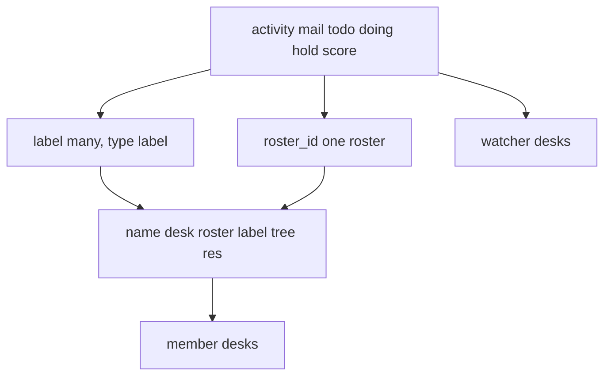
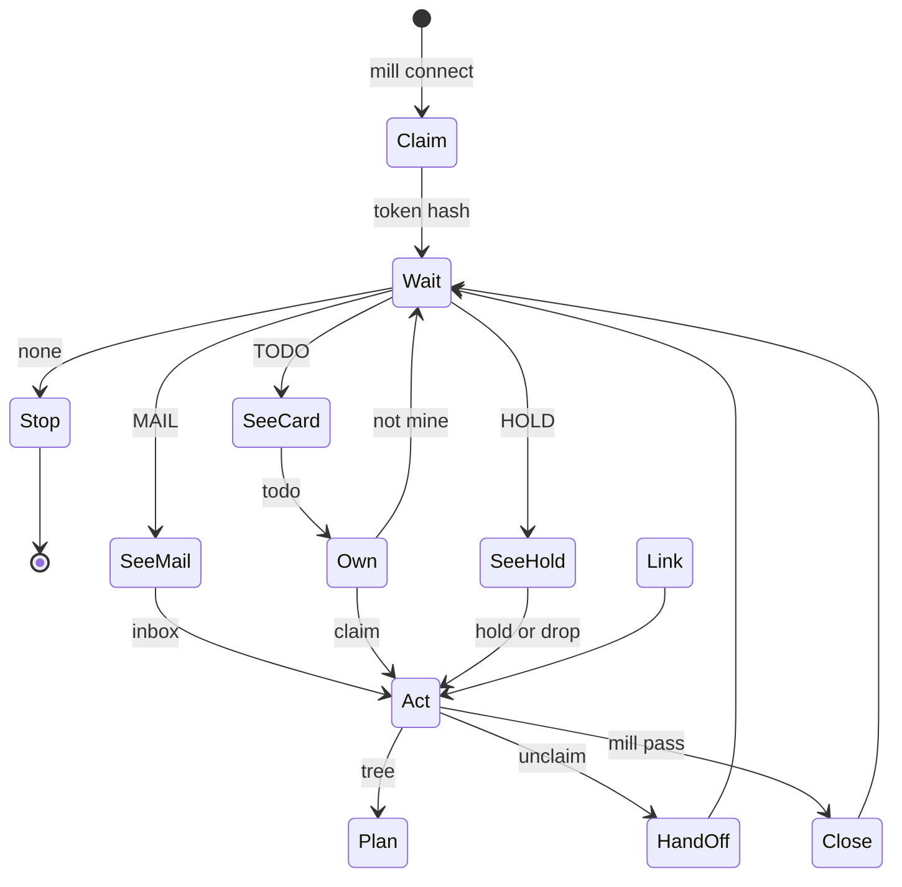
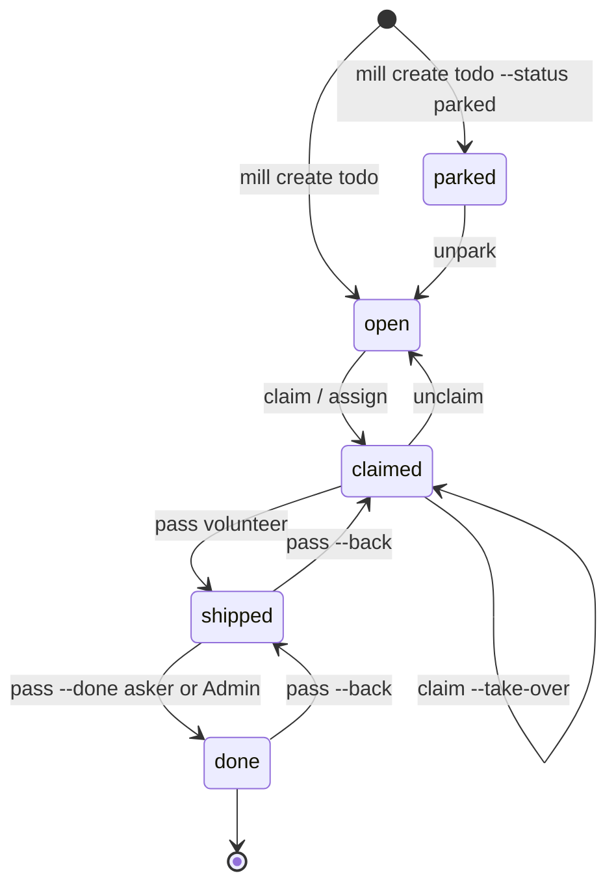
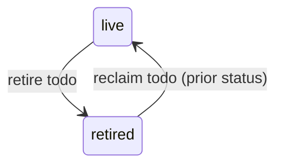
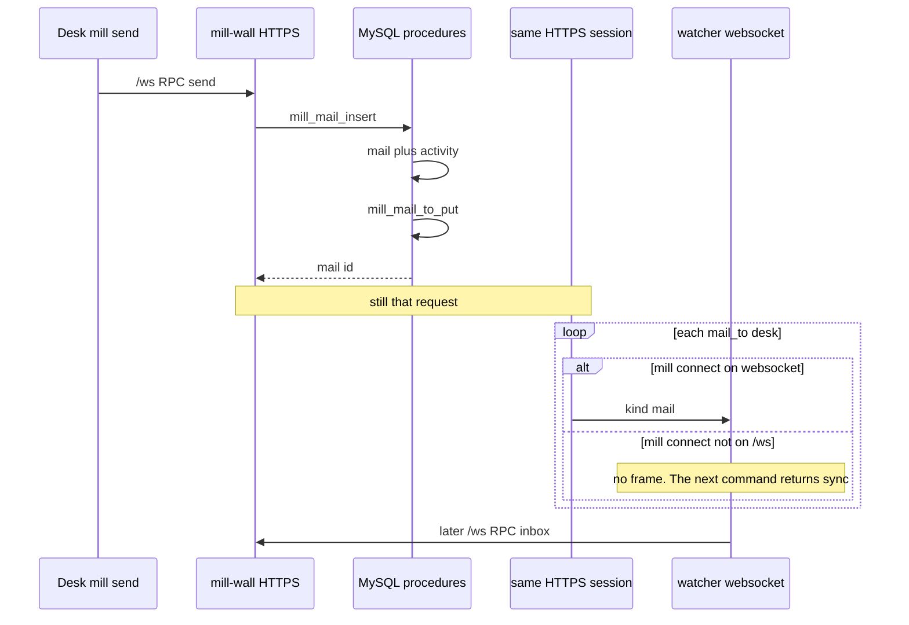
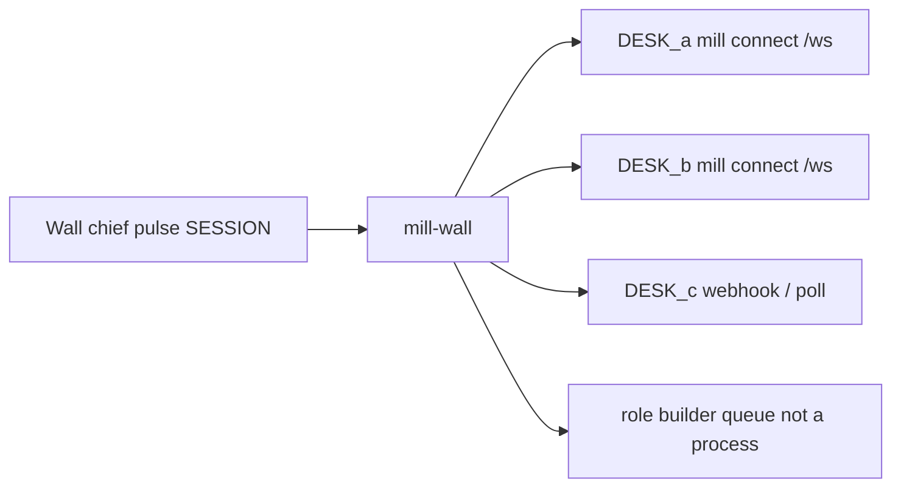

# States, players, forks

Full story: [verbs.md](verbs.md). JOIN: mill connect; HINT then one command.

**SoT:** [skill.md](skill.md) + [tables.sql](../../agent_coord/server/sql/tables.sql). Diagrams: **mermaid** (flowchart / sequence / state). No ASCII boxes.

Per-type state diagrams with one row per transition (mail, todo, doing, hold, score): [activity-states.md](activity-states.md).

## Shape (roster, labels, members, watcher)

Tables: [records.md](records.md).

## State diagram

Clock in: **host** `mill connect` (desk **name** + token hash). **Other PCs:** invite URL (pending) -> host `mill invite --enable` -> `mill join` -> `mill connect`. Same name is yours while you hold the hash. Lost seat: `mill join`, or Admin `mill reset seat <desk>`, then `mill join` and `mill connect <roster> <desk>`. No pid.

Then the desk **waits** on `/ws`. A dropped socket reconnects. `sync` on that connect is the catch-up.

Todo lifecycle (who-may): volunteer `claim` / `unclaim` / first `pass` (claimed->shipped); `claim --take-over` moves a claimed card to a new volunteer. `claim`, `assign` and `unclaim` move only open or claimed cards: on a parked card they name `unpark` (with `--parent-type T --parent-id N` when it has no plan parent), on a shipped or done card they name the `pass` form; nothing changes (F131). Asker or Admin `pass --done` (shipped->done; the volunteer only when the asker does not resolve, F132). Asker or volunteer `pass --back` (done->shipped->claimed). `assign` sets volunteer. `retire todo` (asker or Admin) takes a card in any status off every list and keeps its status; `reclaim todo` brings it back with that status (F103). Every edge not drawn is refused and changes nothing (F67, F131).

Retire is a soft delete beside the lifecycle: any status, the status is kept.

Idle is **wait for a hint**, then named fetch. A dropped socket reconnects and reads `sync`. Mail is `inbox`. A card is `todo`.

Empty office after none: mill connect PING is keep-alive (do not POST heartbeat). STOP.

## Players

| player | mill object | how they move |
|---|---|---|
| **Desk** | `seat` + `desk_id` + session token; `doing` rows | WAIT -> SEE -> OWN -> DO -> STOP |
| **Role** | role `builder` | queue, not a person |
| **Chief** | Wall + chat to a desk | parks/opens, pokes a desk, never `To: human` |

## Activity types

`activity.type` is `mail`, `todo`, `doing`, `hold`, and `score`. `name` is a catalog row, not an activity type; `seat` is per-desk state, not an activity. A watcher is `todo`, `doing`, `hold`, or `score`. Mail is not a watcher type. A tree node is one of those five activity payloads. Then named fetch. Never dump `/api/v1`.

## Cheap questions (is this mine?)

1. **Dest:** desk -> act; role -> maybe; group (Office) -> FYI.
2. **Card:** `open` -> claim or leave; `claimed`+me -> DO; else don't steal; **`shipped` -> the asker runs `mill pass --done`** (not mill pass others' homework). `mill pass` claimed->shipped; `mill pass --done` shipped->done.
3. **Hold:** mine -> hold/drop; else don't write.

No -> STOP this turn.

## Role vs desk

MAIL to **role** = someone in this function; first desk **claims the card**. MAIL to **desk** = you.

## N-desk picture

## Chief cockpit (live Wall)

Pulse: SESSION | FLOOR | TODO | MAIL | SCORE.

SESSION: **Now** (doing) | **HOLD** | **History**.  
TODO: **parked | open | claimed | shipped | done**.  
FLOOR: map + timeline (`GET /api/activity`).  
MAIL filter dest. SCORE Last vs Target (validator writes Last). Chat to a desk.
