# Activity - requirements

Activity is the record of agent work a person can report on after the detail is gone. The five types are the `activity.type` enum: **mail**, **todo**, **doing**, **hold**, **score**. Primary work is hold, todo, and mail. Doing and score are the meta records. Seat, label, tree, watcher, member, `mail_to`, `push_queue`, and `name` are not activity rows.

Primary key is `(type, id)`. Both columns stay filled. Mail 5 and todo 5 are two rows. `todo`, `doing`, `hold`, and `score` each allocate `id` with `AUTO_INCREMENT`. The activity row uses that same id. Activity itself has no counter. Mail and todo work the same way: `mill_mail_insert` and `mill_todo_insert` insert the payload, read `LAST_INSERT_ID()`, then write the activity row, in one transaction. Activity is the timeline, not a parent: no payload table has a foreign key to it, and no writer turns foreign key checks off. A failed activity write rolls the payload back. `label` and `tree` keep their foreign keys to activity. A soft-deleted letter keeps its activity row, and the `mail` counter never goes back, so a mail id is not reused. `name` allocates its own `id`. That id is not an activity id. `name.n` is the desk count for a project or a role.

`mill_activity_put` inserts the row with `n=1`, or updates that same row and sets `n=n+1`. A null byte length keeps the previous length.

A desk's pulse is `seat.updated`. A desk's current doing is its newest `doing` row; doing rows are append-only. Columns and procedures are in [records.md](../protocol/records.md).

```mermaid
stateDiagram-v2
  [*] --> Live: insert detail and activity (n=1)
  Live --> Live: later write (n grows)
  Live --> Remembered: soft-delete mail, todo, or score (activity.deleted stamped)
  Remembered --> Remembered: detail is gone; the activity row keeps this id
  Remembered --> Gone: delete the activity row (refused while a tree row points at it)
```

No payload key guards the activity row (#216). Deleting it is refused while a tree row points at it (`fk_tree_activity`); the payload row is not checked. Labels on it go (`fk_label_activity` CASCADE) and watchers go (`activity_del_watchers`). Retire sets `name.deleted` and leaves the name row.

`activity.roster_id` is required. Default is 1 (Office). `ON DELETE RESTRICT`. It is the shortcut that finds activities by project or role. `mail.roster_id`, `todo.roster_id`, `doing.roster_id`, and `score.roster_id` are required (NOT NULL, `ON DELETE RESTRICT`, like every mill key to `name`). Hold has no roster column: hold activity roster is Office (1). A score is unique on `(roster_id, desk_id, kpi)`. One hold row per `resource_id`. `hold.desk_id` NULL means free. Opening a letter stamps `mail_to.opened` and sets `activity.updated`. Desk, roster, weight, `n`, and bytes stay.

`mill_name_delete` sets `name.deleted` and leaves the name row. Retire does not fire these keys. Reclaim clears `deleted` on the same id.

Law: `agent_coord/server/sql/tables.sql` and the procedures. What each command writes is in the procedures; this page keeps only the delete and id rules.

## Delete the activity row

| What is deleted | What else goes |
|---|---|
| activity `mail` / `todo` / `doing` / `hold` / `score` | no payload FK (#216), so the detail row does not guard it; refused only while a tree row points at it (`fk_tree_activity`). On delete: labels on that activity go, watchers go (mail has none) |
| a `tree` row still cites the activity | the activity delete is refused until the plan node is gone |
| card delete (mail/todo/doing/score) while a `tree` row cites that `(type, id)` | a direct DELETE is refused by BEFORE DELETE `*_no_delete_in_tree`. `mill_mail_delete`, `mill_todo_delete`, and `mill_score_delete` take the card off every plan first (`mill_tree_detach`, one `mill_tree_remove` per plan inside the delete transaction), so they do not hit the guard |
| a `hold` row (direct DELETE) | always refused by BEFORE DELETE `hold_no_delete`; release is `mill_hold_delete` (NULL desk_id). FK cascades do not fire triggers |
| a `score` row, or its activity, while `score_evidence` rows exist | refused (`fk_score_evidence_score` ON DELETE RESTRICT) |
| a `name` row | always refused by BEFORE DELETE `name_no_delete`; retire stamps `name.deleted`. Every mill key to `name` is ON DELETE RESTRICT as well. The `human_desk` / `human_member` keys to `name` are unchanged for now (human-table redo) |

No product procedure deletes an activity row. The rules above are what a direct delete does. Tests cover them.

## Ids

| Rule | Behavior |
|---|---|
| next id | `AUTO_INCREMENT` on that detail table, mail included. The activity row copies it |
| after a detail delete | the activity row keeps its id |
| diary restore | historical todo ids are inserted explicitly |

An Admin retention sweep that would later drop a remembered activity row is not in this book. A live detail keeps its activity row.
