```mermaid
stateDiagram-v2
  [*] --> Live: insert detail and activity (n=1)
  Live --> Live: later write (n grows)
  Live --> Remembered: soft-delete mail, todo, or score (activity.deleted stamped)
  Remembered --> Remembered: detail is gone; the activity row keeps this id
  Remembered --> Gone: delete the activity row (refused while a tree row points at it)
```

# Activity - requirements

Activity is the record of agent work a person can report on after the detail is gone. The five types are the `activity.type` enum: **mail**, **todo**, **join**, **hold**, **score**. Primary work is hold, todo, and mail. Join and score are the meta records. Label, tree, watcher, member, `mail_to`, `push_queue`, and `name` are not activity rows.

Per-type state diagrams with one row per transition: [activity-states.md](../protocol/activity-states.md).

Primary key is `(type, id)`. Both columns stay filled. Mail 5 and todo 5 are two rows. `todo`, `join`, `hold`, and `score` each allocate `id` with `AUTO_INCREMENT`. The activity row uses that same id. Activity itself has no counter. Mail and todo work the same way: `mill_mail_insert` and `mill_todo_insert` insert the payload, read `LAST_INSERT_ID()`, then write the activity row, in one transaction. Activity is the timeline, not a parent: no payload table has a foreign key to it, and no writer turns foreign key checks off. A failed activity write rolls the payload back. `label` and `tree` keep their foreign keys to activity. A soft-deleted letter keeps its activity row, and the `mail` counter never goes back, so a mail id is not reused. `name` allocates its own `id`. That id is not an activity id. `name.n` is the desk count for a project or a role.

`mill_activity_put` inserts the row with `n=1`, or updates that same row and sets `n=n+1`. A null byte length keeps the previous length.

A desk's pulse on the seat is `join.updated`. **Bump** means `join.updated = now()`. The column is `ON UPDATE CURRENT_TIMESTAMP`, so any write to that `join` row bumps it. `mill_join_doing` sets it in the same statement as `doing`. Hub PING is a socket frame (`type=heartbeat`, `hint=PING`) and leaves the book unchanged. Session and the floor share one threshold: a desk is alive while that time is at most 15 minutes old. A missing time is stale. A later write makes the desk alive again.

`join.doing` is a stack, newest on top, separated by ` | `. A `\` or `|` inside an entry is escaped (`\\`, `\|`), so that character is text and not the separator. The column is `VARCHAR(512)`. A push that does not fit drops the oldest entries. One entry that is still too long is cut so the escaped text fits. Only the desk writes it: an agent `doing` pushes that text, and drops an older copy of the same text and the join placeholders (`present`, `invited`). `todo`, `session`, `mail-thread`, `trail`, `member`, `trust`, `invite`, `move`, `prune`, `detach`, `label-remove`, `add`, and `remove` write nothing else, so each bumps the seat and leaves the text alone (#635); that bump also drops command names an older wall pushed. Both writes bump `join.updated`. The same call also moves the join activity row (`activity.updated = now()`, `n` grows).

No payload key guards the activity row (#216). Deleting it is refused while a tree row points at it (`fk_tree_activity`); the payload row is not checked. Labels on it go (`fk_label_activity` CASCADE) and watchers go (`activity_del_watchers`). Join clock-out stays on `Live`: the detail row remains. Retire sets `name.deleted` and leaves the name row.

`activity.roster_id` is required. Default is 1 (Office). `ON DELETE RESTRICT`. It is the shortcut that finds activities by project or role. `mail.roster_id`, `todo.roster_id`, and `score.roster_id` are required (NOT NULL, no default, so a missed insert fails; `ON DELETE RESTRICT`, like every mill key to `name`). Join and hold have no roster column. Office on those rows is `activity.roster_id`, default 1. A score is unique on `(roster_id, desk_id, kpi)`. Hold has no roster column. One row per `resource_id`. `hold.desk_id` NULL means free. Hold activity roster is Office (1). Opening a letter stamps `mail_to.opened` and sets `activity.updated`. Desk, roster, weight, `n`, and bytes stay.

`mill_name_delete` sets `name.deleted` and leaves the name row. Retire does not fire these keys. Reclaim clears `deleted` on the same id.

Law: `agent_coord/server/sql/tables.sql` and the procedures. This chart is that book.

The hour and day measure is a second record. `mill_score_event` counts the command on that desk's current hour and rolls the same addition into today's midnight. Details are in the profiler under Product instrumentation. This chart stays the map of which activity row moves.

## Commands

Wall commands and what each one writes. **Bump** means `join.updated = now()`. A doing-stack push does that. `mill connect` is not a command. The socket open writes `time_connect`, so the seat bumps. `mill_join_connect` itself leaves the `join` row alone, so it does not bump. It does move the join activity row.

| Command | Detail | `join.updated` | Activity row |
|---|---|---|---|
| `todo` | list cards | bump. Push `todo` | join `n` grows |
| `session` | list seats | bump. Push `session` | join `n` grows |
| `mail-thread` | read one thread | bump. Push `mail-thread` | join `n` grows |
| `member` | list this desk's groups | bump. Push `member` | join `n` grows |
| `trust` | office trust in the wall config | bump. Push `trust` | join `n` grows |
| `invite` | door keys, LAN bind, invite board | bump. Push `invite` | join `n` grows |
| `move` | plan node moves | bump. Push `move` | join `n` grows. That node's own activity stays |
| `prune` | plan branch removed | bump. Push `prune` | join `n` grows. The nodes' own activity stays |
| `detach` | node leaves the plan | bump. Push `detach` | join `n` grows. That node's own activity stays |
| `label-remove` | label row removed | bump. Push `label-remove` | join `n` grows. The tagged activity stays |
| `add` / `remove` | watcher row, or recipients on a letter and below | bump. Push `add` / `remove` | join `n` grows. The target activity stays |
| `doing` | agent text pushed on the stack | bump | join `n` grows |
| `inbox` | unread letters marked opened | stays | mail `updated` moves when a letter is marked. `n`, desk, roster, and bytes stay |
| `open` | new card | stays | todo inserted, `n=1` |
| `claim`, `assign`, `note`, `pass`, `unclaim` | card status, body, assignee | stays | todo `n` grows |
| `unpark` | card set open; may attach it | stays | todo `n` grows. A plan born by that attach also moves the parent activity |
| `send`, `reply` | new letter | stays | mail inserted, `n=1`. A new dest is a name row |
| `hold` | first take, or a free row taken | stays | hold inserted (`n=1`) or `desk_id` set (`n` grows). Same desk again: `ok=0`, `n` stays. Another desk: `ok=0`, hold activity stays. The resource is a res name |
| `drop` | owner releases | stays | `desk_id` set NULL; the row stays; hold activity `n` grows |
| `score` | kpi written | stays | score inserted or `n` grows |
| `attach` | tree row | stays | parent activity moves only when this attach creates the plan. The plan is a tree name |
| `label-add` | label row | stays | tagged activity stays. A new label is a name of type `label` |
| `member-add` | member row; `name.n` grows | stays | no activity row |
| `member-remove` | member row removed; `name.n` shrinks | stays | no activity row. Leaving Office is refused |
| `join` | seat written. `doing` replaced with the request text, or `present` | bump | join `n` grows. A new project or role membership increments that name's `name.n`. Office membership increments Office `name.n` |
| `invite-seat` | seat written. `doing` replaced with the request text, or `invited` | bump | join `n` grows. Office membership increments Office `name.n` |
| `reset` | token cleared and `doing` cleared | bump | join `n` grows |
| `group`, `role`, `label` | name created, or an existing name named again | stays | no activity row. No watcher row |
| `rename`, `retire`, `reclaim` | same id; the name, `deleted`, or `deleted` cleared | stays | no activity row. Office and Admin stay on retire |

Aliases arrive as the command in the left column: `agents` is `session`, `thread` is `send`, `yield` is `unclaim`, `ask` is `open`, `here` / `presence` / `register` are `join`, `kpi` is `score`, `acquire` is `hold`, `release` is `drop`.

## Writes

| Type | Use | Detail | Activity |
|---|---|---|---|
| mail | send | new letter; id picked by `mill_mail_insert` (see Ids); roster is a project, else a role | letter inserted first, then `LAST_INSERT_ID()`, then the activity row, in one transaction: `n=1`, desk = sender, roster = that project or role, bytes = body length. Foreign key checks are off only around that letter and activity pair; a failed activity write rolls the letter back |
| mail | edit body | body rewritten when a body is passed | `n` grows; desk = editor; bytes follow the new body. `join.updated` stays |
| mail | open | letter unchanged; `mail_to.opened` stamped for that desk | `updated` moves when a recipient row changed. `n`, desk, roster, and bytes stay. `join.updated` stays |
| mail | delete | off every plan first (`mill_tree_detach`: children move up to the parent, as `mill_tree_remove`); queued pushes dropped; letter removed; its `mail_to` rows go with it | row kept; `activity.deleted` and `updated` stamped; desk_id, roster_id, `n`, and bytes stay (no `mill_activity_put`). `join.updated` stays |
| mail | address a letter | `mail_to` rows only | letter activity already written at send. A new dest is a name row |
| todo | create | new card; id from `todo` | insert, `n=1` |
| todo | claim, note, pass, assign | status, body, assignee | `n` grows. `join.updated` stays |
| todo | delete | off every plan first (`mill_tree_detach`: children move up); card removed; watchers for that card removed before the stamp (#97); labels stay | row kept; `activity.deleted` and `updated` stamped; desk_id, roster_id, and `n` stay (no `mill_activity_put`). `join.updated` stays |
| join | first seat | new `join` row | bump. Activity insert, `n=1`, roster = Office |
| join | seat again, same desk | token and doing replaced | bump. Activity `n` grows, roster = Office |
| join | connect | `join` row unchanged (`time_connect` stays) | no bump. Activity `n` grows, roster = Office |
| join | doing | agent text pushed on top of the doing stack | bump. Activity `n` grows, roster = Office |
| join | todo, session, mail-thread, member, trust, invite, move, prune, detach, label-remove, watcher | other rows unchanged | bump. Command name pushed on `join.doing`. Activity `n` grows |
| join | clock-out | `doing` cleared; row remains | bump. Activity `n` grows, roster = Office |
| join | reset | `token_hash` cleared, `doing` cleared, `time_disconnect` stamped; row remains (never DELETE join or its activity, #96) | bump. Activity `n` grows, roster unchanged (NULL passed to `mill_activity_put`) |
| join | socket open | `time_connect` set, `time_disconnect` cleared | bump. Activity `n` grows, roster = Office |
| join | socket close | `time_disconnect` set | bump. Activity `n` grows, roster = Office |
| join | LAN address | `lan_ip` written | bump. Activity `n` grows when the address is non-empty |
| join | token does not match a live seat | refused; nothing written | unchanged |
| hold | first hold | new hold; id from `hold`; `desk_id` set | insert, `n=1`, roster = Office. The resource is a res name |
| hold | free row taken | `desk_id` set | `n` grows, roster = Office. `join.updated` stays |
| hold | same desk already holds it | hold unchanged (`ok=0`) | hold activity unchanged |
| hold | another desk already holds it | hold unchanged (`ok=0`) | hold activity unchanged |
| hold | drop | `desk_id` set NULL; the row stays. `DELETE FROM hold` is always refused (BEFORE DELETE `hold_no_delete`, #97) | row kept, `n` grows, roster unchanged (NULL passed to `mill_activity_put`). `join.updated` stays |
| score | first reading of a kpi | new score; id from `score` | insert, `n=1`. `join.updated` stays |
| score | same kpi again | value, target, note | `n` grows. `join.updated` stays |
| score | delete | score card kept (#95; `score_evidence` FK RESTRICT keeps history attached); off every plan first (`mill_tree_detach`: children move up); watchers for that card removed | row kept; `activity.deleted` and `updated` stamped; desk_id, roster_id, and `n` stay (no `mill_activity_put`). `join.updated` stays |
| name | first name | new name row; id from `name` | no activity row. `name.n` stays 0 until a desk is a member |
| name | host creates a name, or names one that exists | name row only | no activity row. No watcher row. `join.updated` stays |
| name | rename | same id, new string | no activity row. `join.updated` stays |
| name | retire | `deleted` set; row remains | no activity row. Office and Admin stay. `join.updated` stays |
| name | reclaim | `deleted` cleared on the same id. Refused only while a live seat (token set) is that desk or a member of that name | no activity row. `join.updated` stays |
| name | add a member | `member` row; `name.n` grows. No watcher row | no activity row. `join.updated` stays |
| name | remove a member | `member` row removed; `name.n` shrinks. No watcher row is deleted | no activity row. Leaving Office is refused. `join.updated` stays |
| name | `Admin` on join | refused; the seat is not written | unchanged |
| plan | new plan | tree name; first card at lft 1, rgt 2 | that card's activity `n` grows (desk Office, Office). The plan name is not an activity. `join.updated` stays |
| plan | add under a parent that is already on the plan | tree row | that card's activity stays |
| plan | card is on two plans and no plan name is passed | nothing written | signal `which TREE_* (activity is on more than one plan)` |
| plan | move, detach, prune | `tree` rows only | the node's own activity stays. The command pushes its name on `join.doing` and bumps `join.updated` |
| label | add | `label` row. The label is a name of type `label` | tagged activity stays. `join.updated` stays |
| label | remove | `label` row removed | tagged activity stays. `label-remove` is pushed on `join.doing` and `join.updated = now()` |
| add / remove | watch, unwatch, set hint; mail: recipients at a node | `watcher` row, or `mail_to` rows | target stays. `add` / `remove` is pushed on `join.doing` and `join.updated = now()` |

## Delete the activity row

| What is deleted | What else goes |
|---|---|
| activity `mail` / `todo` / `join` / `hold` / `score` | no payload FK (#216), so the detail row does not guard it; refused only while a tree row points at it (`fk_tree_activity`). On delete: labels on that activity go, watchers go (mail has none) |
| a `tree` row still cites the activity | the activity delete is refused until the plan node is gone |
| card delete (mail/todo/join/score) while a `tree` row cites that `(type, id)` | a direct DELETE is refused by BEFORE DELETE `*_no_delete_in_tree`. `mill_mail_delete`, `mill_todo_delete`, and `mill_score_delete` take the card off every plan first (`mill_tree_detach`, one `mill_tree_remove` per plan inside the delete transaction), so they do not hit the guard |
| a `hold` row (direct DELETE) | always refused by BEFORE DELETE `hold_no_delete`; release is `mill_hold_delete` (NULL desk_id). FK cascades do not fire triggers |
| a `score` row, or its activity, while `score_evidence` rows exist | refused (`fk_score_evidence_score` ON DELETE RESTRICT) |
| a `name` row | always refused by BEFORE DELETE `name_no_delete`; retire stamps `name.deleted`. Every mill key to `name` is ON DELETE RESTRICT as well. The `human_desk` / `human_member` keys to `name` are unchanged for now (human-table redo) |

No product procedure deletes an activity row. The rules above are what a direct delete does. Tests cover them.

## Ids

| Rule | Behavior |
|---|---|
| next id | `AUTO_INCREMENT` on that detail table, mail included. The activity row copies it |
| after a detail delete | the activity row keeps its id |
| diary restore | historical todo ids are inserted explicitly |

An Admin retention sweep that would later drop a remembered activity row is not in this book. A live detail keeps its activity row.
