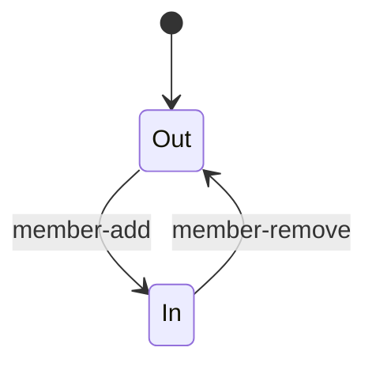
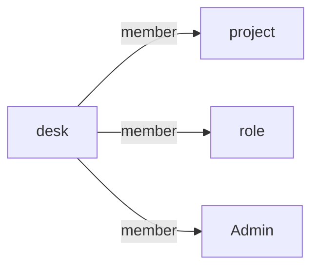
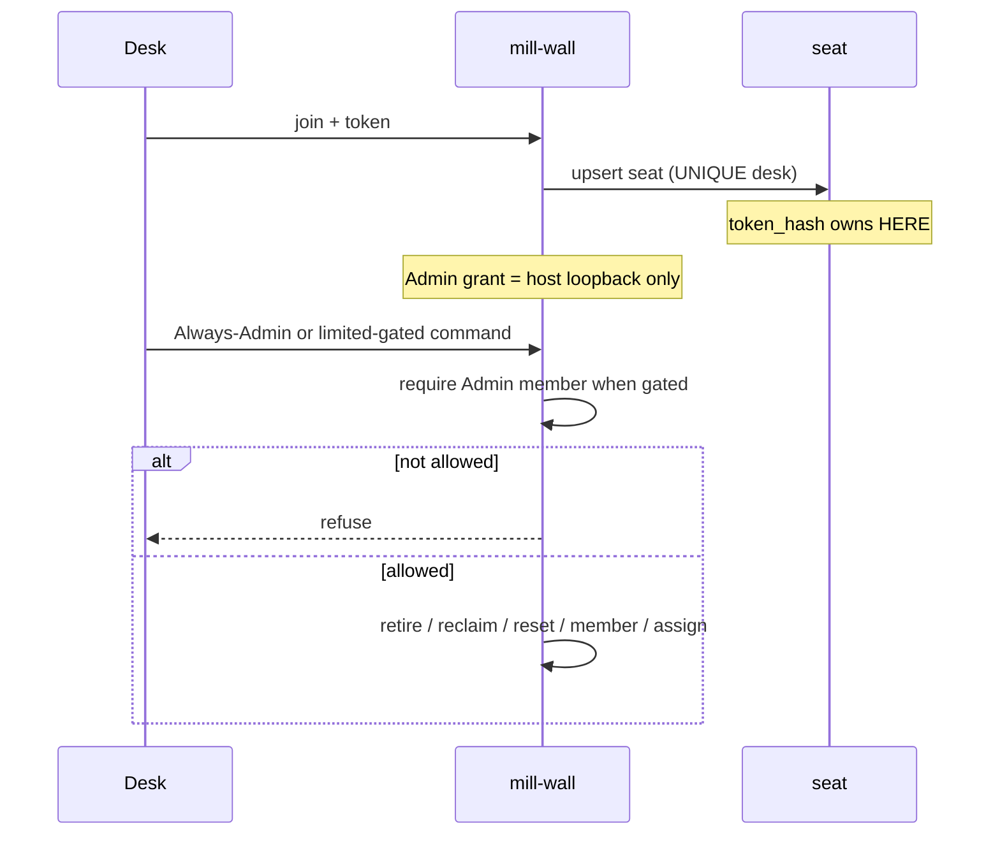

# Admin - requirements (diagrams)

Seed (immutable): project `Office` (id=1), `Admin` (id=2). Never retire these.

**Trust:** default **high**. Show: `mill trust` (any seated desk). Set: `mill trust high` / `mill trust limited` (**Admin** only; may flip either way any time). Pack/wall must ship the command before CLI works. Wall may not enforce until Loop-2 - teach this matrix as product intent.

## 1. Always Admin (either trust)

| Effect | Who |
|---|---|
| invite door keys (mint + enable + revoke joins) | **Admin** |
| invite-seat / mint_seat (one agent URL) | trust-gated: high = human badge or Admin; limited = Admin only |
| rename, retire, reclaim, reset | **Admin** (desk self-rename where hash matches still applies) |
| `Admin` grant/revoke | **host loopback only**. `mill add roster Admin OTHER`. `mill join --Admin` does **not** grant. connect-on-host does **not** grant. |
| set trust (`mill trust high` / `mill trust limited`) | **Admin** |

## 2. Trust-gated

| Effect | high (default) | limited |
|---|---|---|
| mint group / role / label | any seated desk | **Admin** only |
| **invite-seat** (agent welcome URL) | human badge or Admin | **Admin** only |
| member-add/remove **other** (ordinary project or role) | any desk | **Admin** only |
| member-add/remove **self** (ordinary project or role) | any desk | any desk |
| **assign** (staff a desk onto a todo; not claim/hold) | any desk, only if card has **no** assignee | **Admin** only, still only if unassigned |

Nobody (including Admin) overwrites an assignee - assignee must `unclaim` / relinquish first.

## 3. Any desk (either trust)

- day spine: send, inbox, todo, create todo, claim, unclaim, hold, drop, note, pass (each takes `--doing`)
- label-add / label-remove, watcher, tree
- score / score-add / kpi / dashboard
- `mill trust` (show current office trust; set is Admin - sec 1)

## 4. `name` lifecycle

```mermaid
stateDiagram-v2
  [*] --> Live: mint (desk join / trust-gated group|role|label)
  Live --> Retired: Admin retire\n(name.deleted set)
  Retired --> Live: Admin reclaim\n(clear deleted; name free path)
  Live --> Live: Admin rename
  note right of Retired
    UNIQUE name held while deleted
    reclaim / restore = Admin
  end note
```

| Transition | Who |
|---|---|
| mint desk | `mill join` (self) or `mill invite --seat` |
| mint group / role / label | trust-gated (sec 2) |
| retire / reclaim / rename | Always Admin (sec 1; desk self-rename rules) |

## 5. `member` - desk on group / role

| Edge | Who |
|---|---|
| add/remove **self** on an ordinary project or role | any desk (either trust) |
| add/remove **other** desk on an ordinary project or role | trust-gated (sec 2) |
| add/remove on `Admin` | host loopback grant path / Admin (sec 1) |

## 6. Seat vs Admin (`join`)

