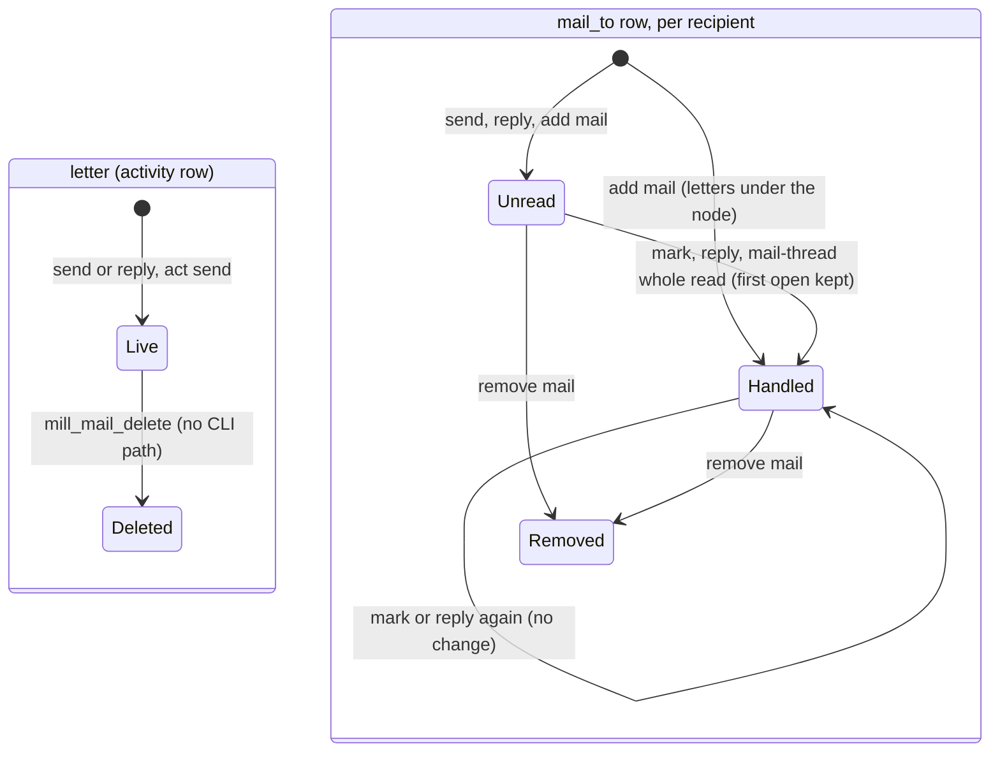
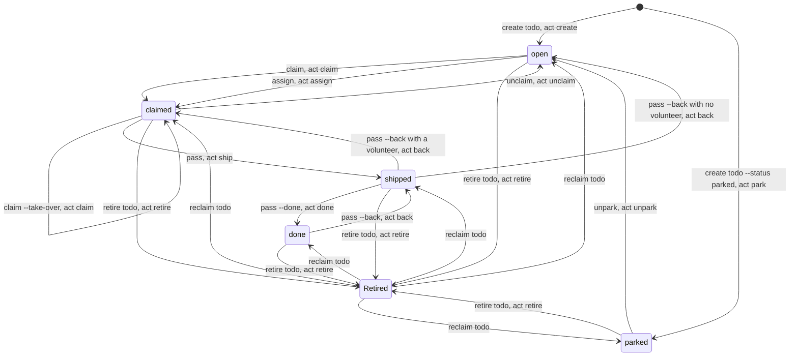
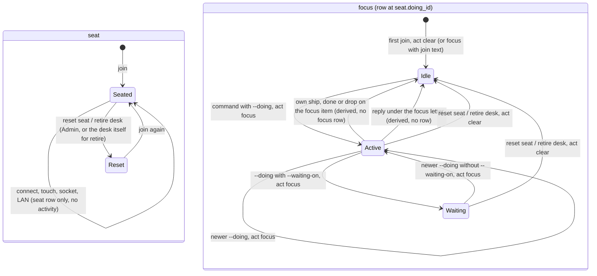
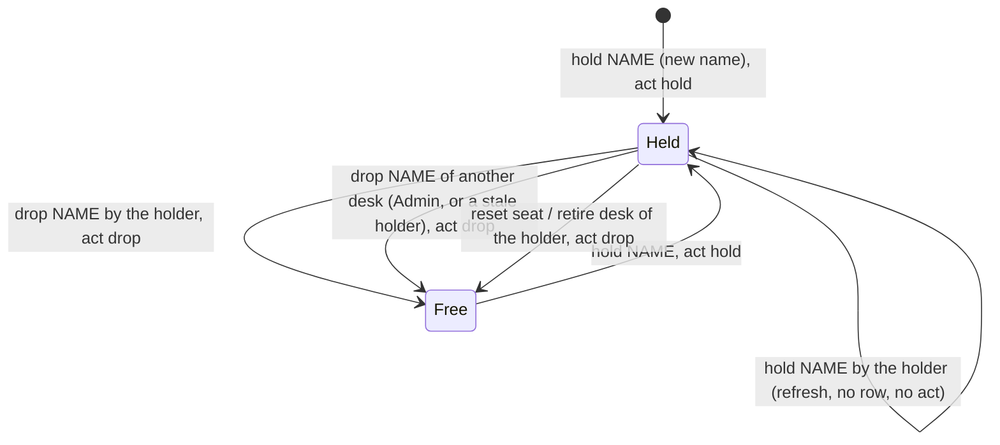
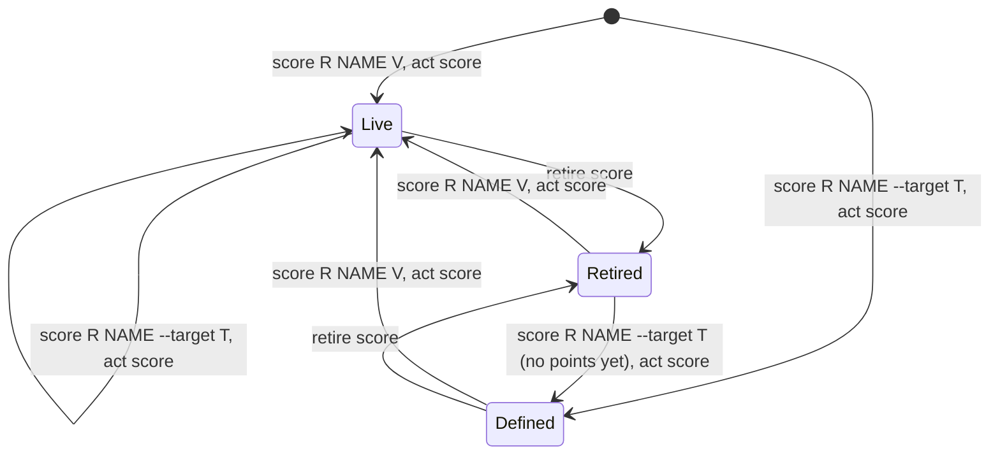

# Activity states on the current schema

This page redraws the per-type state diagrams of [activity-states.md](../../protocol/activity-states.md) (0.7.19, PR #221) for the schema on main today: the 0.8.0 schema the owner approved on 2026-10-26, plus what landed after it, the `transition` and `wake` tables (card 1022) and the task wrapper (card 970, `act` value `task`). Each section has a diagram, one table row per transition, and what changed from 0.7.19. It is written for the Auditor's formal models.

Status: read from the code on main (`agent_coord/server/sql/tables.sql`, the `sp_*.sql` procedures, `agent_coord/server/records/doing.py`, `agent_coord/server/transition_enums.py`, `migrate_080.sql`, `migrate_970_task.sql`). This page names procedures, not line numbers. Transition ids keep their 0.7.19 numbers (M1, T1, D1, H1, S1). A new transition gets a new number. The task transitions use the `Tsk` ids from `transition_enums.ALLOWED_TRANSITIONS`.

Placeholders are the ones activity-states.md uses: `R` roster, `NEED` card need, `N` id, `D` desk, `F` body file, `NAME` hold or score name, `V` number, `W` a task watch id.

## What changed since 0.7.19

- **No vote tables and no vote state.** `vote`, `vote_option`, `vote_cast`, `todo_event`, `hold_event`, `doing_now`, `glance_cache` and `sp_deploy` are not in the schema. A vote is a build-room letter: each desk replies GO or NOGO at one exact commit, silence is not GO, and any NOGO blocks.
- **One `act` list on `activity` and `doing`.** `activity.act` is the item's latest move, and `activity.desk_id` is the desk that made it. `doing.act` is the move a doing row records. Both columns use the same ENUM; the list and what each value folds to are in [BETA-CHANGES.md, "The act list"](BETA-CHANGES.md#the-act-list-activityact-and-doingact).
- **Doing is the history of card and hold moves.** Every card status or volunteer change, and every hold take or drop, appends one move row (`mill_doing_move`) with `on_type` and `on_id` set to the item, the move's `act`, `peer_id` for the second desk, and card evidence in `doing.evidence` (VARCHAR(2000), move rows only). A hold refresh writes no row.
- **`seat.doing_id` names the desk's focus.** It points at the desk's newest focus row (act `focus` or `clear`). A move row and a task row never move it. The seat row lock orders a desk's doing writes.
- **Mail stamps only move forward.** `mail_to.opened` keeps the first open. Opening a letter does not touch `activity`.
- **Heartbeats do not touch `activity`.** Connect, touch, socket and LAN updates write only the seat row. `activity.n` and `activity.weight` are dropped: token use comes from the reply bytes of each command. The glance is computed live.
- **A desk may retire itself** with its own seat token (card 880). Every other retire and every reclaim stays Admin only.
- **`activity` gets `KEY idx_updated (updated)`.** It changes no state.
- **Card 1022: `wake` is an activity type, and every state change can write a `transition` row.** `transition` holds (activity, from_state, to_state, reason, desk, join_key, small meta). `transition_edge` is seeded from `transition_enums.ALLOWED_TRANSITIONS` and is the list of allowed edges for every type, including the mail, todo, hold, score and doing edges drawn below. `wake` (the former `push_queue`) has its own edges there; they are not redrawn on this page.
- **Card 970: the task wrapper.** `activity.act` and `doing.act` gain `task` (`migrate_970_task.sql` for existing books). A task is one doing row with act `task`; its states live only in `transition` rows (section "task").

## The act list

`activity.act` and `doing.act` are one ENUM, in this order: `create`, `send`, `reply`, `note`, `park`, `claim`, `unclaim`, `assign`, `unpark`, `ship`, `done`, `back`, `hold`, `drop`, `focus`, `clear`, `finish`, `score`, `retire`, `reclaim`, `remove`, `delete`, `restore`, `purge`, `rename`, `ring`, `task`. BETA-CHANGES.md is the only source for what each value means. The rows on this page use these spellings.

Three kinds of doing row follow from the list:

- A **focus row** has act `focus` (text set) or `clear` (text empty). It is the desk's current doing, and `seat.doing_id` moves to it (`mill_doing_insert`).
- A **move row** has a card or hold act (`create`, `park`, `claim`, `unclaim`, `assign`, `unpark`, `ship`, `done`, `back`, `rename`, `hold`, `drop`). It records a move on the item and leaves `seat.doing_id` where it was (`mill_doing_move`).
- A **task row** has act `task` (`mill_doing_task`). It is the birth of one task-wrapper run and never a focus or clear.

`finish` is a row kept from before 0.8.0 (the migration only; no writer on main). A command that makes a move and also carries `--doing TEXT` writes both: first the move row, then the focus row, under the same seat lock.

## The activity row

`activity` stays one row per item, with primary key `(type, id)`. A move calls `mill_activity_put` once with its act. The call sets `updated`, `desk_id` (the desk that made the move), `act`, `roster_id` when given, and `bytes` when given. A move row writes no activity row of its own: the move lands on the item's row (`todo` or `hold`). A focus row and a task row each have their own activity row of type `doing`. A focus or clear put never overwrites the activity row of a task (`mill_activity_put` keeps a non-focus doing row's act).

These writes do not touch `activity`: opening a letter, every heartbeat, and a hold refresh.

## mail

A letter has two layers, as in 0.7.19. The `mail` row is live until deleted. Each recipient has a `mail_to` row: unread while `opened` is NULL, handled once it is stamped. The stamp is written once and never changes (`mill_mail_open` reads the row `FOR UPDATE` and stamps only a NULL `opened`).

| # | From | To | Command | act on activity | Rows written |
|---|---|---|---|---|---|
| M1 | none | letter live; each recipient unread | `mill send desk D --body-file F` (or `send roster R`, `--to-desk D`, `--room ROOM`) | `send` | `mail`, one `mail_to` per recipient, activity |
| M2 | none | reply live; recipients unread; the replier's parent handled | `mill reply N --body-file F [--to-desk D]` | `send` on the reply (see open point 1) | `mail`, `mail_to` rows, activity; the parent's `mail_to.opened` when NULL |
| M3 | unread | handled | `mill mark N [N...]` | none | `mail_to.opened` |
| M4 | unread | handled | `mill mail-thread N` (whole read) | none | `mail_to.opened` on the unread rows |
| M5 | unread | unread | `mill inbox`, preview reads | none | none |
| M6 | handled | handled, stamp unchanged | `mill mark N` or `mill reply N --body-file F` again | none (reply: `send` on the new letter) | none on the old `mail_to` row |
| M7 | not a recipient | unread on N; handled under N | `mill add mail:N D` | none | `mail_to` rows |
| M8 | recipient | removed from N and under it | `mill remove mail:N D` | none | `mail_to` rows deleted |
| M9 | live | deleted | none | `deleted` stamped | gap, as in 0.7.19 |

Card 1022 also allows mail edges for delivery and answers (`delivered`, `woken`, `answered`, and the `size_limit` and `orphan_refuse` refusals) in `transition_edge`. They are `transition` rows about a letter, not new `mail_to` states, and are not drawn here.

Changes from 0.7.19:

| # | 0.7.19 | now |
|---|---|---|
| M3, M4 | open stamps `mail_to.opened` and bumps `activity.updated`, while `desk_id` still names the sender | open stamps `mail_to.opened` only; `activity` is not touched |
| M6 | a second open re-stamps `opened` | `opened` keeps its first value; no write |
| M1, M2 | activity put with `weight` and `n + 1` | activity put with act `send`; no `weight`, no `n` |
| receipts | `push_receipt` keys on the first open, which a re-open overwrote | the first open is the only open, so the receipt key is stable |

## todo

A card has one status from `todo.status`: `parked`, `open`, `claimed`, `shipped`, `done`. Retired is a flag on top of any status (`activity.deleted`). The statuses and edges are the ones 0.7.19 has. What changes is what each edge writes: every status or volunteer change appends one move row on the card (`mill_todo_write`, which `mill_card_write` and `mill_todo_update` both call, picks the act from the old and new status and volunteer), and the card's activity row takes the same act. `todo.evidence` is gone; evidence is `doing.evidence` on the `ship` or `done` move row.

| # | From | To | Command | act | Move row (on the card) |
|---|---|---|---|---|---|
| T1 | none | open | `mill create todo R NEED [--detail T]` | `create` | one, `create` |
| T2 | none | parked | `mill create todo R NEED --status parked` | `park` | one, `park` |
| T3 | parked | open | `mill unpark R NEED [--parent-type todo --parent-id N]` | `unpark` | one, `unpark` |
| T4 | open | claimed by caller | `mill claim R NEED` | `claim` | one, `claim` |
| T5 | open | claimed by D | `mill assign R NEED D` | `assign` | one, `assign`, `peer_id` = D |
| T6 | claimed by another desk | claimed by caller | `mill claim R NEED --take-over` | `claim` | one, `claim`, `peer_id` = the previous volunteer |
| T7 | claimed | open | `mill unclaim R NEED` | `unclaim` | one, `unclaim` |
| T8 | claimed | shipped | `mill pass R NEED [--evidence T]` | `ship` | one, `ship`, `evidence` = T |
| T9 | shipped | done | `mill pass R NEED --done` | `done` | one, `done`, `evidence` = T, or the ship's when none is given |
| T10 | done | shipped | `mill pass R NEED --back` | `back` | one, `back` |
| T11 | shipped | claimed, or open with no volunteer | `mill pass R NEED --back` | `back` | one, `back` |
| T12 | any status | retired, status kept | `mill retire todo R NEED --yes` | `retire` | none |
| T13 | retired | the status it had | `mill reclaim todo R NEED --yes` | unchanged (`retire` stays; `deleted` cleared) | none |
| T14 | any | same status | `mill note R NEED --note T`, `mill note R NEED --done-when T` | `note` | none |
| T15 | live | deleted | none (test-only `probe-delete`) | `remove` | none; the card's move rows stay |
| T16 | any | same status, new need | `mill rename todo R NEED NEW` | `rename` | one, `rename`, `evidence` holds old, new and why |

Every card write reads the old status and volunteer under a row lock on the card, and the move row is written in the same procedure that writes the card. So the paths that call `mill_todo_update` straight from `rpc.py` (assign, unpark) write their row too. Reading a card's move rows in id order (`idx_on`) rebuilds its status and volunteer (BETA-CHANGES.md, test F175).

Changes from 0.7.19:

| # | 0.7.19 | now |
|---|---|---|
| T1 to T11 | the card row is updated and the activity row bumped (`n + 1`); no history of the move | the same update, plus one move row on the card with the move's act, plus act on the activity row |
| T5, T6 | a volunteer change with the status unchanged leaves no trace beyond the last actor | its own move row (`assign`, or `claim` for a take-over), with the other desk in `peer_id` |
| T8, T9 | evidence is a column on `todo`, overwritten by the next pass | evidence is `doing.evidence` on that move row; the card shows the newest one |
| T10 | evidence cleared on the card | the `back` row has no evidence; earlier evidence rows stay |
| T12, T13 | `activity.deleted` stamped or cleared | the same; retire also sets act `retire`; no move row |
| T14 | activity bumped like a move | act `note`, so an edit no longer looks like a move; no move row |
| T15 | the card row and its watchers go | the same, act `remove`; the card's move rows stay (`doing.on_id` has no FK) |
| migration | none | `migrate_080.sql` gives every card one first move row (act from its status, `peer_id` the volunteer, `evidence` the card's evidence), then drops `todo.evidence` |

Refusals are the ones 0.7.19 has (activity-states.md, todo). A refused command writes no move row and no act.

## doing

The type is `doing`; no command is named `doing`. A desk writes focus with `--doing TEXT` on another command. The seat (one row per desk) is not an activity. It carries `doing_id`, the desk's newest focus row.

The state of a desk's focus is read from the row `seat.doing_id` names, and never stored:

- `seat.doing_id` is NULL, or the row's act is `clear`: idle.
- act `focus`, no waiting reference, and nothing has ended it: active.
- act `focus` with a waiting reference, and nothing has ended it: waiting.
- The focus is on an item, and the desk's own `ship`, `done` or `drop` move on that item, or a reply under the focus letter, came after it: idle (finished, D7 to D9). `mill_doing_end` derives this on read; no row is written.

Task rows (act `task`) are not part of this machine. They are drawn in the next section.

| # | From | To | Command | act | Rows written |
|---|---|---|---|---|---|
| D1 | no seat | seated; idle | `mill join --link-file LINKFILE` | doing row `clear` (`focus` with join text) when the desk has no focus row; the activity row says `focus` either way | seat; one focus row; its activity row; `seat.doing_id` set |
| D2 | seated | connected | `mill connect D` | none | `seat.updated`; `seat.time_connect` on the first socket |
| D3 | connected | disconnected | stop the connect process | none | `seat.time_disconnect` |
| D4 | idle | active on the item | a command with `--doing TEXT` (`send`, `reply`, `mark`, `create todo`, `claim`, `unclaim`, `assign`, `pass`, `note`, `unpark`, `hold`, `drop`, `score`) | `focus` | the command's own writes, then one focus row and its activity row; `seat.doing_id` moves |
| D5 | active | waiting | the same with `--waiting-on "WHAT WHY"` | `focus` | as D4, with the waiting reference on the row |
| D6 | active or waiting | active, newer entry | another `--doing TEXT` | `focus` | as D4 |
| D7 | active on `mail-N` | idle, finished | `mill reply N --body-file F` | none (the reply is `send`) | none; derived on read |
| D8 | active on `todo-N` | idle, finished | `mill pass R NEED` or `mill pass R NEED --done`, without `--doing` | none on the focus | the `ship` or `done` move row only; `seat.doing_id` does not move; derived on read |
| D9 | active on `hold-N` | idle, finished | `mill drop NAME` without `--doing` | none on the focus | the `drop` move row only; derived on read |
| D10 | any | idle, cleared | `mill reset seat D --yes` (Admin), `mill retire desk D --yes` (Admin), or the desk retiring itself | `clear` | reset: one empty focus row unless the focus is already empty; retire: one `clear` row; `seat.doing_id` moves to it |
| D11 | seated | reset: token cleared, webhook off, holds freed | `mill reset seat D --yes` (Admin) | `drop` per freed hold, `clear` | one `drop` move row per hold, as H5; D10 |
| D12 | any | same focus | a card or hold move without `--doing` that does not end the focus | the move's act on the item | one move row; `seat.doing_id` does not move |

Every focus or move write first locks the desk's seat row (`SELECT ... FROM seat WHERE desk_id = D FOR UPDATE`), then inserts the row, then sets `seat.doing_id` when the row is a focus row.

Card 1022 records these as `doing` transition reasons: `join`, `connect`, `disconnect`, `reset_seat`, `doing_put`, `doing_newer`, `doing_wait`, `finish_reply`, `finish_pass`, `finish_drop`, `clear`.

Changes from 0.7.19:

| # | 0.7.19 | now |
|---|---|---|
| current entry | the desk's newest doing row | the row `seat.doing_id` points at; move rows and task rows are never the current entry |
| D2, D3, touch, LAN | bump the activity row of the desk's newest doing row (about 2,000 bumps a day live); connect writes an empty row when the desk has none | write only the seat row; no doing row, no activity |
| D4 to D6 | one doing row, its activity row bumped | one focus row, act `focus`; `seat.doing_id` moves |
| D8, D9 | an empty finish row when the desk's newest row is on the item | no finish row: the desk's own `ship`, `done` or `drop` move row on the focus item ends the entry, read by `mill_doing_end` |
| D10 | an empty row, the newest | an empty focus row, act `clear`; `seat.doing_id` moves to it |
| D12 | (no such row) | new: a move row that leaves the focus alone |
| ordering | none in 0.7.19 | the seat row lock |
| migration | none | each old row with text becomes `focus`, an empty one on an item `finish`, any other empty one `clear`; `seat.doing_id` is set to the desk's newest focus row |

## task (card 970)

A task is one run of the task wrapper (`tw CMD [ARGS...]`). The client sends `tw.event` hops on the desk's sitting session; the server keeps one doing row per run and records its states as `transition` rows. The row is never a focus: it does not move `seat.doing_id`, and a focus or clear put does not overwrite its activity row. The Wall shows act `task` as "tasked".

Birth: the first accepted `start` for a new watch id inserts one doing row with act `task`, empty `text`, and `on_type` `todo` / `on_id` the card when the hop names one (`mill_doing_task`), plus its activity row with act `task`. The new row is idle; there is no birth transition. Every transition of the run carries `join_key` = `task:D:W`.

```mermaid
stateDiagram-v2
  [*] --> idle: first start for a new watch id (doing row, act task; no transition)
  idle --> active: start, tw_start
  active --> waiting: stall, tw_wait
  waiting --> active: resume, tw_resume
  active --> finished: exit 0, tw_finished
  waiting --> finished: exit 0, tw_finished
  active --> failed: exit not 0 or crash, tw_failed
  waiting --> failed: exit not 0 or crash, tw_failed
  finished --> [*]
  failed --> [*]
```

| # | From | To | Hop (`kind`) | reason | Rows written |
|---|---|---|---|---|---|
| Tsk0 | no row | idle | first `start` for a new W | none | one doing row (act `task`) and its activity row |
| Tsk1 | idle | active | `start` | `tw_start` | one `transition` row |
| Tsk2 | active | waiting | `stall` | `tw_wait` | one `transition` row; `meta.cause` when sent |
| Tsk3 | waiting | active | `resume` | `tw_resume` | one `transition` row |
| Tsk4a, Tsk4b | active or waiting | finished | `exit` with `exit_code` 0 | `tw_finished` | one `transition` row |
| Tsk5a, Tsk5b | active or waiting | failed | `exit` with any other `exit_code`, or `crash` | `tw_failed` | one `transition` row |

Not transitions:

- `match` writes no `tw_*` row; it only wakes the desk.
- `overflow` and `retry` are metrics (`doing.task.buffer_overflow_n`, `doing.task.retry_give_up_n` scores), never a transition.
- `tw_stale` (Tsk6), `clear` on a task (Tsk7) and `wait_cycle` (Tsk8) are allowed edges in `transition_edge`, but nothing writes them yet (parked).

Cap: a desk may have at most 8 live task rows (act `task` with no `finished`, `failed`, `stale` or `cleared` transition; `TASK_CAP`). A `start` that would be the 9th replies `ok: false`, `code: cap`, and writes nothing: no row, no transition, no wake. The count is read `FOR SHARE` under the seat row lock `mill_doing_task` takes, so two concurrent starts cannot both pass it (#360). Finished and failed runs do not count.

Replay-safe: a repeated or late hop on a known watch writes nothing and replies `ok: true`. That covers any hop on a finished or failed run, a second `start` once the run has left idle, a `stall` while waiting and a `resume` while active. A hop that names no started run, or does not follow the state, is refused (`tw.event: start required before a transition`, `tw.event: kind does not follow the task state`).

Wake: `stall`, `match`, `exit` and `crash` ring the desk after commit through the shared wake path, unless the hop says `wake: false` or wrote nothing.

What the server stores: `transition.meta` and the reply carry only `watch_id`, `desk`, `kind`, and when sent `card`, `cause` (a short token), `exit_code` and numeric `counts`. The server drops `argv`, `title`, `pattern`, `stdout`, `stderr`, `log`, `sample` and `pid` before it builds meta; none of them is stored. Dwell times per state and stalls per cause are scores under `doing.task.*`.

## hold

One hold row per resource name; held means `desk_id` is set, free means NULL. The row is never deleted. Holds do not expire on their own. Each take and each drop also appends one move row on the hold, so the hold's history (who held it, from when to when) is its move rows in id order.

| # | From | To | Command | act | Move row (on the hold) |
|---|---|---|---|---|---|
| H1 | no row | held by caller | `mill hold NAME` | `hold` | one, `hold` |
| H2 | free | held by caller | `mill hold NAME` | `hold` | one, `hold` |
| H3 | held by caller | held by caller | `mill hold NAME` | none | none; `hold.updated` only |
| H4 | held by caller | free | `mill drop NAME` | `drop` | one, `drop` |
| H5 | held by D | free | `mill reset seat D --yes`, `mill retire desk D --yes`, or D retiring itself; or `mill drop NAME` by Admin, or by a desk when D is disconnected and has held it the configured stale days (card 931) | `drop` | one per freed hold, by the acting desk, `peer_id` = D when another desk acted (reset names D itself). Transition reason `hold_force`. |
| H6 | any | same | `mill hold --peek NAME`, `mill hold` | none | none |
| H7 | any | refused | `mill hold NAME` while another desk holds it | none | none; no hold move row. Transition reason `hold_refuse`. |

A take locks the hold row (`SELECT ... FOR UPDATE` on `resource_id`) before it checks `desk_id`, as in 0.7.19. A refused take (another desk holds it) writes no hold move row and records transition reason `hold_refuse` (H7). A forced release (H5, reason `hold_force`) covers reset, retire, Admin drop, or a stale-holder drop. An Admin or stale-holder drop frees the hold only when the holder is still the one the caller checked (`mill_hold_release_other`).

Changes from 0.7.19:

| # | 0.7.19 | now |
|---|---|---|
| H1, H2 | hold row written, activity bumped | the same, plus one `hold` move row and act `hold` |
| H3 | `hold.updated` refreshed | the same; still no activity write and no row |
| H4 | `desk_id` set NULL, activity bumped | the same, plus one `drop` move row and act `drop` |
| H5 | holds freed in the reset or retire call, each activity row bumped | the same, plus one `drop` row per freed hold by the acting desk |
| H5 force path | (admin/stale release-other not separate) | `hold_force` also covers Admin or stale-holder `mill drop` (card 931) |
| H7 | (no such path) | `hold_refuse`: a blocked take writes no move row |
| history | who held it before is lost | the hold's move rows; no `hold_event` table |

## score

A score is a `score` row plus its `score_point` series. Score moves write no doing row; the points are the series. Only the act on the activity row is new.

| # | From | To | Command | act |
|---|---|---|---|---|
| S1 | none | live, one point | `mill score R NAME V [--target T]` | `score` |
| S2 | none | defined | `mill score R NAME --target T` | `score` |
| S3 | defined or live | live, one more point | `mill score R NAME V` | `score` |
| S4 | live | live, new target, better or unit | `mill score R NAME --target T` | `score` |
| S5 | defined or live | retired | `mill retire score R NAME --yes` | unchanged; `activity.deleted` stamped |
| S6 | retired | live or defined | `mill score R NAME V` or `mill score R NAME --target T` | `score`; `activity.deleted` cleared |
| S7 | live | deleted | none (test-only `probe-delete`, the install migration) | none |

Changes from 0.7.19:

| # | 0.7.19 | now |
|---|---|---|
| S1 to S4, S6 | activity bumped with `weight` and `n + 1` | activity put with act `score`; no `weight`, no `n` |
| host and Wall writers | `mill_score_upsert`, `mill_score_admin_upsert`, `mill_wall_event` bump activity | the same calls, with act `score` |

## seat focus and name retire

The seat is drawn under doing. This section covers the name lifecycle, because retire is where seat, focus and holds change in one call.

```mermaid
stateDiagram-v2
  [*] --> Live: mint
  Live --> Retired: retire (Admin; or a desk name, by that desk with its own seat token)
  Retired --> Live: reclaim (Admin only)
```

| # | From | To | Command | Who | Writes |
|---|---|---|---|---|---|
| N1 | live | retired | `mill retire desk D --yes` | Admin | `name.deleted`; seat token and webhook cleared; D10 (`clear` focus row); H5 (one `drop` row per hold, by Admin, `peer_id` = D) |
| N2 | live (desk D) | retired | `mill retire desk D` (retype prompt, no `--yes`), run by D | D, when the token it sends is its seat's token | the same as N1, with D as the acting desk |
| N3 | live (roster or label) | retired | `mill retire TYPE NAME --yes` | Admin | `name.deleted` |
| N4 | retired | live | `mill reclaim TYPE NAME` | Admin; refused while a live seat is that desk or a member of that name | `name.deleted` cleared; a reclaimed desk has no seat token until reset |

Changes from 0.7.19:

| # | 0.7.19 | now |
|---|---|---|
| N2 | the CLI lets a desk retire itself (card 880) | the rule is in the procedure: `sp_name_retire` takes the seat token hash and accepts the desk itself, checked under the seat lock |
| N1, N2 | the retire call frees holds and ends the doing with an empty row | the same, and the freed holds and the cleared focus each write their act |
| N3, N4 | Admin only | unchanged |

## Votes

There is no vote kind, no vote table and no vote state. A release vote is a letter thread in the build room: a consensus letter names one commit, each ship desk replies GO or NOGO at that commit, silence does not count as GO, there is no timeout or quorum, and any NOGO blocks. These are mail states (M1, M2) and add no transitions.

## Open points

The 0.8.0 draft of this page listed six open points. The code on main has settled them: a move with `--doing` writes two rows (move, then focus); connect writes no doing row; freed holds are `drop` rows by the acting desk with the holder as `peer_id`; a deleted card's move rows stay; retire, reclaim and note write no doing row; and the migration gives every card one first move row, not only cards with evidence.

What the code does that the act list does not say, for the owner:

1. **A reply writes act `send`.** `mill_mail_insert` puts `send` for every letter, so no writer sets `reply` (M2, M6). Either a reply should put `reply`, or `reply` leaves the list.
2. **Reclaim keeps act `retire`.** `mill_todo_reclaim` clears `activity.deleted` without setting act, so no writer sets `reclaim` (T13). Score retire likewise stamps `deleted` and leaves act `score` (S5).
