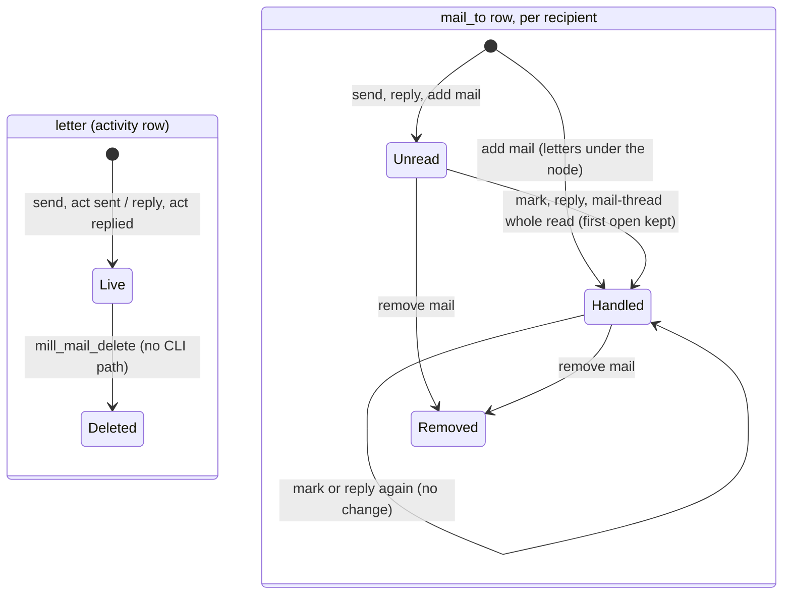
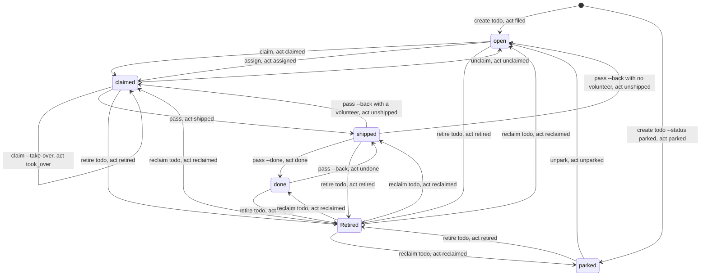
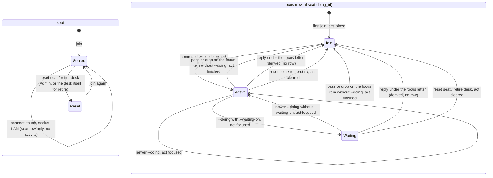
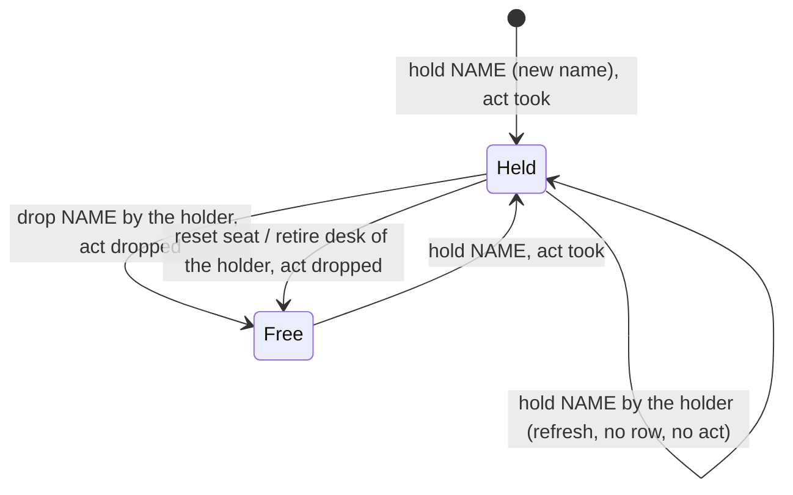
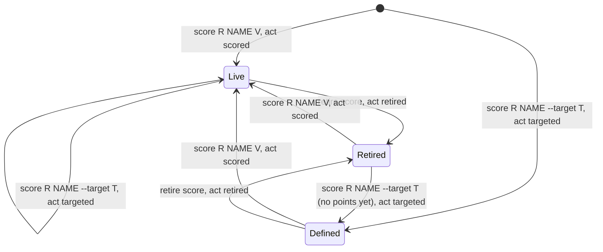

# Activity states in 0.8.0

This page redraws the per-type state diagrams of [activity-states.md on main at 9e60c5e](https://github.com/si4ai/the-mill/blob/9e60c5e/docs/protocol/activity-states.md) (0.7.19, PR #221) for the 0.8.0 schema the owner approved on 2026-10-26. Each section has the 0.8.0 diagram, one table row per transition, and a table of what changed from 0.7.19.

Status: design. The procedures that make these moves are being changed in #214 and the lane PRs at the same time, so this page names procedures, not line numbers. Line evidence for 0.7.19 is in activity-states.md on main. Transition ids keep their 0.7.19 numbers (M1, T1, D1, H1, S1). A new transition gets a new number, and a removed one is listed as removed.

Placeholders are the ones activity-states.md uses: `R` roster, `NEED` card need, `N` id, `D` desk, `F` body file, `NAME` hold or score name, `V` number.

## What 0.8.0 changes

- **No new tables.** `vote`, `vote_option`, `vote_cast`, `todo_event`, `doing_now`, `glance_cache` and `sp_deploy` are out of 0.8.0. There is no vote kind and no vote state. A vote is a build-room letter: each desk replies GO or NOGO at one exact commit, silence is not GO, and any NOGO blocks.
- **One `act` list on `activity` and `doing`.** `activity.act` is the item's latest move, and `activity.desk_id` is the desk that made it. `doing.act` is the move a doing row records. Both columns use the same ENUM.
- **Doing is the history of todo and hold moves.** Every todo status or volunteer change, and every hold take or drop, appends one doing row with `on_type` and `on_id` set to the item, the move's `act`, and `text` (todo evidence goes in `text`). A hold refresh writes no row.
- **`seat.doing_id` replaces `doing_now`.** It points at the desk's latest focus row. A move row (todo or hold) does not move the focus. The seat row lock orders a desk's doing writes.
- **Mail stamps only move forward.** `mail_to.opened` is set once, and the first open is kept. Opening a letter does not touch `activity`.
- **Heartbeats do not touch `activity`.** Connect, touch, socket and LAN updates write only the seat row. `activity.n` and `activity.weight` are dropped: token use comes from the reply bytes of each command. The glance is computed live.
- **A desk may retire itself** with its own seat token (card 880). Every other retire and every reclaim stays Admin only.
- `activity` gets `KEY idx_updated (updated)`. It changes no state.

## The act list

The column is one ENUM shared by `activity.act` and `doing.act`. The spellings below are the proposal this page uses. If the change pass spells a value differently, only the spelling changes: each transition keeps its row and its id.

| act | kind | move | doing row |
|---|---|---|---|
| `sent` | mail | a new letter | no |
| `replied` | mail | a reply under a letter | no |
| `filed` | todo | create, open | yes |
| `parked` | todo | create with `--status parked` | yes |
| `unparked` | todo | parked to open | yes |
| `claimed` | todo | claim of an open card | yes |
| `took_over` | todo | claim of a card another desk holds | yes |
| `assigned` | todo | assign to a named desk | yes |
| `unclaimed` | todo | claimed to open | yes |
| `shipped` | todo | claimed to shipped | yes, evidence in `text` |
| `done` | todo | shipped to done | yes, evidence in `text` |
| `undone` | todo | done to shipped | yes |
| `unshipped` | todo | shipped to claimed, or to open when there is no volunteer | yes |
| `noted` | todo | body, note or done-when edit, status unchanged | no |
| `took` | hold | take of a free or new hold | yes |
| `dropped` | hold | drop, or release when the holder's seat is reset or retired | yes |
| `scored` | score | a point | no |
| `targeted` | score | define, or a new target, better or unit | no |
| `joined` | doing | the empty first focus row at join | yes (focus) |
| `focused` | doing | `--doing TEXT`, with or without `--waiting-on` | yes (focus) |
| `finished` | doing | the empty row after pass or drop without `--doing` | yes (focus) |
| `cleared` | doing | the empty row at reset or retire | yes (focus) |
| `retired` | todo, score | retire | no |
| `reclaimed` | todo | reclaim | no |

Two kinds of doing row follow from this list:

- A **focus row** has act `joined`, `focused`, `finished` or `cleared`. It is the desk's current doing, and `seat.doing_id` moves to it.
- A **move row** has a todo or hold act. It records a move on the item and leaves `seat.doing_id` where it was.

A command that makes a move and also carries `--doing TEXT` writes both: first the move row, then the focus row, under the same seat lock.

## The activity row

`activity` stays one row per item, with primary key `(type, id)`. Every move above calls `mill_activity_put` once with its act. The call sets `updated`, `desk_id` (the desk that made the move), `act`, `roster_id` when given, and `bytes` when given. A move row writes no activity row of its own: the move lands on the item's row (`todo` or `hold`). A focus row has its own activity row of type `doing`.

These writes no longer touch `activity`: opening a letter, every heartbeat, and a hold refresh. Retire and reclaim stamp or clear `activity.deleted` and set act `retired` or `reclaimed`.

## mail

A letter has two layers, as in 0.7.19. The `mail` row is live until deleted. Each recipient has a `mail_to` row: unread while `opened` is NULL, handled once it is stamped. In 0.8.0 the stamp is written once and never changes.

| # | From | To | Command | act on activity | Rows written |
|---|---|---|---|---|---|
| M1 | none | letter live; each recipient unread | `mill send desk D --body-file F` (or `send roster R`, `--to-desk D`, `--room ROOM`) | `sent` | `mail`, one `mail_to` per recipient, activity |
| M2 | none | reply live; recipients unread; the replier's parent handled | `mill reply N --body-file F [--to-desk D]` | `replied` on the reply | `mail`, `mail_to` rows, activity; the parent's `mail_to.opened` when NULL |
| M3 | unread | handled | `mill mark N [N...]` | none | `mail_to.opened` |
| M4 | unread | handled | `mill mail-thread N` (whole read) | none | `mail_to.opened` on the unread rows |
| M5 | unread | unread | `mill inbox`, preview reads | none | none |
| M6 | handled | handled, stamp unchanged | `mill mark N` or `mill reply N --body-file F` again | none (reply: `replied` on the new letter) | none on the old `mail_to` row |
| M7 | not a recipient | unread on N; handled under N | `mill add mail:N D` | none | `mail_to` rows |
| M8 | recipient | removed from N and under it | `mill remove mail:N D` | none | `mail_to` rows deleted |
| M9 | live | deleted | none | `deleted` stamped | gap, as in 0.7.19 |

Changes from 0.7.19:

| # | 0.7.19 | 0.8.0 |
|---|---|---|
| M3, M4 | open stamps `mail_to.opened` and bumps `activity.updated`, while `desk_id` still names the sender | open stamps `mail_to.opened` only; `activity` is not touched |
| M6 | a second open re-stamps `opened` | `opened` keeps its first value (`IFNULL(opened, now)`); no write |
| M1, M2 | activity put with `weight` and `n + 1` | activity put with act `sent` or `replied`; no `weight`, no `n` |
| receipts | `push_receipt` keys on the first open, which a re-open overwrote | the first open is the only open, so the receipt key is stable |

## todo

A card has one status from `todo.status`: `parked`, `open`, `claimed`, `shipped`, `done`. Retired is a flag on top of any status (`activity.deleted`). The statuses and edges are the ones 0.7.19 has. What changes is what each edge writes: every status or volunteer change appends one doing row on the card, and the card's activity row takes the same act. `todo.evidence` is gone; evidence is the `text` of the `shipped` or `done` move row.

| # | From | To | Command | act | Doing row (on the card) |
|---|---|---|---|---|---|
| T1 | none | open | `mill create todo R NEED [--detail T]` | `filed` | one, `filed` |
| T2 | none | parked | `mill create todo R NEED --status parked` | `parked` | one, `parked` |
| T3 | parked | open | `mill unpark R NEED [--parent-type todo --parent-id N]` | `unparked` | one, `unparked` |
| T4 | open | claimed by caller | `mill claim R NEED` | `claimed` | one, `claimed` |
| T5 | open | claimed by D | `mill assign R NEED D` | `assigned` | one, `assigned` |
| T6 | claimed by another desk | claimed by caller | `mill claim R NEED --take-over` | `took_over` | one, `took_over` |
| T7 | claimed | open | `mill unclaim R NEED` | `unclaimed` | one, `unclaimed` |
| T8 | claimed | shipped | `mill pass R NEED [--evidence T]` | `shipped` | one, `shipped`, `text` = evidence |
| T9 | shipped | done | `mill pass R NEED --done` | `done` | one, `done`, `text` = evidence |
| T10 | done | shipped | `mill pass R NEED --back` | `undone` | one, `undone` |
| T11 | shipped | claimed, or open with no volunteer | `mill pass R NEED --back` | `unshipped` | one, `unshipped` |
| T12 | any status | retired, status kept | `mill retire todo R NEED --yes` | `retired` | none |
| T13 | retired | the status it had | `mill reclaim todo R NEED --yes` | `reclaimed` | none |
| T14 | any | same status | `mill note R NEED --note T`, `mill note R NEED --done-when T` | `noted` | none |
| T15 | live | deleted | none (test-only `probe-delete`) | none | open point 4 |

Every card write reads the old status and volunteer under a row lock on the card (`SELECT ... FOR UPDATE`), and the doing row is written in the same procedure that writes the card. So the paths that call `mill_todo_update` straight from `rpc.py` (assign, unpark) write their row too.

Changes from 0.7.19:

| # | 0.7.19 | 0.8.0 |
|---|---|---|
| T1 to T11 | the card row is updated and the activity row bumped (`n + 1`); no history of the move | the same update, plus one doing row on the card with the move's act, plus act on the activity row |
| T5, T6 | a volunteer change with the status unchanged leaves no trace beyond the last actor | its own doing row (`assigned`, `took_over`); the previous volunteer is the volunteer of the card's earlier move row |
| T8, T9 | evidence is a column on `todo`, overwritten by the next pass | evidence is the `text` of that move row; the card shows the newest one |
| T10 | evidence cleared on the card | the `undone` row has empty `text`; earlier evidence rows stay |
| T12, T13 | `activity.deleted` stamped or cleared | the same, with act `retired` or `reclaimed`; no doing row |
| T14 | activity bumped like a move | act `noted`, so an edit no longer looks like a move; no doing row |
| T15 | the card row and its watchers go | the same; what happens to its move rows is open point 4 |
| all | the old status is read without a row lock | the old status is read `FOR UPDATE` |
| migration | none | each 0.7.19 card with evidence gets one doing row (`shipped` or `done`, matching its status) carrying the evidence |

Refusals are the ones 0.7.19 has (activity-states.md, todo). A refused command writes no doing row and no act.

## doing

The type is `doing`; no command is named `doing`. A desk writes focus with `--doing TEXT` on another command. The seat (one row per desk) is not an activity. In 0.8.0 it carries `doing_id`, the desk's latest focus row.

The state of a desk's doing is read from that focus row and never stored:

- `seat.doing_id` is NULL, or the row's `text` is empty: idle.
- `text` is set, there is no waiting reference, and no reply by the desk under the focus letter has ended it: active.
- `text` is set with a waiting reference, and nothing has ended it: waiting.
- The focus is on `mail-N` and the desk has replied under N since: idle (finished, D7).

How the last entry ended (finished, cleared, newer) is still worked out on read, from the desk's next focus row or a reply in the letter's tree. Move rows are skipped by that read.

| # | From | To | Command | act | Rows written |
|---|---|---|---|---|---|
| D1 | no seat | seated; idle | `mill join --link-file LINKFILE` | `joined` when the desk has no doing row | seat; one focus row; its activity row; `seat.doing_id` set |
| D2 | seated | connected | `mill connect D` | none | `seat.time_connect` on the first socket |
| D3 | connected | disconnected | stop the connect process | none | `seat.time_disconnect` |
| D4 | idle | active on the item | a command with `--doing TEXT` (`send`, `reply`, `mark`, `create todo`, `claim`, `unclaim`, `assign`, `pass`, `note`, `unpark`, `hold`, `drop`, `score`) | `focused` | the command's own writes, then one focus row and its activity row; `seat.doing_id` moves |
| D5 | active | waiting | the same with `--waiting-on "WHAT WHY"` | `focused` | as D4, with the waiting reference on the row |
| D6 | active or waiting | active, newer entry | another `--doing TEXT` | `focused` | as D4 |
| D7 | active on `mail-N` | idle, finished | `mill reply N --body-file F` | none (the reply is `replied`) | none; derived on read |
| D8 | active on `todo-N` | idle, finished | `mill pass R NEED` or `mill pass R NEED --done`, without `--doing` | `finished` | the `shipped` or `done` move row, then the empty focus row; `seat.doing_id` moves |
| D9 | active on `hold-N` | idle, finished | `mill drop NAME` without `--doing` | `finished` | the `dropped` move row, then the empty focus row; `seat.doing_id` moves |
| D10 | any | idle, cleared | `mill reset seat D --yes` (Admin), `mill retire desk D --yes` (Admin), or the desk retiring itself | `cleared` | one empty focus row unless the focus is already empty; `seat.doing_id` moves |
| D11 | seated | reset: token cleared, webhook off, holds freed | `mill reset seat D --yes` (Admin) | `dropped` per freed hold, `cleared` | one `dropped` move row per hold, as H5; D10 |
| D12 | any | same focus | a todo or hold move without `--doing` that does not finish the focus | the move's act on the item | one move row; `seat.doing_id` does not move |

Every doing write, focus or move, first locks the desk's seat row (`SELECT ... FROM seat WHERE desk_id = D FOR UPDATE`), then inserts the row, then sets `seat.doing_id` when the row is a focus row. `mill_doing_put` already updates that seat row, so the lock adds no write.

Changes from 0.7.19:

| # | 0.7.19 | 0.8.0 |
|---|---|---|
| current entry | the desk's newest doing row | the row `seat.doing_id` points at; move rows are never the current entry |
| D2, D3, touch, LAN | bump the activity row of the desk's newest doing row (about 2,000 bumps a day live); connect writes an empty row when the desk has none, so the bump has a row | write only the seat row; no doing row, no activity |
| D4 to D6 | one doing row, its activity row bumped | one focus row, activity act `focused`; `seat.doing_id` moves |
| D8, D9 | finish when the desk's newest row is on the item | finish when the focus row (`seat.doing_id`) is on the item and has text; the move row written just before does not count |
| D10 | an empty row, the newest | an empty focus row, act `cleared`; `seat.doing_id` moves to it |
| D12 | (no such row) | new: a move row that leaves the focus alone |
| ordering | none in 0.7.19; the #214 draft used a `doing_now` row lock | the seat row lock |
| migration | none | `seat.doing_id` is set to each desk's newest 0.7.19 doing row (every 0.7.19 row is a focus row) |

## hold

One hold row per resource name; held means `desk_id` is set, free means NULL. The row is never deleted. Holds do not expire. In 0.8.0 each take and each drop also appends one doing row on the hold, so the hold's history (who held it, from when to when) is the hold's move rows in id order.

| # | From | To | Command | act | Doing row (on the hold) |
|---|---|---|---|---|---|
| H1 | no row | held by caller | `mill hold NAME` | `took` | one, `took` |
| H2 | free | held by caller | `mill hold NAME` | `took` | one, `took` |
| H3 | held by caller | held by caller | `mill hold NAME` | none | none; `hold.updated` only |
| H4 | held by caller | free | `mill drop NAME` | `dropped` | one, `dropped` |
| H5 | held by D | free | `mill reset seat D --yes`, `mill retire desk D --yes`, or D retiring itself | `dropped` | one per freed hold, `dropped`, on D's doing |
| H6 | any | same | `mill hold --peek NAME`, `mill hold` | none | none |

A take locks the hold row (`SELECT ... FOR UPDATE` on `resource_id`) before it checks `desk_id`, as in 0.7.19. A refused take (another desk holds it) writes no row.

Changes from 0.7.19:

| # | 0.7.19 | 0.8.0 |
|---|---|---|
| H1, H2 | hold row written, activity bumped | the same, plus one `took` row and act `took` |
| H3 | `hold.updated` refreshed | the same; still no activity write and no row |
| H4 | `desk_id` set NULL, activity bumped | the same, plus one `dropped` row and act `dropped` |
| H5 | holds freed in the reset or retire call, each activity row bumped | the same, plus one `dropped` row per freed hold |
| history | who held it before is lost | the hold's move rows; no `hold_event` table |

## score

A score is a `score` row plus its `score_point` series. Score moves write no doing row in 0.8.0; the points are the series. Only the act on the activity row is new.

| # | From | To | Command | act |
|---|---|---|---|---|
| S1 | none | live, one point | `mill score R NAME V [--target T]` | `scored` |
| S2 | none | defined | `mill score R NAME --target T` | `targeted` |
| S3 | defined or live | live, one more point | `mill score R NAME V` | `scored` |
| S4 | live | live, new target, better or unit | `mill score R NAME --target T` | `targeted` |
| S5 | defined or live | retired | `mill retire score R NAME --yes` | `retired` |
| S6 | retired | live or defined | `mill score R NAME V` or `mill score R NAME --target T` | `scored` or `targeted`; `activity.deleted` cleared |
| S7 | live | deleted | none (test-only `probe-delete`, the install migration) | none |

Changes from 0.7.19:

| # | 0.7.19 | 0.8.0 |
|---|---|---|
| S1 to S6 | activity bumped with `weight` and `n + 1` | activity put with the act; no `weight`, no `n` |
| host and Wall writers | `mill_score_upsert`, `mill_score_admin_upsert`, `mill_wall_event` bump activity | the same calls, with act `scored` |

## seat focus and name retire

The seat is drawn under doing. This section covers the name lifecycle, because retire is where seat, focus and holds change in one call.

```mermaid
stateDiagram-v2
  [*] --> Live: mint
  Live --> Retired: retire (Admin; or a desk name, by that desk with its own seat token)
  Retired --> Live: reclaim (Admin only)
```

| # | From | To | Command | Who | Writes |
|---|---|---|---|---|---|
| N1 | live | retired | `mill retire desk D --yes` | Admin | `name.deleted`; seat token and webhook cleared; D10 (`cleared` focus row); H5 (one `dropped` row per hold) |
| N2 | live (desk D) | retired | `mill retire desk D` (retype prompt, no `--yes`), run by D | D, when the token it sends is its seat's token | the same as N1 |
| N3 | live (roster or label) | retired | `mill retire TYPE NAME --yes` | Admin | `name.deleted` |
| N4 | retired | live | `mill reclaim TYPE NAME` | Admin; refused while a live seat is that desk or a member of that name | `name.deleted` cleared; a reclaimed desk has no seat token until reset |

Changes from 0.7.19:

| # | 0.7.19 | 0.8.0 |
|---|---|---|
| N2 | the CLI lets a desk retire itself (card 880) | the same rule moves into the procedure: `sp_name_retire` takes the seat token hash and accepts the desk itself |
| N1, N2 | the retire call frees holds and ends the doing with an empty row | the same, and the freed holds and the cleared focus each write their act |
| N3, N4 | Admin only | unchanged |

## Votes

0.8.0 has no vote kind, no vote table and no vote state. The #214 draft's `vote`, `vote_option` and `vote_cast` (open, cast, recast, close, escalate) are withdrawn. A release vote is a letter thread in the build room: a consensus letter names one commit, each ship desk replies GO or NOGO at that commit, silence does not count as GO, there is no timeout or quorum, and any NOGO blocks. These are mail states (M1, M2) and add no transitions.

## Open points for the change pass

The owner's decisions fix the items above. These points are not fixed by them. This page assumes the first answer in each, and a different answer changes only the rows named.

1. **A move with `--doing` writes two rows.** The move row comes first, then the focus row (D4 with T1 to T11, H1, H2, H4). The other answer is one row that is both a move and a focus row; then "one move row per move" and "the focus is a focus row" need a flag to tell the rows apart.
2. **Connect writes no doing row.** In 0.7.19 connect wrote an empty row when the desk had none, only so the heartbeat bump had a row (D2). With no bump, the row has no job.
3. **Freed holds and the cleared focus are on the holder's doing.** At reset or retire (H5, D10), the `dropped` and `cleared` rows carry the holder desk, and the activity row names the holder, as `mill_hold_release_desk` does in 0.7.19. The Admin who ran the reset is not recorded on them.
4. **Deleting a card (T15, test-only).** `doing.on_id` has no FK, so the card's move rows can stay or be deleted with it. The #214 draft deleted the card's `todo_event` rows.
5. **Retire, reclaim and note write no doing row** (T12 to T14). They are not status or volunteer changes. They set act on the activity row only.
6. **The migration seeds evidence rows only.** Each 0.7.19 card with evidence gets one move row; other cards start with no move rows.

