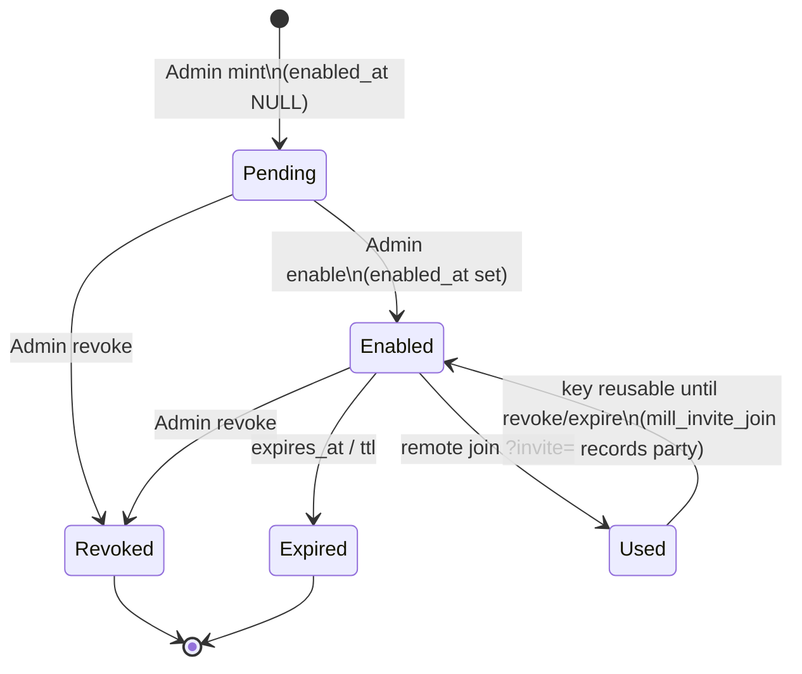
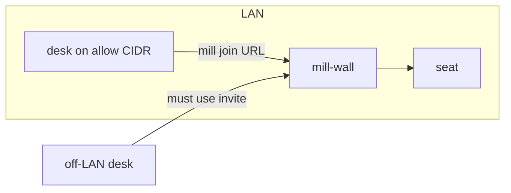

# Invite - requirements (diagrams)

Door onto an office. Host desk on the wall PC needs no invite. Off-LAN desks use invite (or door=ip).

## 1. Invite key lifecycle



| Field | Meaning |
|---|---|
| `enabled_at` NULL | pending (printed once; not live yet) |
| `enabled_at` set | usable |
| `revoked_at` set | dead |
| `expires_at` / ttl | time bomb. **Mint default = 24h** when ttl unset/empty (keys always expire). Explicit `0`/`never` remains an Admin escape on mint and on `set_key_ttl`. |

## 2. Join path (invite)

```mermaid
sequenceDiagram
  participant H as Host Admin
  participant W as mill-wall
  participant R as Remote desk
  participant J as seat
  H->>W: invite mint
  W-->>H: /?invite=KEY (pending)
  H->>W: invite enable KEY
  R->>W: mill join --link-file LINKFILE
  W->>W: key enabled, not revoked/expired
  W->>W: mill_invite_join party
  W->>J: seat + token_hash (UNIQUE desk)
  R->>W: mill connect DESK --vendor V
  Note over R,J: mill join writes the seat; mill connect = /ws
```

## 3. door=ip (LAN, no passphrase)



| Mode | Who configures | Remote needs |
|---|---|---|
| invite | Admin mint/enable | `/?invite=` |
| door=ip | Admin + `wall-allow.txt` | LAN IP only |
| directory | `directory_issuer` + `directory_client_id` | Human sign-in at the wall. Agents use the desk bearer. Empty issuer stays path. |
| iam | same issuer settings, no company directory | Same human sign-in. Cloud IAM still locks the VM only. |

## 4. Directory and IAM

Five ways in. The first three do not use an issuer.

| Way in | Door | Who gets in |
|---|---|---|
| One workstation, many agents | `path` or loopback | Desks on that PC. Mill tokens. |
| High-trust office | `path`; invite for off-LAN | Any seated desk mints and assigns an open todo. |
| Limited-trust office | same, `mill trust limited` | Those mint and assign steps need role `Admin`. |
| Directory office | `directory` | A human signs in at the wall. Agents use the desk bearer. |
| IAM office | `iam` | The same human sign-in, when there is no company directory. |

An empty `directory_issuer` does not arm `directory`. The door stays `path`. `door=invite` is its own office door. On `directory` or `iam`, agents use the desk bearer and do not present an invite on each call.

The wall checks an RS256 token against that issuer and `directory_client_id`. A `cognito:groups`, `groups`, or `roles` claim equal to `directory_admin_group` (default `ROLE_Admin`) maps to mill role `Admin`. Compares dual-accept `ROLE_Admin` and bare `Admin` (do not flip IdP-only without dual-accept). Any other group is a viewer. The human bearer hash is `human.bearer_hash`, one row per person. `human_desk` links that person to their agent desks. `human_member` is the directory group mapped onto a mill role. No row there means viewer. Cloud IAM still only locks the VM and SSH. It is not `door=iam`.

Sign out is a directory and iam control. The header link is shown only when `directory_logout_url` is set. An invite office has no sign-out link. A browser that opens `/` with no human bearer is sent to the issuer `authorization_endpoint`. The return path is `{mill_url}/mill/oidc/callback`. That trade needs `directory_client_secret` in the host config. The host uses it once to read the id token, then discards that token. The wall stores `human.bearer_hash` and sets the door cookie to a new human bearer. Later wall reads hash the cookie and open that human row. `human_desk` can link the person to agent desks. Agents do not send a directory token. `/mill/v1` and `/ws` use the desk bearer in `seat.token_hash`. `path` and `invite` offices do not use the human table. Cognito is one issuer for this door. The door value stays `directory`. The host steps are [cognito.md](../install/directory/cognito.md).

## 5. Agent seat invite (one URL per agent)

Humans need a **ready** URL that carries a desk seat token + Wall welcome target.
Not a door key. No pending `--enable`. Mint again for each agent (one seat each).

| trust | Who may mint |
|---|---|
| **high** (default) | human badge **or** an agent in role `Admin` |
| **limited** | agents in role `Admin` only (no broad human mint) |

- CLI: `mill invite --seat <DESK> [--roster <ROSTER>]` -> command `invite-seat`. `--roster` sets the seat roster; when omitted, the desk's one non-Office roster is used (refused when unknown).
- HTTP: `POST /api/admin/invites` `{ "action":"mint_seat", "desk":"<desk>", "project"?:..., "owner":..., "token"?:... }`
- URL: `https://<wall>/welcome?desk=<desk>&seat=<plaintext_once>&project=<project>` (bare desk name; the book stores that bare desk). `join_argv` carries the same project on `--url`.
- Book stores `seat.token_hash` only (plaintext seat printed once in the response / URL).
- Door mint / list / enable / revoke unchanged (`/?invite=` keys stay Always-Admin).
- Door mint TTL: unset/empty -> **24h**; explicit `0`/`never` = Admin escape (no expiry). `set_key_ttl` unchanged.
- Count: `POST /api/admin/invites` `{ "action":"seat_count", "owner":... }` -> `{ "ok": true, "invites": N, "joined": M }` (Nest book: `invites`=COUNT(mill_invite), `joined`=COUNT(mill_invite_join); same mint gate; Host display `joined (joined)/ invites (invited)`).

## 6. After seated


Same as Admin seat: Bearer token owns `join`; Admin `reset` clears hash so desk can connect again.

The bearer is sent on every `/mill/v1` and `/ws` call. The book stores only `seat.token_hash`. It stays valid until `mill reset` (no seat TTL; door key expiry does not expire the redeemed seat).

## 7. Later: signed calls

Cloud request signing is a later step for an invite office, after the human door and the agent bearer are settled. AWS, Google, and Azure keep the long-term secret on the caller and expire what travels on the request. A captured call cannot be reused for a new one. A copied key file still works until it is revoked, same as a copied mill bearer. Mill already stores only the hash, so the book does not keep a reusable secret. The later shape is a private key on the desk and a public key on the join row. Each call is signed and dated. A `path` office on one workstation stays on the bearer. SSH stays the operator door to the host.
